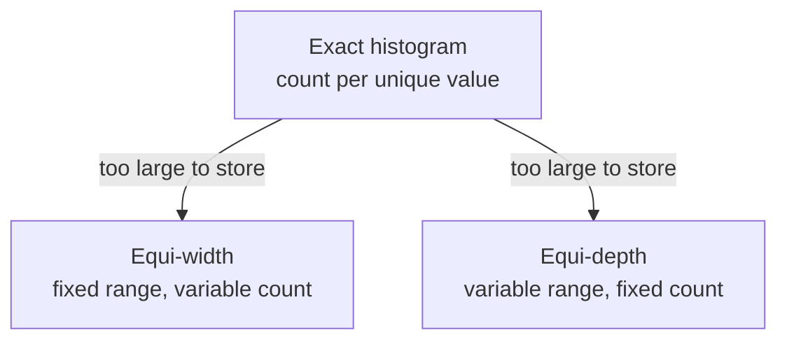

# 10 — Histograms, sketches, and sampling

Three techniques supply the numbers that cost estimates are built from. Some systems use all three, some only a subset ([`1:14:45`](https://www.youtube.com/watch?v=X8EHO8VLeG0&t=4485)). Pavlo blazes through them so you know **where a cost estimate actually comes from** — explicitly not exam material ([`1:14:45`](https://www.youtube.com/watch?v=X8EHO8VLeG0&t=4485)).

## 1. Histograms

**Exact histogram** — one count per unique value. Accurate, but prohibitively expensive to store when there are many distinct values ([`1:15:18`](https://www.youtube.com/watch?v=X8EHO8VLeG0&t=4518)).

| Variant | Fixed | Variable | Trade-off |
|---|---|---|---|
| **Equi-width** | Bucket **range** size (e.g. 1–3, 4–6, …) | Count per bucket | Big storage reduction; a lookup like `5.5` lands in a bucket and can **overestimate** the tuples in it ([`1:15:18`](https://www.youtube.com/watch?v=X8EHO8VLeG0&t=4518), [`1:15:48`](https://www.youtube.com/watch?v=X8EHO8VLeG0&t=4548)) |
| **Equi-depth** | **Count** per bucket (e.g. always 12) | Bucket range size (1–5, then 6–8) | Same storage reduction, same accuracy cost, but buckets adapt to data density ([`1:16:19`](https://www.youtube.com/watch?v=X8EHO8VLeG0&t=4579), [`1:16:44`](https://www.youtube.com/watch?v=X8EHO8VLeG0&t=4604)) |

## 2. Sketches

- Probabilistic data structures giving approximate counts for a range, or membership tests ([`1:16:44`](https://www.youtube.com/watch?v=X8EHO8VLeG0&t=4604)).
- Named: **HyperLogLog** and **Count-Min sketch** — the same structures from Project 0. The answer to "what was that actually for?" is **cost estimation in the query optimizer** ([`1:16:44`](https://www.youtube.com/watch?v=X8EHO8VLeG0&t=4604)).
- Can be used **alongside** histograms, or some systems drop histograms entirely and use only sketches, since there's a suite of sketches covering the properties histograms offer ([`1:17:10`](https://www.youtube.com/watch?v=X8EHO8VLeG0&t=4630)).

## 3. Sampling

- Collect a subset of the original table into a **sample set**, stored in the catalog (or in the database) as if it were another table — a local copy ([`1:17:22`](https://www.youtube.com/watch?v=X8EHO8VLeG0&t=4642), [`1:17:41`](https://www.youtube.com/watch?v=X8EHO8VLeG0&t=4661)).
- At optimization time, run a sequential scan of the **sample** rather than the full query, which gives a better selectivity estimate than the assumptions in the previous topic ([`1:17:41`](https://www.youtube.com/watch?v=X8EHO8VLeG0&t=4661)).
- Worked example: apply `WHERE age > 50` to the sample; **one third** of the sample matches → selectivity ≈ **1/3**, which then decides index lookup vs sequential scan ([`1:18:02`](https://www.youtube.com/watch?v=X8EHO8VLeG0&t=4682), [`1:18:29`](https://www.youtube.com/watch?v=X8EHO8VLeG0&t=4709)).
- Not every system does this ([`1:17:22`](https://www.youtube.com/watch?v=X8EHO8VLeG0&t=4642)).
- Some systems will use samples to produce the **actual answer** via approximate aggregations — but you must ask for it explicitly in your SQL; no system does it automatically ([`1:18:29`](https://www.youtube.com/watch?v=X8EHO8VLeG0&t=4709), [`1:18:42`](https://www.youtube.com/watch?v=X8EHO8VLeG0&t=4722)).
