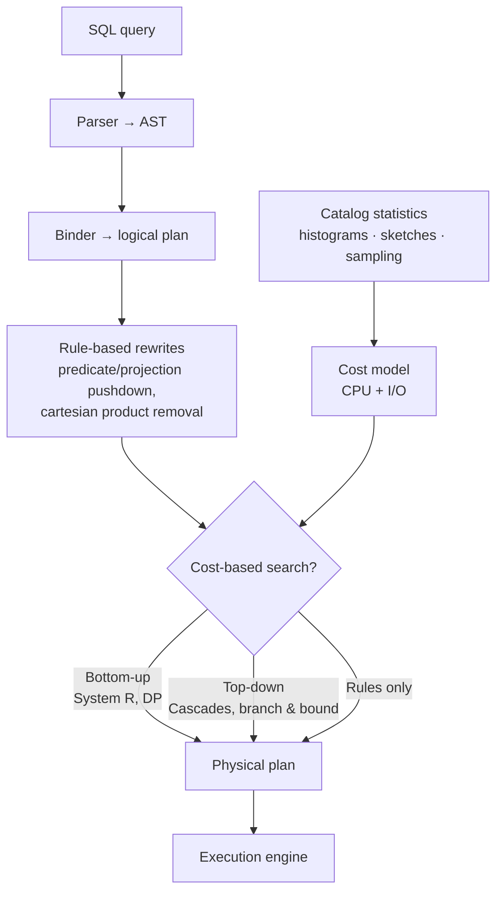

# #15 - Query Planning & Optimization (CMU Intro to Database Systems)

*CMU Database Group · 1:21:18 · [Watch on YouTube](https://www.youtube.com/watch?v=X8EHO8VLeG0)*

## Summary

Andy Pavlo's CMU 15-445/645 lecture on how a database system turns a declarative SQL string into an executable physical plan. It opens with a motivating example that drives one query from ~2,000,000 I/Os down to 37 by successively replacing a cartesian product, swapping join algorithms, enabling pipelining, and pushing a predicate below the join ([`6:00`](https://www.youtube.com/watch?v=X8EHO8VLeG0&t=360), [`11:00`](https://www.youtube.com/watch?v=X8EHO8VLeG0&t=660)). From there it covers the parser → binder → optimizer pipeline, the two families of optimization (rule-based heuristics and cost-based search), the two classic cost-based architectures — IBM's bottom-up System R dynamic programming and Graefe's top-down Cascades branch-and-bound — plus subquery decorrelation and expression rewriting. The final third is about cost models and where their numbers come from: catalog statistics, histograms, sketches, and sampling, and why those estimates are fragile enough that plans "start to fall apart" beyond three joins ([`1:05:32`](https://www.youtube.com/watch?v=X8EHO8VLeG0&t=3932)).

## Topics

1. [Introduction & the motivating example](./01-introduction-and-motivating-example.md) — the 2M → 37 I/O walkthrough and the three warnings
2. [Optimizer architecture: logical vs physical plans](./02-optimizer-architecture-logical-vs-physical-plans.md) — parser, binder, optimizer, and why the problem is NP-hard
3. [Rule-based (heuristic) logical optimization](./03-rule-based-logical-optimization.md) — the three canonical rewrite rules
4. [Bottom-up cost-based search (IBM System R)](./04-bottom-up-cost-based-search-system-r.md) — dynamic programming, left-deep trees, the physical-property hack
5. [Top-down optimization (Volcano / Cascades)](./05-top-down-optimization-cascades.md) — branch-and-bound, enforcer rules, the memo table
6. [Nested subqueries](./06-nested-subqueries.md) — decorrelate into joins, or extract as a CTE
7. [Expression tree rewriting](./07-expression-tree-rewriting.md) — impossible predicates, null-safe functions, range merging
8. [Cost models](./08-cost-models.md) — physical vs logical costs, Postgres constants, DB2 micro-benchmarks
9. [Statistics and selectivity estimation](./09-statistics-and-selectivity-estimation.md) — the three dangerous assumptions and the Honda Accord failure
10. [Histograms, sketches, and sampling](./10-histograms-sketches-and-sampling.md) — where the numbers come from
11. [Wrap-up and next steps](./11-wrap-up-and-next-steps.md) — course notes and the transition to transactions

Full transcript: [transcript.md](./transcript.md)

## Key takeaways

- **Plan choice dominates everything else.** The same logical query went from ~2,000,000 I/Os to **37** through five successive changes: cartesian product → nested loop join (54,000), → sort-merge join (7,000), → pipelined execution (3,000), → predicate pushdown with index access on both sides (37) ([`6:00`](https://www.youtube.com/watch?v=X8EHO8VLeG0&t=360), [`7:03`](https://www.youtube.com/watch?v=X8EHO8VLeG0&t=423), [`7:44`](https://www.youtube.com/watch?v=X8EHO8VLeG0&t=464), [`8:55`](https://www.youtube.com/watch?v=X8EHO8VLeG0&t=535), [`11:00`](https://www.youtube.com/watch?v=X8EHO8VLeG0&t=660)).
- **Cost numbers are meaningless across systems.** A Postgres cost and a MySQL cost for the same query cannot be compared; they are only valid for relative comparison inside a single system, and can shift within it when data, hardware, or tuning changes ([`27:14`](https://www.youtube.com/watch?v=X8EHO8VLeG0&t=1634), [`27:41`](https://www.youtube.com/watch?v=X8EHO8VLeG0&t=1661)).
- **System R chose left-deep trees for pipelining and search-space reduction — and thereby gave up global optimality.** Its "best path" is optimal only within the shapes it considers; the true optimum may be a bushy plan it never examines. Modern systems do consider bushy plans ([`35:38`](https://www.youtube.com/watch?v=X8EHO8VLeG0&t=2138), [`36:57`](https://www.youtube.com/watch?v=X8EHO8VLeG0&t=2217), [`46:06`](https://www.youtube.com/watch?v=X8EHO8VLeG0&t=2766)).
- **Top-down (Cascades) buys you cost-bound pruning that dynamic programming structurally cannot do**, and treats physical properties as first-class enforcer rules from the start of the search rather than as a post-hoc patch ([`51:45`](https://www.youtube.com/watch?v=X8EHO8VLeG0&t=3105), [`52:23`](https://www.youtube.com/watch?v=X8EHO8VLeG0&t=3143)). Graefe, who invented it, now argues the right design is a hybrid — Cascades for the plan outline, DP/hypergraphs for join ordering — and **nobody does that yet** ([`53:48`](https://www.youtube.com/watch?v=X8EHO8VLeG0&t=3228)).
- **Cardinality estimation is the unsolved core.** Independence + uniformity assumptions produce a 10x error on a two-predicate `make = 'Honda' AND model = 'Accord'` query (`1/1000` estimated vs `1/100` actual), and errors compound operator by operator until, **beyond three joins, the estimates fall apart entirely** ([`1:05:32`](https://www.youtube.com/watch?v=X8EHO8VLeG0&t=3932), [`1:13:17`](https://www.youtube.com/watch?v=X8EHO8VLeG0&t=4397), [`1:13:46`](https://www.youtube.com/watch?v=X8EHO8VLeG0&t=4426)).
- **Named system verdicts**: Umbra and DuckDB currently decorrelate subqueries best, with SQL Server catching up ([`56:40`](https://www.youtube.com/watch?v=X8EHO8VLeG0&t=3400)); SQL Server is likely to reclaim the "best optimizer" crown from Umbra ([`47:57`](https://www.youtube.com/watch?v=X8EHO8VLeG0&t=2877)); Postgres uses if/else rules and order-sensitive rewrites, mostly I/O-based costs, and won't use an index for `ORDER BY id + 0` ([`23:00`](https://www.youtube.com/watch?v=X8EHO8VLeG0&t=1380), [`1:02:05`](https://www.youtube.com/watch?v=X8EHO8VLeG0&t=3725)); MongoDB just runs the candidate plans and keeps whichever returns first ([`1:04:49`](https://www.youtube.com/watch?v=X8EHO8VLeG0&t=3889)).
