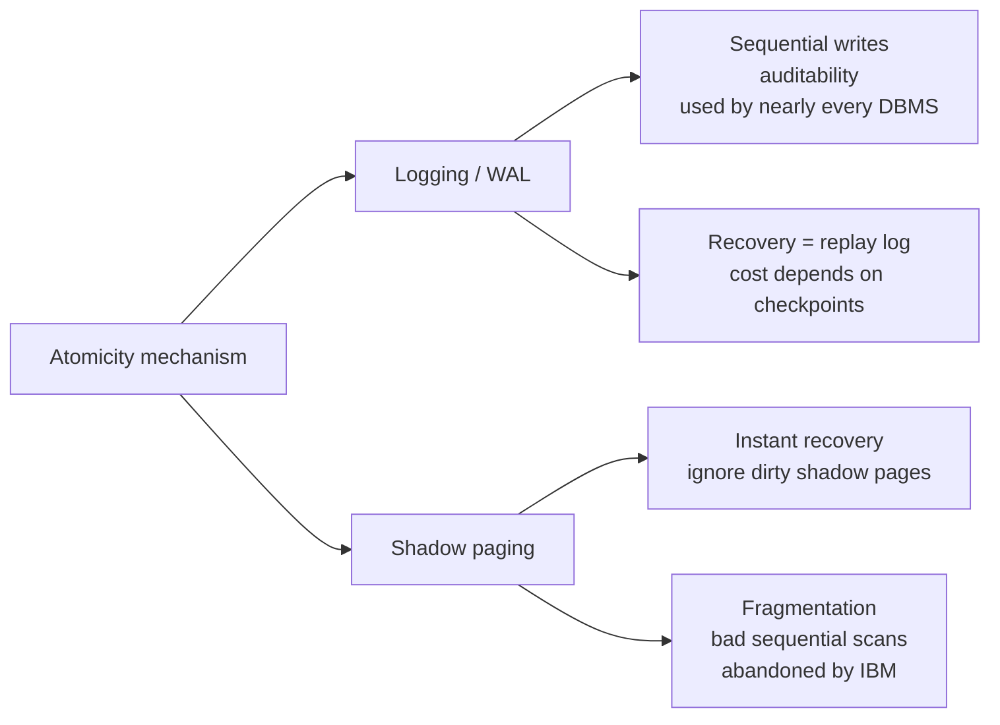

# 04 — Atomicity: Logging vs Shadow Paging

## What atomicity means

- Either all operations in the transaction commit in the specified order, or none of them do ([`18:26`](https://www.youtube.com/watch?v=4y656idl8ZU&t=1106)).
- Two ways a transaction ends badly: the application aborts it, or the DBMS refuses the commit and kills it ([`18:26`](https://www.youtube.com/watch?v=4y656idl8ZU&t=1106)).
- It is the DBMS's job, not the application's ([`18:59`](https://www.youtube.com/watch?v=4y656idl8ZU&t=1139)).

## Approach 1 — Logging (the recommended one)

- Keep a ledger of every operation transactions perform, maintained separately from the database itself ([`19:15`](https://www.youtube.com/watch?v=4y656idl8ZU&t=1155)).
- Same idea as the update log in **log-structured merge trees**, already covered in the course ([`19:15`](https://www.youtube.com/watch?v=4y656idl8ZU&t=1155)).
- Analogy: an airplane's black box — after the crash, you recover every step taken right before it ([`19:57`](https://www.youtube.com/watch?v=4y656idl8ZU&t=1197)).
- Naming caveat: "logging" here is nothing to do with debug print statements ([`19:15`](https://www.youtube.com/watch?v=4y656idl8ZU&t=1155)).
- **Nearly every modern DBMS uses some variant of logging** ([`20:17`](https://www.youtube.com/watch?v=4y656idl8ZU&t=1217)).
- Benefits: turns random writes into sequential writes (better performance), plus auditability and recoverability ([`20:17`](https://www.youtube.com/watch?v=4y656idl8ZU&t=1217)).

## Approach 2 — Shadow paging

- Instead of copying the whole database, copy at **page** granularity: on update, copy the page into shadow space, apply the change, and atomically install the new pages at commit ([`20:40`](https://www.youtube.com/watch?v=4y656idl8ZU&t=1240), [`21:11`](https://www.youtube.com/watch?v=4y656idl8ZU&t=1271)).
- First implemented by IBM in the 1970s (System R); they concluded it was a **bad idea for performance** ([`21:11`](https://www.youtube.com/watch?v=4y656idl8ZU&t=1271)).
- Failure modes: pages develop holes, requiring defragmentation, which makes sequential scans very bad ([`21:11`](https://www.youtube.com/watch?v=4y656idl8ZU&t=1271)).
- Few systems still do it — LMDB and Tokyo Cabinet are the famous examples (Tokyo Cabinet was largely superseded by the faster Kyoto Cabinet, which the instructor believes dropped shadow paging) ([`21:11`](https://www.youtube.com/watch?v=4y656idl8ZU&t=1271)).
- Verdict: "almost always want to use the logging approach" — write-ahead log on a heap, or LSM trees ([`21:58`](https://www.youtube.com/watch?v=4y656idl8ZU&t=1318)).

## The one real advantage of shadow paging

- **Recovery is instantaneous**: on restart the correct state is already there; the dirty shadow pages are simply ignored ([`21:58`](https://www.youtube.com/watch?v=4y656idl8ZU&t=1318), [`22:29`](https://www.youtube.com/watch?v=4y656idl8ZU&t=1349)).
- Write-ahead logging must replay the log, with cost depending on disk speed and checkpoint frequency ([`22:29`](https://www.youtube.com/watch?v=4y656idl8ZU&t=1349)).
- Real case: in the 1970s the **Puerto Rican power company** built a specialized DBMS using shadow paging, because frequent daily power outages meant they could not wait hours for recovery each time ([`22:48`](https://www.youtube.com/watch?v=4y656idl8ZU&t=1368), [`23:22`](https://www.youtube.com/watch?v=4y656idl8ZU&t=1402)).

