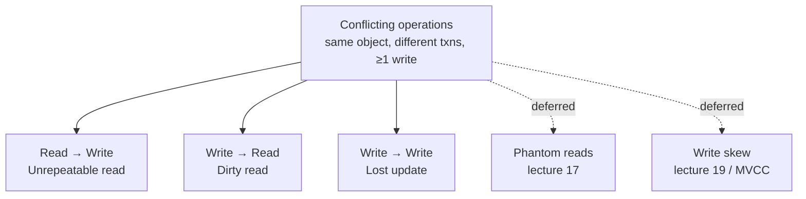

# 07 — Conflicts and Anomalies

## Definition of a conflict

Two operations conflict when they are from **different transactions**, touch the **same object**, and **at least one is a write** ([`39:14`](https://www.youtube.com/watch?v=4y656idl8ZU&t=2354), [`39:37`](https://www.youtube.com/watch?v=4y656idl8ZU&t=2377)).

- Read–read is **not** a conflict — if we both just read, nothing breaks ([`39:58`](https://www.youtube.com/watch?v=4y656idl8ZU&t=2398)).

## The three anomalies covered today

### 1. Unrepeatable read — read-write conflict

A transaction reads the same object twice and gets different values ([`41:02`](https://www.youtube.com/watch?v=4y656idl8ZU&t=2462)).

- T1 reads A = $10; T2 reads A = $10, bumps it to $19, commits; T1 re-reads A and now sees $19 ([`41:19`](https://www.youtube.com/watch?v=4y656idl8ZU&t=2479), [`41:43`](https://www.youtube.com/watch?v=4y656idl8ZU&t=2503)).
- Under a serial T1→T2 both reads would return $10 ([`41:43`](https://www.youtube.com/watch?v=4y656idl8ZU&t=2503)).
- Two ways to prevent it, both covered later: T1 holds a **lock** so the write can't happen (next class), or T2's write lives in a **private workspace** hidden from T1 (Wednesday's class) ([`42:24`](https://www.youtube.com/watch?v=4y656idl8ZU&t=2544)). Locking brings deadlocks along with it ([`42:52`](https://www.youtube.com/watch?v=4y656idl8ZU&t=2572)).

### 2. Dirty read — write-read conflict

A transaction reads a value written by a transaction that has not committed ([`42:52`](https://www.youtube.com/watch?v=4y656idl8ZU&t=2572)).

- T1 reads A = $10, writes $12; T2 reads $12 and acts on it, writing its own value; T1 then **aborts** and its change to A must be undone ([`42:52`](https://www.youtube.com/watch?v=4y656idl8ZU&t=2572), [`43:21`](https://www.youtube.com/watch?v=4y656idl8ZU&t=2601)).
- The damage is already done — T2 committed and told the outside world, based on a value that never legitimately existed ([`43:21`](https://www.youtube.com/watch?v=4y656idl8ZU&t=2601)).

### 3. Lost update — write-write conflict

One transaction overwrites an uncommitted update from another ([`43:53`](https://www.youtube.com/watch?v=4y656idl8ZU&t=2633)).

- T1 writes A = $10, T2 writes A = $19 and B = "Bob", T1 then writes B = "Alice".
- Legal serial outcomes are `$10 / Alice` or `$19 / Bob`; the schedule yields `$19 / Alice`, impossible in any serial ordering ([`44:16`](https://www.youtube.com/watch?v=4y656idl8ZU&t=2656)).

## Two more conflict types, deferred

- **Phantom reads** — a range scan re-run after someone inserts into that range returns different rows. Next class ([`39:58`](https://www.youtube.com/watch?v=4y656idl8ZU&t=2398), [`40:30`](https://www.youtube.com/watch?v=4y656idl8ZU&t=2430)).
- **Write skew** — concurrent reads look fine but the resulting writes match no serial ordering. Covered with multi-version concurrency control in two weeks (lectures 17 and 19) ([`40:30`](https://www.youtube.com/watch?v=4y656idl8ZU&t=2430), [`41:02`](https://www.youtube.com/watch?v=4y656idl8ZU&t=2462)).

