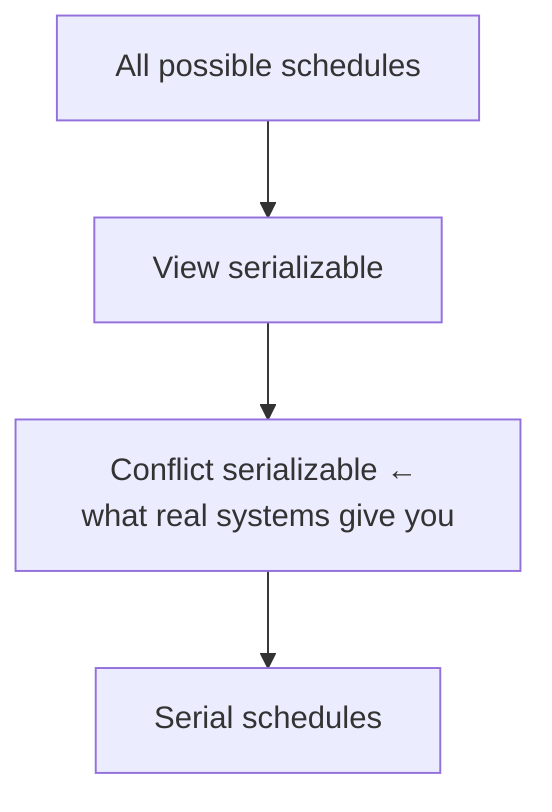

# 09 — View Serializability

A broader definition of correctness: if you understand what the application actually *means*, you can legally interleave schedules that conflict serializability rejects ([`56:23`](https://www.youtube.com/watch?v=4y656idl8ZU&t=3383)).

## Example 1 — changing the aggregation makes the anomaly disappear

- Take the schedule from [08](./08-conflict-serializability-dependency-graphs.md) that had a cycle, but change T2 from "compute the sum of A and B" to "count how many accounts have a balance ≥ 0" ([`55:11`](https://www.youtube.com/watch?v=4y656idl8ZU&t=3311), [`55:37`](https://www.youtube.com/watch?v=4y656idl8ZU&t=3337)).
- Assuming balances stay non-negative after the $10 debit, the count is identical under any interleaving ([`56:00`](https://www.youtube.com/watch?v=4y656idl8ZU&t=3360)).
- So the schedule is equivalent to a serial ordering **even though the dependency graph still has a cycle** ([`56:00`](https://www.youtube.com/watch?v=4y656idl8ZU&t=3360)).

## Example 2 — blind writes

- **Blind write**: writing an object without ever reading it first ([`56:56`](https://www.youtube.com/watch?v=4y656idl8ZU&t=3416)).
- Schedule: T1 does `R(A) W(A)`, T2 does `W(A)`, T3 does `W(A)`. The dependency graph is full of cycles ([`57:28`](https://www.youtube.com/watch?v=4y656idl8ZU&t=3448)).
- But the only thing that survives is **whatever T3 wrote last** — so the schedule is *view equivalent* to the serial order T1 → T2 → T3 ([`57:52`](https://www.youtube.com/watch?v=4y656idl8ZU&t=3472), [`58:22`](https://www.youtube.com/watch?v=4y656idl8ZU&t=3502)).

## Why nobody implements it

- View serializability admits **all** conflict-serializable schedules plus more, especially those with blind writes ([`58:22`](https://www.youtube.com/watch?v=4y656idl8ZU&t=3502)).
- It requires static analysis of the application, or "talking to a human — the worst thing to do." **That is why no system actually supports it** ([`58:50`](https://www.youtube.com/watch?v=4y656idl8ZU&t=3530)).
- It is taught because it shows correctness is not one fixed idea and that more parallelism is theoretically available beyond 2PL, MVCC and OCC ([`46:21`](https://www.youtube.com/watch?v=4y656idl8ZU&t=2781)).

## The hierarchy of schedules

Nested from smallest to largest ([`1:01:30`](https://www.youtube.com/watch?v=4y656idl8ZU&t=3690), [`1:01:48`](https://www.youtube.com/watch?v=4y656idl8ZU&t=3708)):

- Beyond view serializable there are further categories the course ignores ([`1:01:48`](https://www.youtube.com/watch?v=4y656idl8ZU&t=3708)).
- Next class adds another overlapping category around all of these — schedules that avoid **cascading aborts**, which includes some non-serializable schedules ([`1:02:07`](https://www.youtube.com/watch?v=4y656idl8ZU&t=3727)).
- When you ask a real system for serializable, you get the **conflict serializable** boundary ([`1:02:22`](https://www.youtube.com/watch?v=4y656idl8ZU&t=3742)).
