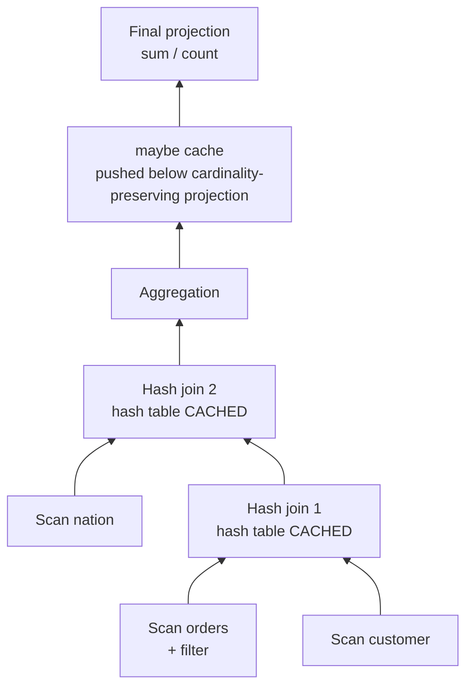

# 12 — Guest Talk: Firebolt and Sub-Result Caching

Speaker: **Mosha Pasumansky**, Firebolt — presented as joint work of many people at the company ([`1:09:42`](https://www.youtube.com/watch?v=4y656idl8ZU&t=4182), [`1:10:55`](https://www.youtube.com/watch?v=4y656idl8ZU&t=4255)).

- Opening exchange: the speaker objects to being introduced as "a fork of ClickHouse" — that is maybe 10% of what Firebolt is; some subsystems were forked from ClickHouse, others from other systems ([`1:09:13`](https://www.youtube.com/watch?v=4y656idl8ZU&t=4153), [`1:09:42`](https://www.youtube.com/watch?v=4y656idl8ZU&t=4182)).

## What Firebolt is

Slogan: *cloud data warehouse for data-intensive applications* ([`1:10:55`](https://www.youtube.com/watch?v=4y656idl8ZU&t=4255)).

- **Data warehouse features**: columnar storage, vectorized execution, PostgreSQL-compatible SQL dialect ([`1:10:55`](https://www.youtube.com/watch?v=4y656idl8ZU&t=4255)).
- **Transactions**: optimistic concurrency control on MVCC, with **snapshot isolation as the default isolation level** ([`1:11:35`](https://www.youtube.com/watch?v=4y656idl8ZU&t=4295)).
- **Cloud features**: separation of storage and compute; multi-cluster architecture where any node in any cluster can update any data (with permissions); distributed execution engine ([`1:11:35`](https://www.youtube.com/watch?v=4y656idl8ZU&t=4295), [`1:11:58`](https://www.youtube.com/watch?v=4y656idl8ZU&t=4318)).

### Target: user-facing applications

- Low latency — **tens of milliseconds**; their fastest non-trivial production query is **5 ms** ([`1:11:58`](https://www.youtube.com/watch?v=4y656idl8ZU&t=4318), [`1:12:32`](https://www.youtube.com/watch?v=4y656idl8ZU&t=4352)).
- High concurrency — **thousands of QPS** ([`1:12:32`](https://www.youtube.com/watch?v=4y656idl8ZU&t=4352)).
- At analytics volumes — **tens of terabytes**, with customers beyond petabyte scale ([`1:12:53`](https://www.youtube.com/watch?v=4y656idl8ZU&t=4373)).
- A single-node MySQL can hit those latencies on small data; combining them with analytics data volumes is what warehouses cannot do today ([`1:12:32`](https://www.youtube.com/watch?v=4y656idl8ZU&t=4352), [`1:12:53`](https://www.youtube.com/watch?v=4y656idl8ZU&t=4373)).
- They present a "faster than the blink of an eye" chart, admitting they use **median latency**, "a little bit of cheating" ([`1:12:53`](https://www.youtube.com/watch?v=4y656idl8ZU&t=4373)).

## Why it's achievable — workload assumptions

- The workload is **fixed and predictable**: tens to hundreds of query patterns, not arbitrary new ones each time ([`1:13:28`](https://www.youtube.com/watch?v=4y656idl8ZU&t=4408)).
- Schema changes are infrequent — they coincide with new application deployments ([`1:13:28`](https://www.youtube.com/watch?v=4y656idl8ZU&t=4408)).
- **Read-mostly**: updates are supported (bulk inserts, point DML updates/deletes) but low-volume, usually on fact tables not dimension tables ([`1:13:56`](https://www.youtube.com/watch?v=4y656idl8ZU&t=4436)).

## Techniques

- Classic indexing ([`1:14:25`](https://www.youtube.com/watch?v=4y656idl8ZU&t=4465)).
- **History-based optimization instead of cost-based**: the biggest problem with cost-based optimizers is cardinality estimation and error propagation, so Firebolt looks at what actually happened at every stage in query history and feeds that back to the planner ([`1:14:25`](https://www.youtube.com/watch?v=4y656idl8ZU&t=4465)).
- **Sub-result caching** — the focus of the talk ([`1:15:04`](https://www.youtube.com/watch?v=4y656idl8ZU&t=4504)).

## Sub-result caching

### The idea

- Buffer pool = caching at the bottom of the plan (scan operators); full result caching = caching at the top. Why not cache anywhere else in the plan? ([`1:16:00`](https://www.youtube.com/watch?v=4y656idl8ZU&t=4560))
- Researched since the **1980s**, yet **surprisingly rare in real systems** — Firebolt does it ([`1:16:25`](https://www.youtube.com/watch?v=4y656idl8ZU&t=4585)).
- "Sub-result" means two things ([`1:16:56`](https://www.youtube.com/watch?v=4y656idl8ZU&t=4616), [`1:17:26`](https://www.youtube.com/watch?v=4y656idl8ZU&t=4646)):
  1. The **output of any operator** — final result at the top, sub-result in the middle.
  2. **Operator artifacts**, e.g. the hash table a hash join builds — a perfect caching target.

### Mechanism: the "maybe cache" operator

- The **planner inserts a "maybe cache" operator** at good caching points in the plan ([`1:17:26`](https://www.youtube.com/watch?v=4y656idl8ZU&t=4646)).
- "Maybe" because the runtime may decline — e.g. the cache entry would be too big or violate other settings ([`1:17:26`](https://www.youtube.com/watch?v=4y656idl8ZU&t=4646)).
- **Vectorized execution makes it cheap**: operators already pass blocks between each other, so caching means simply not throwing the block away ([`1:18:02`](https://www.youtube.com/watch?v=4y656idl8ZU&t=4682)).

### Worked example — TPC-H-style query (3 scans, 2 joins, 1 aggregation)

1. **Baseline** ([`1:18:26`](https://www.youtube.com/watch?v=4y656idl8ZU&t=4706)): planner puts a maybe-cache at the top (full result caching) and both joins store their hash tables — three things cached. A second identical run does nothing.
2. **Add a filter on `orders`** (the biggest table) ([`1:19:07`](https://www.youtube.com/watch?v=4y656idl8ZU&t=4747)): the filter is pushed to the scan, so the full result cache is invalid and the left side changes — but the right subtree (`nation`, `customer` dimension tables) is untouched, so its hash table is reused. Result: **~5× faster execution** ([`1:19:45`](https://www.youtube.com/watch?v=4y656idl8ZU&t=4785)).
3. **Rewrite `avg` as `sum / count`** ([`1:19:45`](https://www.youtube.com/watch?v=4y656idl8ZU&t=4785), [`1:20:21`](https://www.youtube.com/watch?v=4y656idl8ZU&t=4821)): a different query, but the final projection is cardinality-preserving and the result set is small (nation is a small table), so the planner places the maybe-cache *below* the projection — everything under it is identical to the earlier plan, so the query still runs very fast.

### Cache eviction

- The obvious choice, **LRU, is not the best**. The best is a **cost-benefit policy** described in the literature: weigh execution time saved on the subtree against the memory the cache entry occupies ([`1:20:21`](https://www.youtube.com/watch?v=4y656idl8ZU&t=4821)).
- They tried several policies; the paper was right — **up to 2× more effective than plain LRU in real production** ([`1:21:17`](https://www.youtube.com/watch?v=4y656idl8ZU&t=4877)).

### Production results

- **~10× savings in general, sometimes more** ([`1:21:17`](https://www.youtube.com/watch?v=4y656idl8ZU&t=4877)).
- Believed to be far from the ceiling: the planner is currently **too conservative** about inserting maybe-cache; calculations suggest **100× or higher** is reachable ([`1:21:38`](https://www.youtube.com/watch?v=4y656idl8ZU&t=4898)).
- Results are uneven — some customers see **more than 95% savings**, others much less ([`1:21:56`](https://www.youtube.com/watch?v=4y656idl8ZU&t=4916)).

### Open problems

- **Where to place the maybe-cache operator** — mining query history for common sub-plans turns it into a multi-query optimization problem ([`1:21:56`](https://www.youtube.com/watch?v=4y656idl8ZU&t=4916), [`1:22:26`](https://www.youtube.com/watch?v=4y656idl8ZU&t=4946)).
- **Predicate pushdown can destroy caches** if it goes too deep. Sometimes the planner should **pull predicates up instead** — counter-intuitive, but potentially very beneficial ([`1:22:26`](https://www.youtube.com/watch?v=4y656idl8ZU&t=4946)).
- **Design data structures for size, not speed**: a hash table 10× smaller but not the fastest is a net win, because 10× more of them fit in cache and serve more queries from it ([`1:22:59`](https://www.youtube.com/watch?v=4y656idl8ZU&t=4979)).

### Q&A

- **Cache hit statistics?** The cache size is capped because execution needs memory too — roughly **20% of RAM** goes to these caches ([`1:23:27`](https://www.youtube.com/watch?v=4y656idl8ZU&t=5007), [`1:24:02`](https://www.youtube.com/watch?v=4y656idl8ZU&t=5042)).
- **How is the cache placement chosen?** Heuristic today: **all hash tables are cached**, plus a maybe-cache at the top of the plan pushed down as far as it can go through cardinality-preserving operators. Acknowledged as not as aggressive as it could be ([`1:24:02`](https://www.youtube.com/watch?v=4y656idl8ZU&t=5042), [`1:24:32`](https://www.youtube.com/watch?v=4y656idl8ZU&t=5072)).

## Instructor's closing commentary

- Firebolt did start as a ClickHouse fork, but has rewritten essentially everything over the last couple of years, and **ClickHouse does not do this caching** ([`1:24:55`](https://www.youtube.com/watch?v=4y656idl8ZU&t=5095)).
- Being a **cloud system** is a key enabler: you see all queries across all customers and can identify what to optimize ([`1:24:55`](https://www.youtube.com/watch?v=4y656idl8ZU&t=5095)).
- The broader point: caching is injected into the query plan without changing the plan's semantics or the application code — **that is why the relational model and SQL are a brilliant idea**, and why people pay a lot of money for it ([`1:25:25`](https://www.youtube.com/watch?v=4y656idl8ZU&t=5125)).

