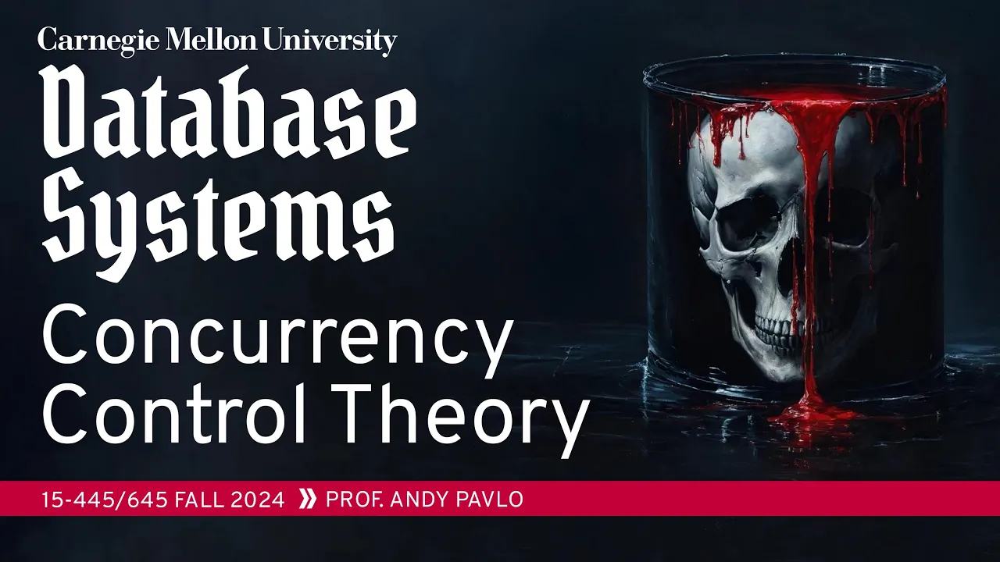
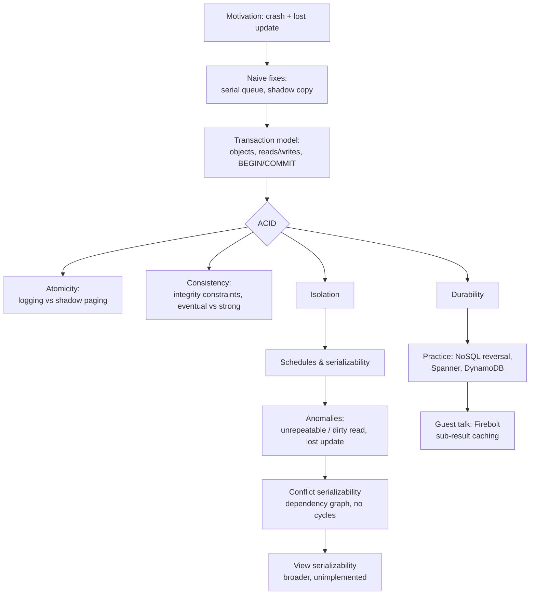

# #16 - Concurrency Control Theory ✸ Firebolt Database Talk (CMU Intro to Database Systems)

*CMU Database Group · 1:27:09 · <https://www.youtube.com/watch?v=4y656idl8ZU>*

## Summary

A university lecture (CMU 15-445/645, Fall 2024) that opens the transactions block of the course. Andy Pavlo motivates concurrency control with a bank-account example showing how a crash mid-transaction and two concurrent withdrawals both corrupt the database, then dismantles the two naive fixes — running one transaction at a time, and copying the whole database before each transaction. The rest of the lecture walks through **ACID** one letter at a time, spending most of its time on isolation: what a schedule is, why arbitrary interleaving is desirable, the three classic anomalies (unrepeatable read, dirty read, lost update), and the dependency-graph test for conflict serializability. It closes with view serializability (theoretically broader, implemented by nobody), a retrospective on the NoSQL movement's reversal on transactions, and a 15-minute guest talk from Firebolt on **sub-result caching**.

This lecture is pure theory — implementation protocols (two-phase locking, OCC, MVCC, write-ahead logging) are explicitly deferred to the following weeks.

## Topics

1. [Motivation: Why Concurrency Control](./01-motivation-why-concurrency-control.md)
2. [Naive Solutions and Why They Fail](./02-naive-solutions-and-their-costs.md)
3. [The Transaction Model and ACID](./03-transaction-model-and-acid.md)
4. [Atomicity: Logging vs Shadow Paging](./04-atomicity-logging-vs-shadow-paging.md)
5. [Consistency](./05-consistency.md)
6. [Isolation and Serializable Schedules](./06-isolation-and-serializable-schedules.md)
7. [Conflicts and Anomalies](./07-conflicts-and-anomalies.md)
8. [Conflict Serializability and Dependency Graphs](./08-conflict-serializability-dependency-graphs.md)
9. [View Serializability](./09-view-serializability.md)
10. [Durability and ACID Recap](./10-durability-and-acid-recap.md)
11. [The NoSQL Retrospective and Industry Q&A](./11-nosql-retrospective-and-industry-qa.md)
12. [Guest Talk: Firebolt and Sub-Result Caching](./12-firebolt-sub-result-caching.md)

## Key takeaways

- **A schedule is conflict serializable if and only if its dependency graph is acyclic** — that is the entire practical test, and it is what "serializable" means in real systems ([`48:08`](https://www.youtube.com/watch?v=4y656idl8ZU&t=2888), [`45:55`](https://www.youtube.com/watch?v=4y656idl8ZU&t=2755)).
- **Correctness is defined by the end state, not by arrival or commit order.** In the two-account example any interleaving is legal as long as A + B = $2,120; a bad interleaving loses $6. Google Spanner's external consistency (submission order = commit order) is the rare exception, and most applications don't need it ([`30:23`](https://www.youtube.com/watch?v=4y656idl8ZU&t=1823), [`35:10`](https://www.youtube.com/watch?v=4y656idl8ZU&t=2110), [`30:43`](https://www.youtube.com/watch?v=4y656idl8ZU&t=1843)).
- **Logging beat shadow paging decisively.** IBM shipped shadow paging in System R in the 1970s and abandoned it — fragmentation ruined sequential scans. Nearly every DBMS today uses write-ahead logging; shadow paging survives only where instant recovery dominates, as in the 1970s Puerto Rican power company's DBMS built for constant outages ([`21:11`](https://www.youtube.com/watch?v=4y656idl8ZU&t=1271), [`20:17`](https://www.youtube.com/watch?v=4y656idl8ZU&t=1217), [`22:48`](https://www.youtube.com/watch?v=4y656idl8ZU&t=1368)).
- **View serializability admits strictly more schedules than conflict serializability — and no system implements it**, because it requires static analysis of application semantics or asking a human ([`58:22`](https://www.youtube.com/watch?v=4y656idl8ZU&t=3502), [`58:50`](https://www.youtube.com/watch?v=4y656idl8ZU&t=3530)).
- **The NoSQL movement lost the transaction argument.** Google went from BigTable ("we don't need transactions") to the Spanner paper's position that programmers should hit performance problems from overusing transactions rather than write code to compensate for their absence; Cassandra, Couchbase, DynamoDB and the rest all added transactions within ten years ([`1:04:56`](https://www.youtube.com/watch?v=4y656idl8ZU&t=3896), [`1:06:16`](https://www.youtube.com/watch?v=4y656idl8ZU&t=3976)).
- **Firebolt's sub-result caching yields ~10× savings in production**, with over 95% savings for some customers and a projected 100×+ headroom once the planner stops being conservative about placing "maybe cache" operators. A cost-benefit eviction policy proved up to **2× more effective than LRU** ([`1:21:17`](https://www.youtube.com/watch?v=4y656idl8ZU&t=4877), [`1:21:38`](https://www.youtube.com/watch?v=4y656idl8ZU&t=4898), [`1:21:56`](https://www.youtube.com/watch?v=4y656idl8ZU&t=4916)).
- **Systems will lie about isolation.** Oracle has reported "serializable" while delivering a weaker level since the 1990s, and most databases default to a level where the anomalies discussed here can genuinely occur ([`46:21`](https://www.youtube.com/watch?v=4y656idl8ZU&t=2781), [`1:07:10`](https://www.youtube.com/watch?v=4y656idl8ZU&t=4030)).
