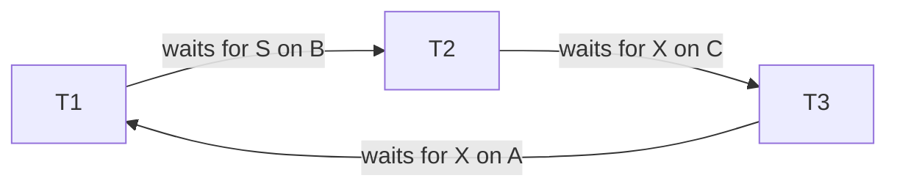

# 07 — Deadlock detection

## The deadlock

Classic case: T1 holds X on A and waits for X on B; T2 holds S on B and waits for S on A. Neither can proceed — a cycle of transactions waiting on locks that will never be released [`30:14`](https://www.youtube.com/watch?v=bXpkEt5P_Js&t=1814), [`30:50`](https://www.youtube.com/watch?v=bXpkEt5P_Js&t=1850).

Two families of solutions [`29:44`](https://www.youtube.com/watch?v=bXpkEt5P_Js&t=1784):

- **Detection** — a background thread finds deadlocks after the fact and breaks them.
- **Prevention** — order lock requests so deadlocks are impossible (see the next topic).

High-end enterprise systems (Oracle et al.) implement **both**, with toggles to pick one based on workload, plus extra internal statistics to decide which to use and which victim to kill [`31:16`](https://www.youtube.com/watch?v=bXpkEt5P_Js&t=1876).

## How detection works

1. Transactions take locks freely as they need them [`31:48`](https://www.youtube.com/watch?v=bXpkEt5P_Js&t=1908).
2. A background worker periodically inspects a **waits-for graph**: an edge is added whenever one transaction waits on a lock held by another [`31:48`](https://www.youtube.com/watch?v=bXpkEt5P_Js&t=1908), [`33:09`](https://www.youtube.com/watch?v=bXpkEt5P_Js&t=1989).
3. A **cycle** means a deadlock; the worker picks a **victim**, aborts it, and steals its locks [`32:11`](https://www.youtube.com/watch?v=bXpkEt5P_Js&t=1931).
4. The graph is built from the centralized lock table — another reason that structure is centralized [`34:41`](https://www.youtube.com/watch?v=bXpkEt5P_Js&t=2081).

## Frequency trade-off

- Run every **60 seconds** → low CPU overhead, but a deadlock can stall for up to 60 seconds [`32:11`](https://www.youtube.com/watch?v=bXpkEt5P_Js&t=1931).
- Run every **nanosecond/microsecond** → burning CPU cycles on cycle detection that could have executed queries [`32:46`](https://www.youtube.com/watch?v=bXpkEt5P_Js&t=1966).
- The right setting depends on workload and hardware [`32:46`](https://www.youtube.com/watch?v=bXpkEt5P_Js&t=1966), [`35:12`](https://www.youtube.com/watch?v=bXpkEt5P_Js&t=2112).

## Two-tier cycle detection

Because general cycle finding is expensive (NP-hard framing in lecture), systems first run a **cheap heuristic pass** for short cycles — e.g. just T1↔T2 pairs — and only fall back to the full, expensive algorithm if that finds nothing [`33:09`](https://www.youtube.com/watch?v=bXpkEt5P_Js&t=1989), [`33:55`](https://www.youtube.com/watch?v=bXpkEt5P_Js&t=2035). Motivation: a high-end system may run **hundreds of thousands of transactions per second**, producing a huge graph with many long cycles [`33:55`](https://www.youtube.com/watch?v=bXpkEt5P_Js&t=2035), [`34:30`](https://www.youtube.com/watch?v=bXpkEt5P_Js&t=2070).

## What happens to the victim

- Client-invoked transaction → send an exception back: "your transaction was killed, please restart it" [`34:41`](https://www.youtube.com/watch?v=bXpkEt5P_Js&t=2081), [`35:12`](https://www.youtube.com/watch?v=bXpkEt5P_Js&t=2112).
- Stored procedure → the system can silently re-invoke it as another RPC without alerting the application, retrying a few times before finally throwing [`35:12`](https://www.youtube.com/watch?v=bXpkEt5P_Js&t=2112).

## Choosing the victim

This is what separates enterprise systems from open-source ones; enterprise systems expose tunable parameters for it [`35:40`](https://www.youtube.com/watch?v=bXpkEt5P_Js&t=2140). Criteria discussed:

- **By age** — kill the oldest (it has already run five days and may run 500 more) or the youngest (it just arrived, cheap to resubmit) [`35:40`](https://www.youtube.com/watch?v=bXpkEt5P_Js&t=2140).
- **By queries already executed** — a transaction that ran 1,000 queries is a worse victim than one that ran a single query [`36:23`](https://www.youtube.com/watch?v=bXpkEt5P_Js&t=2183).
- **By number of locks held** — acquiring a billion locks is expensive, so prefer killing a transaction with fewer locks [`36:23`](https://www.youtube.com/watch?v=bXpkEt5P_Js&t=2183), [`36:55`](https://www.youtube.com/watch?v=bXpkEt5P_Js&t=2215).
- **By prior rollback count** — after roughly 10 rollbacks the system should "be sympathetic" and let it run, to avoid **starving** transactions [`36:55`](https://www.youtube.com/watch?v=bXpkEt5P_Js&t=2215), [`37:30`](https://www.youtube.com/watch?v=bXpkEt5P_Js&t=2250), [`38:13`](https://www.youtube.com/watch?v=bXpkEt5P_Js&t=2293).
- **By downstream cascading aborts** — killing one transaction that a thousand others depend on means killing a thousand more [`37:30`](https://www.youtube.com/watch?v=bXpkEt5P_Js&t=2250).

Getting this right is "super hard"; enterprise systems try to be adaptive and learn over time, or punt the decision to an experienced human via tuning knobs [`37:30`](https://www.youtube.com/watch?v=bXpkEt5P_Js&t=2250), [`38:13`](https://www.youtube.com/watch?v=bXpkEt5P_Js&t=2293).

## How far to roll back

- **Full rollback** — undo everything and restart from the beginning, or push it back to the application [`38:29`](https://www.youtube.com/watch?v=bXpkEt5P_Js&t=2309).
- **Partial rollback to a savepoint** — a named marker placed mid-transaction; roll back only to the last savepoint and resubmit from there [`38:29`](https://www.youtube.com/watch?v=bXpkEt5P_Js&t=2309), [`38:48`](https://www.youtube.com/watch?v=bXpkEt5P_Js&t=2328).
- Savepoints are practical mainly for **stored procedures**, because with client-side application logic (an `if` branching on a query result) the system cannot re-run the decision logic and may do the wrong thing [`39:16`](https://www.youtube.com/watch?v=bXpkEt5P_Js&t=2356). Partial rollbacks can still yield a serializable ordering [`39:16`](https://www.youtube.com/watch?v=bXpkEt5P_Js&t=2356).
