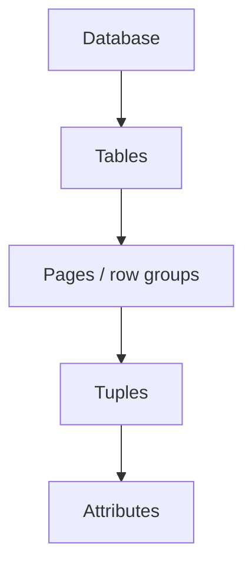

# 09 — Hierarchical locking, granularity, and intention locks

## Why granularity matters

- Everything so far assumed **one lock per object**. Going to the lock manager is far more expensive than taking a latch — you must latch your way into the lock table, read data, update a queue [`44:21`](https://www.youtube.com/watch?v=bXpkEt5P_Js&t=2661).
- Doing that a **billion times for a billion tuples** is prohibitive [`45:08`](https://www.youtube.com/watch?v=bXpkEt5P_Js&t=2708).
- The per-lock cost is acceptable because the protected work lasts milliseconds to hours or days — but it should not be paid excessively [`45:08`](https://www.youtube.com/watch?v=bXpkEt5P_Js&t=2708), [`45:44`](https://www.youtube.com/watch?v=bXpkEt5P_Js&t=2744).

### The trade-off

- **Coarse locks** → few lock manager trips, terrible parallelism. Historical example: **DB2 shipped with a single lock for the entire database** — nobody could read or write anything while one tuple was being updated. Easy to implement, everyone blocked behind a single writer [`46:08`](https://www.youtube.com/watch?v=bXpkEt5P_Js&t=2768), [`46:32`](https://www.youtube.com/watch?v=bXpkEt5P_Js&t=2792).
- **Fine locks** → good parallelism, many expensive acquisitions [`46:53`](https://www.youtube.com/watch?v=bXpkEt5P_Js&t=2813).

## The hierarchy

A lock at any node **implicitly locks all its descendants**, because every transaction must traverse the hierarchy in the same order [`46:53`](https://www.youtube.com/watch?v=bXpkEt5P_Js&t=2813).

### What real systems implement

| Level | Prevalence |
|---|---|
| Tables and tuples | most common [`47:36`](https://www.youtube.com/watch?v=bXpkEt5P_Js&t=2856) |
| Pages | next most common, not all systems implement them [`47:36`](https://www.youtube.com/watch?v=bXpkEt5P_Js&t=2856) |
| Databases | some systems, for DDL/schema changes; less common [`47:57`](https://www.youtube.com/watch?v=bXpkEt5P_Js&t=2877) |
| Attributes / individual columns | **super rare** — the only system the lecturer knows of is **YugabyteDB**, which can convert a tuple lock down to column locks to maximize parallelism [`47:57`](https://www.youtube.com/watch?v=bXpkEt5P_Js&t=2877), [`48:30`](https://www.youtube.com/watch?v=bXpkEt5P_Js&t=2910) |

## Intention locks

Purpose: give **hints** at higher levels of the hierarchy about what you are doing further down, without recording every detail up top — so you don't have to take an exclusive lock on the whole table just to update one tuple [`48:30`](https://www.youtube.com/watch?v=bXpkEt5P_Js&t=2910), [`49:09`](https://www.youtube.com/watch?v=bXpkEt5P_Js&t=2949), [`49:35`](https://www.youtube.com/watch?v=bXpkEt5P_Js&t=2975).

| Mode | Meaning |
|---|---|
| **IS** — Intention-Shared | somewhere below me I hold an explicit **shared** lock [`49:35`](https://www.youtube.com/watch?v=bXpkEt5P_Js&t=2975) |
| **IX** — Intention-Exclusive | somewhere below me I hold an explicit **exclusive** lock; blocks others who wanted to read all tuples [`49:35`](https://www.youtube.com/watch?v=bXpkEt5P_Js&t=2975), [`50:09`](https://www.youtube.com/watch?v=bXpkEt5P_Js&t=3009) |
| **SIX** — Shared + Intention-Exclusive | two locks combined: read everything below in shared mode **and** update some subset in exclusive mode, without exclusively locking the whole node [`50:09`](https://www.youtube.com/watch?v=bXpkEt5P_Js&t=3009), [`50:32`](https://www.youtube.com/watch?v=bXpkEt5P_Js&t=3032) |

Compatibility intuition: **IS is compatible with almost everything except X**; **X blocks everything**; the more intention/shared modes stack up, the more restrictive things get [`51:01`](https://www.youtube.com/watch?v=bXpkEt5P_Js&t=3061).

## The protocol

- Growing and shrinking phases are unchanged, whether basic or strong strict 2PL [`51:25`](https://www.youtube.com/watch?v=bXpkEt5P_Js&t=3085).
- Traverse the hierarchy taking **intention locks as far down as possible**, then the **explicit** S or X lock on the leaf you actually want [`51:39`](https://www.youtube.com/watch?v=bXpkEt5P_Js&t=3099), [`53:24`](https://www.youtube.com/watch?v=bXpkEt5P_Js&t=3204).
- You may go back up and **upgrade/convert** a higher-level intention lock into an explicit S or X lock if you realize the intention lock was a mistake [`52:04`](https://www.youtube.com/watch?v=bXpkEt5P_Js&t=3124), [`53:24`](https://www.youtube.com/watch?v=bXpkEt5P_Js&t=3204).

## Example 1 — two transactions, table + tuple levels

- **T1** reads a record → takes **IS** on the table, then **S** on the tuple [`53:10`](https://www.youtube.com/watch?v=bXpkEt5P_Js&t=3190), [`54:04`](https://www.youtube.com/watch?v=bXpkEt5P_Js&t=3244).
- **T2** updates the other account (adding 1% interest) → takes **IX** on the table, then **X** on its tuple [`53:10`](https://www.youtube.com/watch?v=bXpkEt5P_Js&t=3190), [`54:43`](https://www.youtube.com/watch?v=bXpkEt5P_Js&t=3283), [`54:57`](https://www.youtube.com/watch?v=bXpkEt5P_Js&t=3297).
- **IS is compatible with IX**, so both transactions hold different locks on the same table object simultaneously — the lock manager must track multiple holders and multiple modes per object [`54:57`](https://www.youtube.com/watch?v=bXpkEt5P_Js&t=3297), [`55:34`](https://www.youtube.com/watch?v=bXpkEt5P_Js&t=3334).

## Example 2 — three transactions on table R

- **T1** reads all tuples in R and updates one → **SIX** on R. The shared part covers all tuples; the IX part hints that one tuple below is exclusively locked [`55:34`](https://www.youtube.com/watch?v=bXpkEt5P_Js&t=3334), [`55:57`](https://www.youtube.com/watch?v=bXpkEt5P_Js&t=3357).
- **T2** reads a single tuple (not the one T1 is modifying) → **IS** on R (compatible with SIX), then **S** on that tuple. Both run concurrently [`56:28`](https://www.youtube.com/watch?v=bXpkEt5P_Js&t=3388), [`56:50`](https://www.youtube.com/watch?v=bXpkEt5P_Js&t=3410). Had T2 targeted T1's exclusively-locked tuple, it would stall and the situation would be resolved by deadlock detection or wait-die [`56:50`](https://www.youtube.com/watch?v=bXpkEt5P_Js&t=3410).
- **T3** scans all of R → needs **S on the table**, which is **not compatible with SIX**, so it stalls until T1 and T2 finish [`56:50`](https://www.youtube.com/watch?v=bXpkEt5P_Js&t=3410), [`57:31`](https://www.youtube.com/watch?v=bXpkEt5P_Js&t=3451).

## Lock escalation

If the system notices a transaction acquiring many fine-grained locks, it can go back up the hierarchy and **escalate** the intention lock into an explicit lock, obtaining everything below in one entry [`57:57`](https://www.youtube.com/watch?v=bXpkEt5P_Js&t=3477).

- Benefit: fewer lock table entries and fewer trips into the lock manager — which is itself latch-protected, so repeated access creates **latch contention** that slows everything down [`57:57`](https://www.youtube.com/watch?v=bXpkEt5P_Js&t=3477), [`58:35`](https://www.youtube.com/watch?v=bXpkEt5P_Js&t=3515).
