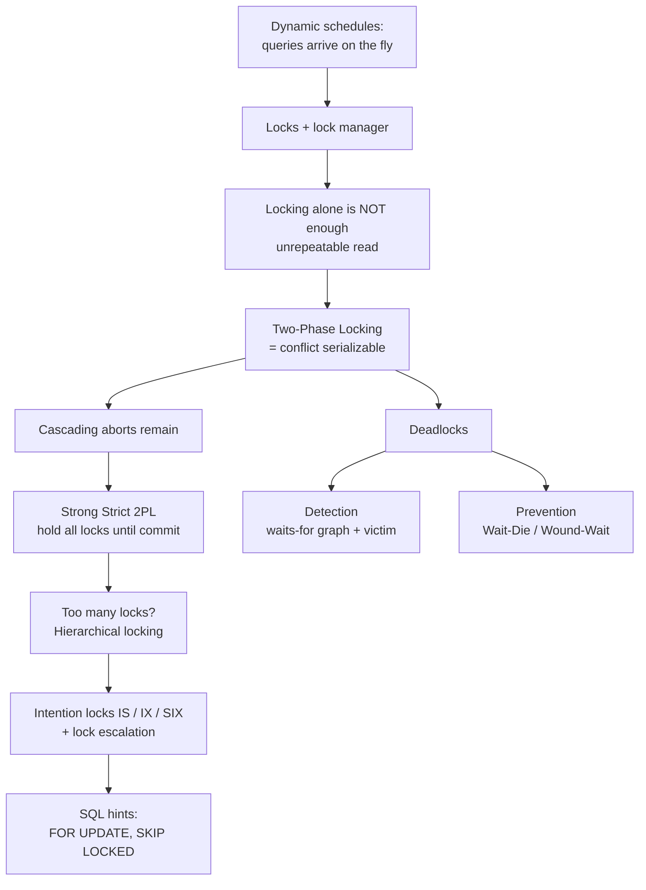

# #17 - Two-Phase Locking Concurrency Control (CMU Intro to Database Systems)

*CMU Database Group · 1:05:22 · [Watch on YouTube](https://www.youtube.com/watch?v=bXpkEt5P_Js)*

## Summary

This lecture (CMU 15-445/645, Fall 2024) moves from the previous class's *static* schedules — where every read and write is known in advance — to **dynamic** schedules, where the DBMS must decide on the fly which transaction may touch which object. The solution presented is **two-phase locking (2PL)**: transactions acquire locks in a growing phase and, once the first lock is released, may only release locks in a shrinking phase. The lecture shows that plain locking is *not* sufficient for serializability, that 2PL fixes it but permits cascading aborts, and that **strong strict 2PL** (holding all locks until commit) eliminates those. It then covers the two deadlock strategies — **detection** via a waits-for graph and a background worker, and **prevention** via the age-priority Wait-Die and Wound-Wait protocols — before closing with **hierarchical locking** (intention locks IS/IX/SIX, lock escalation) and the SQL hints `SELECT ... FOR UPDATE` and `SKIP LOCKED`.

## Overview

## Topics

1. [Recap: serializability and the shift to dynamic schedules](./01-recap-and-motivation.md)
2. [Locks vs. latches, and the lock manager](./02-locks-vs-latches-and-the-lock-manager.md)
3. [Basic lock types, and why locking alone is not enough](./03-lock-types-and-why-locking-alone-fails.md)
4. [Two-phase locking (2PL)](./04-two-phase-locking.md)
5. [Cascading aborts and strong strict 2PL](./05-cascading-aborts-and-strong-strict-2pl.md)
6. [Worked example: bank transfer under each protocol](./06-worked-example-bank-transfer.md)
7. [Deadlock detection](./07-deadlock-detection.md)
8. [Deadlock prevention](./08-deadlock-prevention.md)
9. [Hierarchical locking, granularity, and intention locks](./09-hierarchical-locking-and-intention-locks.md)
10. [Locking hints in SQL](./10-locking-hints-in-sql.md)
11. [Wrap-up and what's next](./11-wrap-up-and-whats-next.md)

Full source: [`transcript.md`](./transcript.md)

## Key takeaways

- **Using locks does not by itself guarantee serializability.** The lecture's counter-example locks every operation correctly yet still produces an unrepeatable read, because T1 released the lock on A and later re-acquired it after T2 wrote [`14:36`](https://www.youtube.com/watch?v=bXpkEt5P_Js&t=876), [`15:16`](https://www.youtube.com/watch?v=bXpkEt5P_Js&t=916).
- **2PL alone is sufficient for conflict serializability**: once you can never acquire a lock after releasing one, the precedence graph is guaranteed acyclic. It was the first provably correct concurrency control protocol, invented by Jim Gray at IBM on System R in the 1970s (Turing Award, 1990s) [`15:59`](https://www.youtube.com/watch?v=bXpkEt5P_Js&t=959), [`18:06`](https://www.youtube.com/watch?v=bXpkEt5P_Js&t=1086), [`19:14`](https://www.youtube.com/watch?v=bXpkEt5P_Js&t=1154).
- **Strong strict 2PL is what you actually get in practice.** Holding every lock until commit removes cascading aborts and makes rollback a single-transaction operation instead of unwinding a dependency chain; since SQL has no `UNLOCK`, most systems default to it when you ask for serializable isolation [`24:22`](https://www.youtube.com/watch?v=bXpkEt5P_Js&t=1462), [`24:50`](https://www.youtube.com/watch?v=bXpkEt5P_Js&t=1490), [`25:26`](https://www.youtube.com/watch?v=bXpkEt5P_Js&t=1526).
- **The bank-transfer example quantifies the failure**: without 2PL, T2 reports a total of **$19,900** — $100 missing — because it read A after the debit and B before the credit. Both basic 2PL and strong strict 2PL produce the correct total [`26:49`](https://www.youtube.com/watch?v=bXpkEt5P_Js&t=1609), [`28:01`](https://www.youtube.com/watch?v=bXpkEt5P_Js&t=1681), [`28:17`](https://www.youtube.com/watch?v=bXpkEt5P_Js&t=1697).
- **Deadlock handling is a tuning problem, not a solved one.** Detection trades detector frequency (60 s = cheap but slow recovery; microseconds = burned CPU) and uses a cheap two-transaction cycle heuristic before the expensive full search; victim selection weighs age, queries run, locks held, prior rollbacks, and cascading impact — the thing that separates enterprise systems from open source [`32:11`](https://www.youtube.com/watch?v=bXpkEt5P_Js&t=1931), [`33:55`](https://www.youtube.com/watch?v=bXpkEt5P_Js&t=2035), [`35:40`](https://www.youtube.com/watch?v=bXpkEt5P_Js&t=2140).
- **Prevention needs no background worker at all.** Wait-Die (old waits, young dies) and Wound-Wait (young waits, old kills) make all waiting flow in one direction, so cycles are impossible; restarted transactions reuse their original timestamp to avoid starvation [`41:01`](https://www.youtube.com/watch?v=bXpkEt5P_Js&t=2461), [`43:29`](https://www.youtube.com/watch?v=bXpkEt5P_Js&t=2609), [`43:42`](https://www.youtube.com/watch?v=bXpkEt5P_Js&t=2622).
- **Granularity is the real performance lever.** DB2 originally shipped a single lock for the entire database — trivially correct, terrible parallelism. Intention locks (IS/IX/SIX) let a table-level hint coexist with fine-grained tuple locks (IS is compatible with IX), and lock escalation collapses many leaf locks back into one to reduce latch contention in the lock manager [`46:08`](https://www.youtube.com/watch?v=bXpkEt5P_Js&t=2768), [`54:57`](https://www.youtube.com/watch?v=bXpkEt5P_Js&t=3297), [`57:57`](https://www.youtube.com/watch?v=bXpkEt5P_Js&t=3477).
- **`SKIP LOCKED` turns a database into a work queue**: workers skip rows locked by other transactions instead of blocking, letting each pull the next available task [`1:01:54`](https://www.youtube.com/watch?v=bXpkEt5P_Js&t=3714), [`1:02:19`](https://www.youtube.com/watch?v=bXpkEt5P_Js&t=3739).
