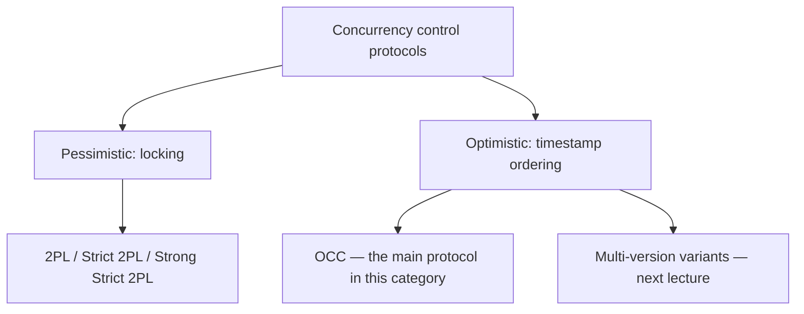

# 01 — Pessimistic vs. Optimistic Concurrency Control, and Timestamps

## Where the lecture picks up

- Previous lecture covered **two-phase locking (2PL)**: a protocol that produces conflict-serializable schedules without knowing ahead of time which queries, operations, or objects a transaction will touch ([`0:24`](https://www.youtube.com/watch?v=-TA0QIwFUnU&t=24)).
- 2PL is **pessimistic**: the system assumes transactions *will* conflict, so locks must be acquired before anything is touched ([`0:24`](https://www.youtube.com/watch?v=-TA0QIwFUnU&t=24)).

## Why an optimistic alternative exists

- In many workloads conflicts are **rare** and transactions are **short-lived** — milliseconds to seconds (loading a web page). Long transactions (minutes, hours, days) exist but are the exception ([`1:16`](https://www.youtube.com/watch?v=-TA0QIwFUnU&t=76)).
- If conflicts are unlikely, paying for locks up front is wasted work; better to optimize for the no-conflict case and **check at commit time** whether the assumption held ([`2:14`](https://www.youtube.com/watch?v=-TA0QIwFUnU&t=134)).
- Claim made at the end of the lecture: **every** concurrency control protocol in existence is either pessimistic (lock first) or optimistic (assume no conflict, decide commit order later) — there is no third category in the literature ([`1:02:30`](https://www.youtube.com/watch?v=-TA0QIwFUnU&t=3750), [`1:03:26`](https://www.youtube.com/watch?v=-TA0QIwFUnU&t=3806)).

## Timestamps as the backbone

- Optimistic protocols are built on **timestamp ordering**: the system assigns timestamps to transactions to decide the order in which they are allowed to commit, guaranteeing an equivalent-to-serial schedule ([`2:50`](https://www.youtube.com/watch?v=-TA0QIwFUnU&t=170)).
- Timestamps permeate the system: **transactions get them, and so do objects** — each tuple header can carry the timestamp of the transaction that created or last updated it, alongside things like null bitmaps ([`3:39`](https://www.youtube.com/watch?v=-TA0QIwFUnU&t=219)).
- A timestamp need not be a wall-clock value; it is an integer proxy for the desired ordering. Best case **64-bit**; PostgreSQL uses **32-bit**, which causes the wraparound problem ([`3:39`](https://www.youtube.com/watch?v=-TA0QIwFUnU&t=219), [`4:44`](https://www.youtube.com/watch?v=-TA0QIwFUnU&t=284)).
- Required property: each transaction gets a **unique, fixed, monotonically increasing** timestamp — time never jumps backwards ([`4:44`](https://www.youtube.com/watch?v=-TA0QIwFUnU&t=284)).
- Wall-clock time is dangerous unless pegged to UTC: daylight-saving changes would move transactions backwards in time ([`5:21`](https://www.youtube.com/watch?v=-TA0QIwFUnU&t=321)).

## Three ways to allocate timestamps

| Approach | How it works | Problem |
| --- | --- | --- |
| System / wall clock | Ask the local CPU for the current time; use UTC | Clocks drift; millisecond granularity can collide, forcing a wait ([`5:54`](https://www.youtube.com/watch?v=-TA0QIwFUnU&t=354)) |
| Logical counter | 64-bit integer, compare-and-swap +1 per transaction — very fast | Breaks in distributed settings: two servers each incrementing their own counter cannot stay globally unique ([`6:21`](https://www.youtube.com/watch?v=-TA0QIwFUnU&t=381), [`6:31`](https://www.youtube.com/watch?v=-TA0QIwFUnU&t=391)) |
| Hybrid (typical best) | Combine both. Google **Spanner** uses wall-clock time backed by atomic clocks in every rack and GPS receivers on the roof to keep clocks in sync worldwide | Hardware most systems don't have ([`6:44`](https://www.youtube.com/watch?v=-TA0QIwFUnU&t=404)) |

## Terminology warning

- Today's *category* is "optimistic concurrency protocols"; the *main protocol* inside that category is literally named **Optimistic Concurrency Control (OCC)** — the category and the protocol share a name ([`7:36`](https://www.youtube.com/watch?v=-TA0QIwFUnU&t=456)).

## Lecture roadmap announced

1. OCC ([`8:18`](https://www.youtube.com/watch?v=-TA0QIwFUnU&t=498))
2. Phantom anomalies not covered last time ([`8:01`](https://www.youtube.com/watch?v=-TA0QIwFUnU&t=481))
3. Isolation levels — relaxing serializability requirements ([`8:01`](https://www.youtube.com/watch?v=-TA0QIwFUnU&t=481))
4. Guest flash talk from the Weaviate team ([`8:01`](https://www.youtube.com/watch?v=-TA0QIwFUnU&t=481))
