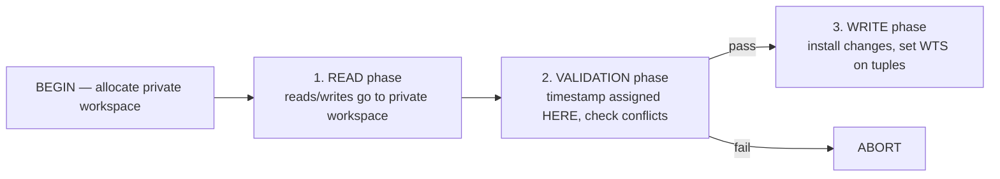

# 02 — OCC: Private Workspaces and the Three Phases

## Origin

- **2PL**: invented 1976 at IBM ([`9:50`](https://www.youtube.com/watch?v=-TA0QIwFUnU&t=590)).
- **OCC**: invented **1981 at CMU by Prof. H. T. Kung** — who was a *networking* person, not a database person, which is why the phase names are odd. He later left for Harvard ([`9:50`](https://www.youtube.com/watch?v=-TA0QIwFUnU&t=590), [`10:57`](https://www.youtube.com/watch?v=-TA0QIwFUnU&t=657)).

## The core idea: private workspaces

- On `BEGIN`, the DBMS allocates a **private workspace** for the transaction ([`8:18`](https://www.youtube.com/watch?v=-TA0QIwFUnU&t=498)).
- Every read and every write is **copied into that workspace**; no other transaction can look inside it while it runs. Writes therefore need **no locks** on the global tuples ([`8:36`](https://www.youtube.com/watch?v=-TA0QIwFUnU&t=516)).
- At commit, the workspace is compared against the global database / other transactions to detect conflicts since the transaction started ([`9:06`](https://www.youtube.com/watch?v=-TA0QIwFUnU&t=546)).
- If no conflicts, the changes are installed into the global database and become visible ([`9:37`](https://www.youtube.com/watch?v=-TA0QIwFUnU&t=577)).

### What the "private workspace" actually is

- At this level of abstraction: a memory space the transaction can read/write, in practice backed by the buffer pool — but the protocol does not care ([`12:47`](https://www.youtube.com/watch?v=-TA0QIwFUnU&t=767), [`13:04`](https://www.youtube.com/watch?v=-TA0QIwFUnU&t=784)).
- It must still be **thread-safe / latched**: multiple threads can execute queries on behalf of the same transaction and touch the same buffer ([`15:05`](https://www.youtube.com/watch?v=-TA0QIwFUnU&t=905)).
- Memory cost is real, but "there is no free lunch": either you maintain a lock table for a billion tuples, or you copy a billion tuples ([`13:27`](https://www.youtube.com/watch?v=-TA0QIwFUnU&t=807)).
  - **Delta copying** mitigates it — copy only the modified attribute, not the whole tuple. This is what CMU Project 4 asks students to implement ([`13:27`](https://www.youtube.com/watch?v=-TA0QIwFUnU&t=807)).
  - **PostgreSQL does not do this**: it copies the entire tuple regardless of how many attributes changed, though it does not copy on reads ([`14:02`](https://www.youtube.com/watch?v=-TA0QIwFUnU&t=842)).

## The three phases

1. **Read phase** — the transaction reads and writes, but everything is copied from the global state into the private workspace. Subsequent reads of an already-copied object read the private copy, which is what guarantees **repeatable reads** ([`11:20`](https://www.youtube.com/watch?v=-TA0QIwFUnU&t=680), [`19:38`](https://www.youtube.com/watch?v=-TA0QIwFUnU&t=1178)).
   - Copying on read is optional: if you don't need repeatable reads, skip it ([`19:38`](https://www.youtube.com/watch?v=-TA0QIwFUnU&t=1178)).
2. **Validation phase** — entered on `COMMIT`. **This is where the timestamp is assigned** — transactions do *not* get timestamps when they arrive. The system checks for conflicts against transactions that completed in the past or are running right now ([`11:48`](https://www.youtube.com/watch?v=-TA0QIwFUnU&t=708), [`12:10`](https://www.youtube.com/watch?v=-TA0QIwFUnU&t=730)).
3. **Write phase** — changes are applied to the global database and each touched tuple's **write timestamp (WTS)** is set to the committing transaction's timestamp ([`12:10`](https://www.youtube.com/watch?v=-TA0QIwFUnU&t=730)).

## Worked example (T1 starts first, T2 commits first)

- Each record in the global database carries `(object, value, WTS)`; the initial WTS is `0` ([`14:20`](https://www.youtube.com/watch?v=-TA0QIwFUnU&t=860)).
- T1 begins, reads `A` → copies `A` plus its WTS into its workspace ([`15:29`](https://www.youtube.com/watch?v=-TA0QIwFUnU&t=929)).
- T2 begins, reads `A` → its own copy ([`15:51`](https://www.youtube.com/watch?v=-TA0QIwFUnU&t=951)).
- T2 commits first, so **T2 gets timestamp 1** even though T1 arrived first — **arrival order no longer equals commit order** ([`16:19`](https://www.youtube.com/watch?v=-TA0QIwFUnU&t=979), [`16:39`](https://www.youtube.com/watch?v=-TA0QIwFUnU&t=999)).
- T2 is read-only → no conflict, write phase does nothing, workspace is discarded ([`16:53`](https://www.youtube.com/watch?v=-TA0QIwFUnU&t=1013)).
- T1 writes `A` in its workspace with **WTS = ∞**, because it has no timestamp yet ([`17:17`](https://www.youtube.com/watch?v=-TA0QIwFUnU&t=1037)).
- T1's next read of `A` hits its own workspace copy — repeatable reads ([`17:45`](https://www.youtube.com/watch?v=-TA0QIwFUnU&t=1065)).
- T1 validates, **gets timestamp 2**, passes (T2 is gone), overwrites the ∞ with 2, installs the change ([`18:01`](https://www.youtube.com/watch?v=-TA0QIwFUnU&t=1081), [`18:17`](https://www.youtube.com/watch?v=-TA0QIwFUnU&t=1097)).
- Equivalent 2PL execution: both take shared locks on `A` (compatible), T2 commits, T1 upgrades to exclusive — same outcome ([`19:06`](https://www.youtube.com/watch?v=-TA0QIwFUnU&t=1146)).

## Open implementation questions flagged

- **Indexes vs. workspaces**: if an index points at the global database, a transaction must additionally check whether the record ID it found is already in its own read/write set ([`19:59`](https://www.youtube.com/watch?v=-TA0QIwFUnU&t=1199)).
- **Repeatable read defined**: read the same value, read it again immediately, get the same value ([`22:02`](https://www.youtube.com/watch?v=-TA0QIwFUnU&t=1322)).
- Systems that don't guarantee it exist — PostgreSQL's default gives read committed ([`22:16`](https://www.youtube.com/watch?v=-TA0QIwFUnU&t=1336)).
