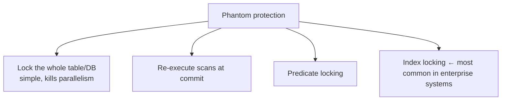

# 05 — Phantom Reads and How Systems Prevent Them

## The broken assumption

- Both OCC and 2PL as presented assume a **fixed-size database**: transactions only read or update objects that already exist. Real systems need `INSERT`, `UPDATE` and `DELETE` ([`42:40`](https://www.youtube.com/watch?v=-TA0QIwFUnU&t=2560), [`43:06`](https://www.youtube.com/watch?v=-TA0QIwFUnU&t=2586)).

## The example

1. T1 runs `SELECT COUNT(*) FROM people WHERE status = 'lit'` → **99** ([`43:06`](https://www.youtube.com/watch?v=-TA0QIwFUnU&t=2586), [`43:34`](https://www.youtube.com/watch?v=-TA0QIwFUnU&t=2614)).
2. T2 inserts a new matching row — legal under both protocols ([`43:34`](https://www.youtube.com/watch?v=-TA0QIwFUnU&t=2614)).
3. T1 reruns the identical query → **100** ([`43:48`](https://www.youtube.com/watch?v=-TA0QIwFUnU&t=2628)).

- Under a true serial order T1 would have seen the same count twice ([`43:48`](https://www.youtube.com/watch?v=-TA0QIwFUnU&t=2628)).
- **Why locking cannot save you**: the row that broke the query *did not exist* during the first scan, so there was nothing to lock ([`44:11`](https://www.youtube.com/watch?v=-TA0QIwFUnU&t=2651), [`44:27`](https://www.youtube.com/watch?v=-TA0QIwFUnU&t=2667)).
- **Definition — phantom read**: scanning a range of a table multiple times within one transaction while another transaction inserts or deletes in between, yielding inconsistent results. Named for a ghost: data appears and disappears ([`44:48`](https://www.youtube.com/watch?v=-TA0QIwFUnU&t=2688), [`45:14`](https://www.youtube.com/watch?v=-TA0QIwFUnU&t=2714)).

## Four defenses, ranked by real-world usage

| Technique | How it works | Practical status |
| --- | --- | --- |
| Lock everything | Lock the table / every page / the whole DB so nobody can insert or delete | Works but destroys parallelism; must be done explicitly by the application ([`45:29`](https://www.youtube.com/watch?v=-TA0QIwFUnU&t=2729), [`46:28`](https://www.youtube.com/watch?v=-TA0QIwFUnU&t=2788)) |
| Re-execute scans | Track the `WHERE` clause of every query; at commit re-run only the scan/`WHERE` portion and check for new results ([`46:57`](https://www.youtube.com/watch?v=-TA0QIwFUnU&t=2817), [`47:17`](https://www.youtube.com/watch?v=-TA0QIwFUnU&t=2837), [`47:35`](https://www.youtube.com/watch?v=-TA0QIwFUnU&t=2855)) | Rare; viable mainly for in-memory systems where scans are cheap — not for a petabyte re-scan ([`48:15`](https://www.youtube.com/watch?v=-TA0QIwFUnU&t=2895)) |
| Predicate locking | Logical locks over the multi-dimensional space of values a `WHERE` clause could match; conflict = intersection of two regions ([`49:10`](https://www.youtube.com/watch?v=-TA0QIwFUnU&t=2950), [`49:53`](https://www.youtube.com/watch?v=-TA0QIwFUnU&t=2993), [`50:37`](https://www.youtube.com/watch?v=-TA0QIwFUnU&t=3037)) | "Very very rare" — doing it fully correctly is **NP-complete** ([`51:09`](https://www.youtube.com/watch?v=-TA0QIwFUnU&t=3069)) |
| Index locking | Use B+Tree structures to hold locks over *ranges* of values ([`46:05`](https://www.youtube.com/watch?v=-TA0QIwFUnU&t=2765), [`51:09`](https://www.youtube.com/watch?v=-TA0QIwFUnU&t=3069)) | **The most common approach in enterprise systems** ([`46:28`](https://www.youtube.com/watch?v=-TA0QIwFUnU&t=2788)) |

### Notes on re-execution and predicate locking

- The inverse of re-execution exists: **reconnaissance transactions** in systems like DynamoDB and FoundationDB — run the queries first to learn the read/write set without changing anything, then re-run for real at commit and roll back on mismatch ([`48:42`](https://www.youtube.com/watch?v=-TA0QIwFUnU&t=2922)).
- Predicate locking was proposed by **System R at IBM in the 1970s** and deemed too impractical to implement efficiently ([`49:10`](https://www.youtube.com/watch?v=-TA0QIwFUnU&t=2950)).
- The only real attempts are approximations using **precision locking**, a technique from a barely-cited 1980s paper. Adopted first by **HyPer**, then copied by **DuckDB**, and carried into **Umbra** and its fork **CedarDB** — all traceable to the same German research group ([`46:57`](https://www.youtube.com/watch?v=-TA0QIwFUnU&t=2817), [`49:10`](https://www.youtube.com/watch?v=-TA0QIwFUnU&t=2950), [`49:53`](https://www.youtube.com/watch?v=-TA0QIwFUnU&t=2993)).

## Index lock varieties

Physical data-structure mechanisms used to enforce a logical guarantee ([`46:05`](https://www.youtube.com/watch?v=-TA0QIwFUnU&t=2765), [`51:30`](https://www.youtube.com/watch?v=-TA0QIwFUnU&t=3090)):

- **Key-value lock** — a lock on one specific key, e.g. `[14, 14]` inclusive ([`52:00`](https://www.youtube.com/watch?v=-TA0QIwFUnU&t=3120)).
- **Gap lock** — a lock on the empty space *between* index values, e.g. `(14, 16)` exclusive. An attempt to insert `15` conflicts ([`52:29`](https://www.youtube.com/watch?v=-TA0QIwFUnU&t=3149)).
- **Key-range lock** — the key plus the adjacent gap, e.g. `[14, 16)`. Gaps may span multiple nodes ([`52:58`](https://www.youtube.com/watch?v=-TA0QIwFUnU&t=3178), [`53:16`](https://www.youtube.com/watch?v=-TA0QIwFUnU&t=3196)).
- **Prior-key lock** — the key plus the gap *before* it; always go in one direction to avoid weird overlaps ([`53:16`](https://www.youtube.com/watch?v=-TA0QIwFUnU&t=3196)).
- **Hierarchical index locking** — coarse-grained intention locks over wide ranges (e.g. `[10, 16)` in intention-exclusive mode) with explicit fine-grained exclusive locks inside them ([`53:39`](https://www.youtube.com/watch?v=-TA0QIwFUnU&t=3219), [`54:15`](https://www.youtube.com/watch?v=-TA0QIwFUnU&t=3255)).

### How that stops a phantom

- With an index on `status`, a query for `status = 'lit'` takes a **gap lock** from that value to the next distinct status. Any insert would have to land either on the key or inside the gap — so it conflicts and the reader is protected. These are **locks, not latches** ([`1:04:09`](https://www.youtube.com/watch?v=-TA0QIwFUnU&t=3849), [`1:04:48`](https://www.youtube.com/watch?v=-TA0QIwFUnU&t=3888)).
