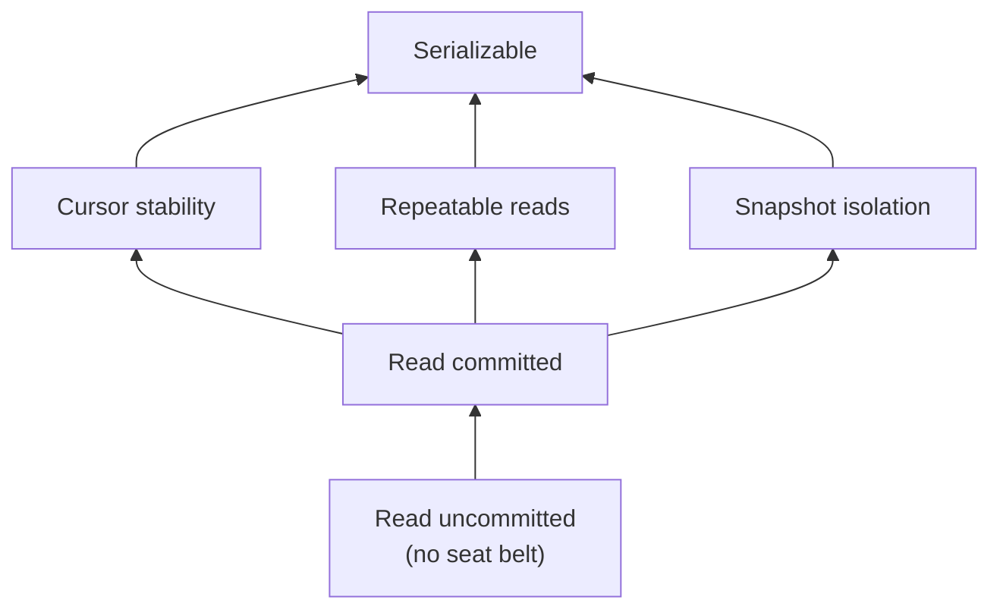

# 06 — Weaker Isolation Levels in Theory and in Practice

## The dirty secret

- Three lectures argued serializability is the gold standard — but **in practice almost nobody runs with serializable isolation**, and most DBMSs do not default to it ([`54:34`](https://www.youtube.com/watch?v=-TA0QIwFUnU&t=3274), [`55:10`](https://www.youtube.com/watch?v=-TA0QIwFUnU&t=3310), [`55:26`](https://www.youtube.com/watch?v=-TA0QIwFUnU&t=3326)).
- **Definition**: an isolation level specifies which anomalies a transaction *could* see — not that it will. A lone transaction conflicts with nothing ([`55:54`](https://www.youtube.com/watch?v=-TA0QIwFUnU&t=3354)).
- The trade: less protection work → more parallelism and better performance, in exchange for potentially wrong results. **How wrong? "Nobody knows"** — it depends on too many factors ([`55:54`](https://www.youtube.com/watch?v=-TA0QIwFUnU&t=3354), [`56:32`](https://www.youtube.com/watch?v=-TA0QIwFUnU&t=3392)).

## The anomalies

Four covered so far: **dirty reads, unrepeatable reads, lost updates, phantom reads**. A fifth, **write skew**, is deferred to the next lecture ([`56:32`](https://www.youtube.com/watch?v=-TA0QIwFUnU&t=3392)).

## The SQL-standard ladder

| Level | Anomalies possible | Implementation with 2PL |
| --- | --- | --- |
| **Serializable** | none ([`56:49`](https://www.youtube.com/watch?v=-TA0QIwFUnU&t=3409)) | Strong strict 2PL **+** a phantom defense (lock everything / re-execute scans / index locks) ([`57:34`](https://www.youtube.com/watch?v=-TA0QIwFUnU&t=3454)) |
| **Repeatable reads** | phantoms ([`56:49`](https://www.youtube.com/watch?v=-TA0QIwFUnU&t=3409)) | Strong strict 2PL with **index locks turned off** ([`57:57`](https://www.youtube.com/watch?v=-TA0QIwFUnU&t=3477)) |
| **Read committed** | phantoms, unrepeatable reads, lost updates ([`56:49`](https://www.youtube.com/watch?v=-TA0QIwFUnU&t=3409)) | Strict 2PL: hold write locks to the end, **release shared locks immediately** ([`57:57`](https://www.youtube.com/watch?v=-TA0QIwFUnU&t=3477), [`58:33`](https://www.youtube.com/watch?v=-TA0QIwFUnU&t=3513)) |
| **Read uncommitted** | everything — "driving without your seat belt" ([`56:49`](https://www.youtube.com/watch?v=-TA0QIwFUnU&t=3409), [`1:00:36`](https://www.youtube.com/watch?v=-TA0QIwFUnU&t=3636)) | Anything goes ([`58:33`](https://www.youtube.com/watch?v=-TA0QIwFUnU&t=3513)) |

- **Strict vs. strong strict 2PL**: strict holds write locks to the end but may release shared locks early; you still cannot re-acquire released locks unless you drop to a lower level ([`58:33`](https://www.youtube.com/watch?v=-TA0QIwFUnU&t=3513)).
- Isolation level is **per transaction**: one transaction may run serializable while a concurrent one runs lower and sees anomalies ([`59:10`](https://www.youtube.com/watch?v=-TA0QIwFUnU&t=3550), [`59:29`](https://www.youtube.com/watch?v=-TA0QIwFUnU&t=3569)).

## The hierarchy is not a single line

Below read committed the ladder **forks into two paths** — some anomalies possible under repeatable reads cannot occur under snapshot isolation, and vice versa ([`1:00:36`](https://www.youtube.com/watch?v=-TA0QIwFUnU&t=3636), [`1:01:14`](https://www.youtube.com/watch?v=-TA0QIwFUnU&t=3674)).

- **Cursor stability** (DB2): while a cursor scans a table it holds a lock on the current page and releases it when done — nobody can modify that page mid-scan ([`1:00:36`](https://www.youtube.com/watch?v=-TA0QIwFUnU&t=3636), [`1:01:31`](https://www.youtube.com/watch?v=-TA0QIwFUnU&t=3691)).

## What real systems default to

| System | Default | Note |
| --- | --- | --- |
| SQL Server, Oracle, PostgreSQL | Read committed | None of the top four relational systems default to serializable ([`59:29`](https://www.youtube.com/watch?v=-TA0QIwFUnU&t=3569)) |
| MySQL | **Repeatable read** — a higher default than its peers ([`59:29`](https://www.youtube.com/watch?v=-TA0QIwFUnU&t=3569)) | |
| Oracle (max level) | Ask for serializable and it says yes — but actually gives you **snapshot isolation**. "Oracle lies to you." ([`59:55`](https://www.youtube.com/watch?v=-TA0QIwFUnU&t=3595), [`1:00:16`](https://www.youtube.com/watch?v=-TA0QIwFUnU&t=3616)) | |
| VoltDB, CockroachDB, Ingres | **Serializable by default** — a very small club. Ingres was PostgreSQL's precursor ([`1:00:16`](https://www.youtube.com/watch?v=-TA0QIwFUnU&t=3616)) | |
| Google Spanner | **Strict serializable** — transactions commit in arrival order, achieved by assigning timestamps on arrival ([`1:00:36`](https://www.youtube.com/watch?v=-TA0QIwFUnU&t=3636)) | |

## What DBAs actually run

- A CMU survey of DBAs found **very few run serializable** for most of their transactions; the overwhelming majority run **read committed** ([`1:01:49`](https://www.youtube.com/watch?v=-TA0QIwFUnU&t=3709), [`1:02:12`](https://www.youtube.com/watch?v=-TA0QIwFUnU&t=3732)).
- Reason given by the room: performance. Reason the lecturer confirms: **it's the default**. Most people don't know what serializable means, or judge the performance penalty not worth paying — "and that might be okay" ([`1:02:12`](https://www.youtube.com/watch?v=-TA0QIwFUnU&t=3732)).

## Next lecture

Multi-version concurrency control: essentially the same mechanics, except versions live in the **global** workspace rather than a private one, with timestamps deciding which version you see ([`37:57`](https://www.youtube.com/watch?v=-TA0QIwFUnU&t=2277), [`1:04:09`](https://www.youtube.com/watch?v=-TA0QIwFUnU&t=3849)). Live demos of isolation levels in PostgreSQL and MySQL were deferred to make room for the guest talk ([`54:34`](https://www.youtube.com/watch?v=-TA0QIwFUnU&t=3274), [`59:10`](https://www.youtube.com/watch?v=-TA0QIwFUnU&t=3550)).
