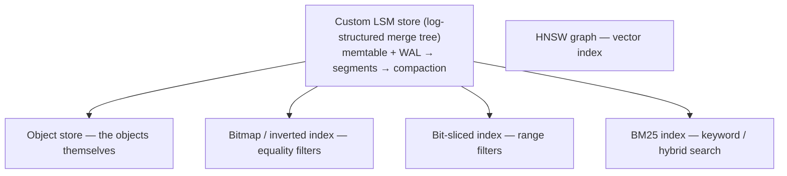

# 08 — Weaviate Architecture: Storage Engine and Non-Vector Indexes

Everything in this note is **not vector-database-specific** — it is the conventional storage machinery underneath ([`1:13:29`](https://www.youtube.com/watch?v=-TA0QIwFUnU&t=4409)).

## The object store: a custom LSM tree

- A **custom-built LSM store** with all the usual traits: write into an in-memory structure plus an **append-only write-ahead log** for durability; memtables flush into **segments**; segments are **compacted** over time ([`1:09:15`](https://www.youtube.com/watch?v=-TA0QIwFUnU&t=4155), [`1:09:55`](https://www.youtube.com/watch?v=-TA0QIwFUnU&t=4195)).
- Multiple compaction strategies:
  - **Leveled compaction** (default) — explained by analogy to the game **2048**: combine tiles whose sums match ([`1:09:55`](https://www.youtube.com/watch?v=-TA0QIwFUnU&t=4195)).
  - **In-place compaction** — added because under heavy overwrite workloads, leveled compaction fails to free disk space fast enough. It removes something deleted in a *future* segment without requiring two segments to be merged ([`1:09:55`](https://www.youtube.com/watch?v=-TA0QIwFUnU&t=4195), [`1:10:29`](https://www.youtube.com/watch?v=-TA0QIwFUnU&t=4229)).

## Bitmap indexes for filters

- An **inverted index built on the same LSM store**, but serving **bitmaps** instead of key-value objects — the equivalent of posting lists in search engines ([`1:10:29`](https://www.youtube.com/watch?v=-TA0QIwFUnU&t=4229)).
- Even when a single filter matches **millions or hundreds of millions** of objects, initialization is very cheap because it is essentially a **zero-copy operation** — speed is bounded only by disk read speed ([`1:10:54`](https://www.youtube.com/watch?v=-TA0QIwFUnU&t=4254)).
- Because it's LSM-backed, the same key appearing across consecutive segments needs a **merge strategy**: compaction unions the ID lists, and deletions remove IDs from the merged result ([`1:11:21`](https://www.youtube.com/watch?v=-TA0QIwFUnU&t=4281)).

## Range indexes: bit-sliced indexing

- **Problem**: a classical inverted index struggles with `price BETWEEN $5 AND $500` — depending on float precision there is a near-infinite number of value combinations to index ([`1:11:21`](https://www.youtube.com/watch?v=-TA0QIwFUnU&t=4281), [`1:12:06`](https://www.youtube.com/watch?v=-TA0QIwFUnU&t=4326)).
- **Solution — bit-sliced index**: index the individual *bits* rather than the value. A 64-bit number yields **64 bitmaps** ([`1:12:06`](https://www.youtube.com/watch?v=-TA0QIwFUnU&t=4326)).
- **Trade-off**: every lookup must merge 64 bitmaps, but the cost **no longer depends on the number of matches** ([`1:12:06`](https://www.youtube.com/watch?v=-TA0QIwFUnU&t=4326)).
- Same concept appears in **Apache Pinot** (StarTree) and **FeatureBase**; both have blog posts on it ([`1:12:06`](https://www.youtube.com/watch?v=-TA0QIwFUnU&t=4326)).

## BM25 index for hybrid search

- **BM25** is the established keyword-similarity algorithm — *the* search algorithm before semantic search existed ([`1:12:44`](https://www.youtube.com/watch?v=-TA0QIwFUnU&t=4364)).
- Its role in a vector database: **compensate for vector search limitations** — if the embedding model was never trained on a specific keyword, hybrid search covers it ([`1:12:44`](https://www.youtube.com/watch?v=-TA0QIwFUnU&t=4364)).
- Implemented as a **disk-based index** with pruning:
  - **WAND** — currently in use; skips scoring documents that can no longer move the needle. "Good but not perfect" ([`1:12:44`](https://www.youtube.com/watch?v=-TA0QIwFUnU&t=4364), [`1:13:29`](https://www.youtube.com/watch?v=-TA0QIwFUnU&t=4409)).
  - **Block-Max WAND** — the in-progress rewrite. Same idea, but skips **entire blocks**, so a block never has to be read from disk, decoded, decompressed or copied ([`1:13:29`](https://www.youtube.com/watch?v=-TA0QIwFUnU&t=4409)).
