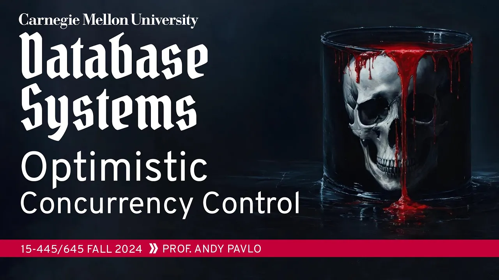
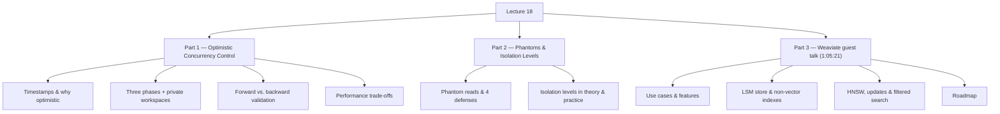

# #18 - Optimistic Concurrency Control ✸ Weaviate Database Talk (CMU Intro to Database Systems)

*CMU Database Group · 1:20:53 · [Watch on YouTube](https://www.youtube.com/watch?v=-TA0QIwFUnU)*

## Summary

Lecture 18 of CMU 15-445/645 (Fall 2024) covers **Optimistic Concurrency Control (OCC)**, the counterpart to the pessimistic two-phase locking protocol from the previous class. Andy Pavlo builds up the timestamp-ordering machinery OCC rests on, walks through its three phases (read into a private workspace, validate, write), works through forward-validation examples, and lays out where OCC beats 2PL and where it loses badly. The second half of the lecture covers **phantom reads** — the anomaly neither protocol can handle once the database is no longer fixed-size — and the four defenses against them, then surveys **weaker isolation levels** and what real systems and real DBAs actually run. The final 15 minutes are a guest talk by **Etienne, CTO and co-founder of Weaviate**, on the internal architecture of a vector database: its custom LSM store, bitmap and bit-sliced indexes, BM25 hybrid search, and its modified HNSW vector index.

## Topics

1. [Pessimistic vs. Optimistic Concurrency Control, and Timestamps](./01-pessimistic-vs-optimistic-and-timestamps.md) — why an optimistic protocol exists, timestamp allocation strategies, and the two-category taxonomy of all concurrency control.
2. [OCC: Private Workspaces and the Three Phases](./02-occ-three-phases-and-private-workspaces.md) — read / validation / write, what a private workspace really is, and a worked schedule.
3. [The Validation Phase: Forward vs. Backward Validation](./03-validation-phase-forward-and-backward.md) — serial vs. parallel validation, the three forward-validation conditions, three examples, and why timestamps are assigned at commit.
4. [When OCC Wins and When It Loses](./04-occ-performance-and-tradeoffs.md) — the low-conflict sweet spot, copying and abort costs, and why adaptive protocols don't ship.
5. [Phantom Reads and How Systems Prevent Them](./05-phantom-reads-and-how-to-prevent-them.md) — the `COUNT(*)` example, and lock-everything / re-execute scans / predicate locking / index locking.
6. [Weaker Isolation Levels in Theory and in Practice](./06-isolation-levels-in-theory-and-practice.md) — the SQL ladder, its two-path fork, per-system defaults, and the DBA survey.
7. [Weaviate: Use Cases and Feature Set](./07-weaviate-use-cases-and-feature-set.md) — semantic search, RAG, recommendations, generative feedback loops.
8. [Weaviate Architecture: Storage Engine and Non-Vector Indexes](./08-weaviate-storage-engine-and-indexes.md) — the custom LSM store, bitmap indexes, bit-sliced range indexes, BM25 with WAND.
9. [Weaviate's Vector Index: HNSW, Updates, and Filtered Search](./09-weaviate-vector-index-hnsw-and-filtering.md) — async graph repair, ACORN-style in-place filtering, negative correlation.
10. [Weaviate Roadmap and Closing Remarks](./10-weaviate-roadmap-and-closing.md) — Block-Max WAND, ColBERT/ColPali, adaptive quantization.

Also in this folder: [`transcript.md`](./transcript.md) — the full timestamped transcript.

## Key takeaways

- **Every concurrency control protocol is either pessimistic or optimistic** — there is no third category in the literature or in practice; the only question is what order you allow transactions to commit in ([`1:02:30`](https://www.youtube.com/watch?v=-TA0QIwFUnU&t=3750), [`1:03:26`](https://www.youtube.com/watch?v=-TA0QIwFUnU&t=3806)).
- **OCC assigns timestamps at validation, not at BEGIN**, so arrival order stops predicting commit order — assigning on arrival (as Spanner does) fixes a serial order in advance and yields less parallelism ([`16:39`](https://www.youtube.com/watch?v=-TA0QIwFUnU&t=999), [`39:08`](https://www.youtube.com/watch?v=-TA0QIwFUnU&t=2348), [`1:00:36`](https://www.youtube.com/watch?v=-TA0QIwFUnU&t=3636)).
- **OCC's aborts are far more expensive than 2PL's**: under 2PL you fail on the first lock and waste nothing; under OCC you update a billion tuples, reach commit, and only then discover you must roll all of it back ([`41:42`](https://www.youtube.com/watch?v=-TA0QIwFUnU&t=2502), [`42:14`](https://www.youtube.com/watch?v=-TA0QIwFUnU&t=2534)).
- **When everyone updates the same tuple, OCC and 2PL are equivalent** — both degenerate to single-threaded execution, and no protocol can do better ([`42:14`](https://www.youtube.com/watch?v=-TA0QIwFUnU&t=2534)).
- **Phantoms cannot be locked away, because the offending record didn't exist during the first scan**; the defense enterprise systems actually use is **index locking** (key, gap, key-range, prior-key locks), while predicate locking — fully correct only at NP-complete cost — exists in roughly four systems, all traceable to one German research lineage: HyPer, DuckDB, Umbra, CedarDB ([`44:27`](https://www.youtube.com/watch?v=-TA0QIwFUnU&t=2667), [`46:28`](https://www.youtube.com/watch?v=-TA0QIwFUnU&t=2788), [`49:53`](https://www.youtube.com/watch?v=-TA0QIwFUnU&t=2993), [`51:09`](https://www.youtube.com/watch?v=-TA0QIwFUnU&t=3069)).
- **Serializability is the gold standard almost nobody uses**: SQL Server, Oracle and PostgreSQL all default to read committed (MySQL to repeatable read), Oracle's "serializable" is actually snapshot isolation, and a CMU DBA survey found the overwhelming majority run read committed — mostly because it is the default ([`59:29`](https://www.youtube.com/watch?v=-TA0QIwFUnU&t=3569), [`59:55`](https://www.youtube.com/watch?v=-TA0QIwFUnU&t=3595), [`1:02:12`](https://www.youtube.com/watch?v=-TA0QIwFUnU&t=3732)).
- **Weaviate sustains 150 million vector updates per day in a single cluster**, achieved by diverging from the HNSW reference implementation with an async, highly parallelizable graph-repair process that degrades neither latency nor recall ([`1:08:42`](https://www.youtube.com/watch?v=-TA0QIwFUnU&t=4122), [`1:14:31`](https://www.youtube.com/watch?v=-TA0QIwFUnU&t=4471)).
- **Bit-sliced indexing makes range-filter cost independent of match count**: indexing individual bits rather than values turns a 64-bit number into 64 bitmaps — every lookup merges all 64, but the cost no longer scales with how many rows match ([`1:12:06`](https://www.youtube.com/watch?v=-TA0QIwFUnU&t=4326)).
- **Weaviate 1.27 shipped ACORN-style in-place filtering**, resolving the minority-filter lose-lose (skip disallowed points and recall drops; traverse them and performance dies) by using disallowed points purely for navigation, with graph enrichment at search time handling negatively-correlated filters ([`1:15:39`](https://www.youtube.com/watch?v=-TA0QIwFUnU&t=4539), [`1:16:32`](https://www.youtube.com/watch?v=-TA0QIwFUnU&t=4592), [`1:17:19`](https://www.youtube.com/watch?v=-TA0QIwFUnU&t=4639)).
