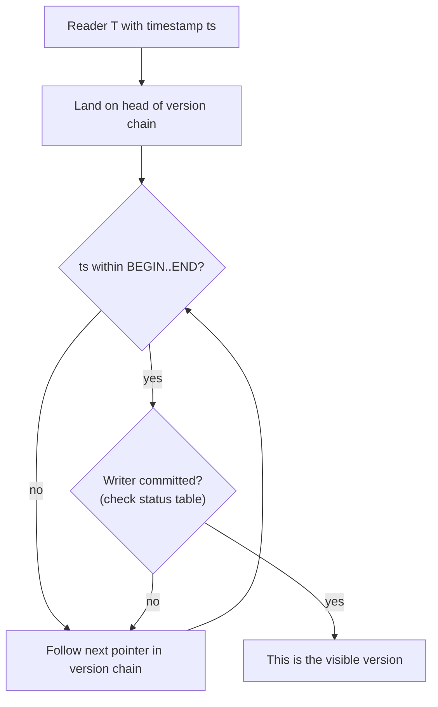

# 03 — Version visibility: timestamps and the transaction status table

## Per-version metadata

- Each physical version carries a **BEGIN timestamp** and an **END timestamp** that scope its visibility range [`13:06`](https://www.youtube.com/watch?v=niLwbfE3V9Q&t=786).
- END = ∞ (or NULL) marks the **latest** version of that logical tuple [`14:20`](https://www.youtube.com/watch?v=niLwbfE3V9Q&t=860).
- The "version number" column shown on the slides is **illustration only** — real systems track versions via those timestamp fields, stored in the **tuple headers** [`13:06`](https://www.youtube.com/watch?v=niLwbfE3V9Q&t=786) [`43:43`](https://www.youtube.com/watch?v=niLwbfE3V9Q&t=2623).
- Contrast with OCC: **OCC assigns a timestamp at COMMIT; MVCC assigns it at BEGIN**, because you must know what you are allowed to see before you read anything [`13:47`](https://www.youtube.com/watch?v=niLwbfE3V9Q&t=827).

## The write protocol

When T2 (timestamp 2) writes tuple A:

1. Create a new version A1 with BEGIN = 2, END = ∞ and install the new value [`14:20`](https://www.youtube.com/watch?v=niLwbfE3V9Q&t=860).
2. **Go back and set the previous version's END timestamp to 2** — otherwise a reader walking the chain would find A0 still at `0 → ∞` and wrongly treat it as latest [`15:04`](https://www.youtube.com/watch?v=niLwbfE3V9Q&t=904) [`22:05`](https://www.youtube.com/watch?v=niLwbfE3V9Q&t=1325).
3. A later transaction with timestamp 3 sees `3 ∉ [0, 2)` for A0, follows the chain, and lands on A1 whose range `[2, ∞)` contains 3 [`15:04`](https://www.youtube.com/watch?v=niLwbfE3V9Q&t=904) [`15:45`](https://www.youtube.com/watch?v=niLwbfE3V9Q&t=945).

## The transaction status table

Timestamps alone cannot tell you whether a version is *committed*. Systems maintain a status table with, per active transaction [`16:08`](https://www.youtube.com/watch?v=niLwbfE3V9Q&t=968):

- Transaction ID
- Assigned timestamp
- Commit status (active / aborted / committed / cleaned up)

A reader that lands on a version checks the writer's entry in this table before deciding visibility. At read-committed and above it skips versions written by still-active transactions and follows the chain to the older one [`16:29`](https://www.youtube.com/watch?v=niLwbfE3V9Q&t=989) [`19:04`](https://www.youtube.com/watch?v=niLwbfE3V9Q&t=1144) [`19:55`](https://www.youtube.com/watch?v=niLwbfE3V9Q&t=1195).

## Q&A clarifications from the room

- **A transaction reads by its own BEGIN timestamp.** A transaction with timestamp 0.5 reads A0 even though A1 physically exists — "it might physically exist but logically at timestamp 0.5 it does not exist yet" [`17:17`](https://www.youtube.com/watch?v=niLwbfE3V9Q&t=1037) [`18:10`](https://www.youtube.com/watch?v=niLwbfE3V9Q&t=1090).
- **Rollback/uncommitted:** T3 at timestamp 3 will not see A1 from an uncommitted T2 — it checks the status table, sees "still running", and reads A0 [`18:27`](https://www.youtube.com/watch?v=niLwbfE3V9Q&t=1107) [`19:04`](https://www.youtube.com/watch?v=niLwbfE3V9Q&t=1144).
- **Repeatable read falls out naturally:** T1 re-reading A gets the same version it read before [`16:49`](https://www.youtube.com/watch?v=niLwbfE3V9Q&t=1009).

## Second example — MVCC does not prevent write-write conflicts

Sequence: T1 reads A, writes A; T2 reads A, tries to write A [`19:55`](https://www.youtube.com/watch?v=niLwbfE3V9Q&t=1195).

- T2 reads A0 (T1 uncommitted) — fine [`20:26`](https://www.youtube.com/watch?v=niLwbfE3V9Q&t=1226).
- T2's write **stalls**: the version it wants to overwrite has END = ∞ and the status table shows T1 uncommitted, so overwriting could clobber T1's changes [`20:51`](https://www.youtube.com/watch?v=niLwbfE3V9Q&t=1251).
- T2 proceeds only once T1 commits and releases the lock on that tuple [`21:20`](https://www.youtube.com/watch?v=niLwbfE3V9Q&t=1280).
- **Takeaway: "MVCC by itself isn't going to protect us about write-write conflicts"** — some 2PL-style locking is still running underneath [`20:51`](https://www.youtube.com/watch?v=niLwbfE3V9Q&t=1251).
