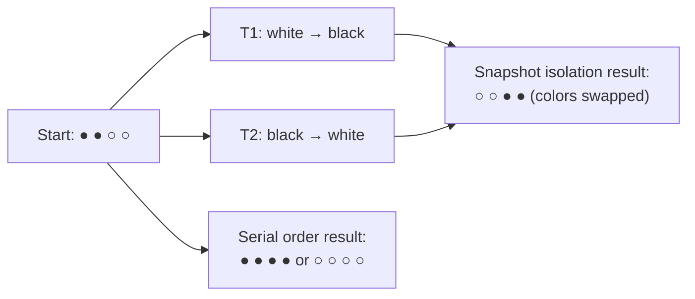

# 04 — Snapshot isolation and the write skew anomaly

## What snapshot isolation guarantees

- You see a consistent view of the database as it existed when your transaction started [`24:18`](https://www.youtube.com/watch?v=niLwbfE3V9Q&t=1458).
- **No torn reads**: if another transaction updates five things, you never see three of them and miss two [`24:18`](https://www.youtube.com/watch?v=niLwbfE3V9Q&t=1458).
- Concurrent writes to the same object resolve **first-writer-wins** (assuming you don't stall and wait) [`24:45`](https://www.youtube.com/watch?v=niLwbfE3V9Q&t=1485).

## What it does *not* guarantee: write skew

Snapshot isolation is **not serializable** [`26:33`](https://www.youtube.com/watch?v=niLwbfE3V9Q&t=1593). The failure mode: each transaction reads a consistent snapshot, but the combined result is not equivalent to any serial order because neither took a write lock over the whole set it logically depended on [`25:02`](https://www.youtube.com/watch?v=niLwbfE3V9Q&t=1502) [`26:09`](https://www.youtube.com/watch?v=niLwbfE3V9Q&t=1569).

### Jim Gray's marbles example

Attributed to Jim Gray — Turing Award winner for concurrency control and 2PL work, also the source of the five-minute rule and P99 / "the nines" latency terminology [`25:02`](https://www.youtube.com/watch?v=niLwbfE3V9Q&t=1502) [`25:22`](https://www.youtube.com/watch?v=niLwbfE3V9Q&t=1522).

- Database = 4 marbles: 2 black, 2 white [`25:22`](https://www.youtube.com/watch?v=niLwbfE3V9Q&t=1522).
- T1: turn all white marbles black. T2: turn all black marbles white. Both start at the same time and see the same snapshot [`25:22`](https://www.youtube.com/watch?v=niLwbfE3V9Q&t=1522) [`25:48`](https://www.youtube.com/watch?v=niLwbfE3V9Q&t=1548).
- **Result under SI: the colors swap** — still 2 black and 2 white [`25:48`](https://www.youtube.com/watch?v=niLwbfE3V9Q&t=1548).
- **Any serial order** would have produced all black or all white [`26:09`](https://www.youtube.com/watch?v=niLwbfE3V9Q&t=1569).

## Historical footnote on the isolation-level spec

- The **1992** ANSI transaction isolation specification defines levels in terms of two-phase locking (read uncommitted, read committed, repeatable read, serializable) and **never mentions write skew** [`27:08`](https://www.youtube.com/watch?v=niLwbfE3V9Q&t=1628).
- Andy says he spoke with an author of the spec (then at Microsoft): the skew anomaly was missed because one contributor was too busy writing code to read the spec carefully; it was patched later [`27:26`](https://www.youtube.com/watch?v=niLwbfE3V9Q&t=1646).
- **Oracle's "serializable" isolation level is actually snapshot isolation**, and therefore vulnerable to write skew [`26:48`](https://www.youtube.com/watch?v=niLwbfE3V9Q&t=1608).
- PostgreSQL adds extra machinery (SSI, out of scope for this class) to make snapshot isolation genuinely serializable [`26:33`](https://www.youtube.com/watch?v=niLwbfE3V9Q&t=1593).
