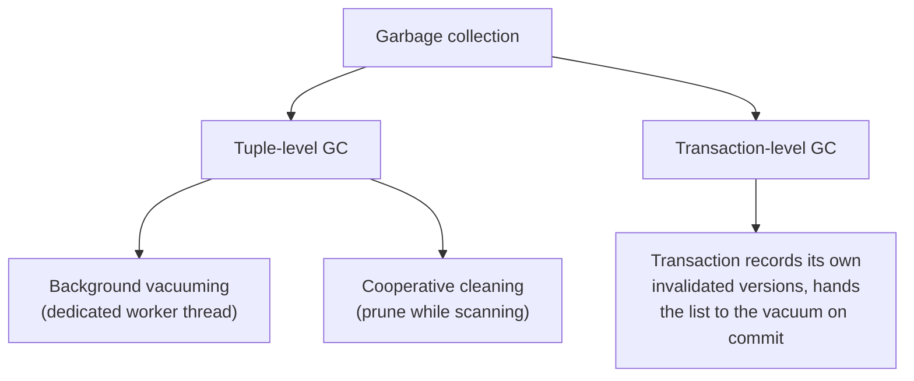

# 07 — Garbage collection

## Why it is mandatory

"MVCC doesn't come for free" — someone has to clean up, or you run out of space [`38:04`](https://www.youtube.com/watch?v=niLwbfE3V9Q&t=2284) [`44:09`](https://www.youtube.com/watch?v=niLwbfE3V9Q&t=2649).

## When a version is reclaimable

A version can be reclaimed when either [`44:35`](https://www.youtube.com/watch?v=niLwbfE3V9Q&t=2675) [`45:03`](https://www.youtube.com/watch?v=niLwbfE3V9Q&t=2703):

- **No active transaction can see it** under snapshot isolation, or
- **It was created by an aborted transaction** — set a flag so scanners know to remove it.

## Two design questions

1. How do we **find** expired versions?
2. How do we **decide when it is safe** to reclaim the storage? [`45:03`](https://www.youtube.com/watch?v=niLwbfE3V9Q&t=2703) [`45:22`](https://www.youtube.com/watch?v=niLwbfE3V9Q&t=2722)

## Tuple-level GC — background vacuuming

- A separate thread wakes periodically, reads the active transactions' timestamps, sequentially scans, and deletes versions outside every active range [`47:31`](https://www.youtube.com/watch?v=niLwbfE3V9Q&t=2851) [`47:59`](https://www.youtube.com/watch?v=niLwbfE3V9Q&t=2879).
- Worked example: with active transactions at timestamps **12 and 25**, versions `a00` and `b100` are visible to neither, so their space is reclaimed [`47:59`](https://www.youtube.com/watch?v=niLwbfE3V9Q&t=2879) [`48:22`](https://www.youtube.com/watch?v=niLwbfE3V9Q&t=2902).
- Works with any storage scheme — append-only, time-travel, or delta [`47:31`](https://www.youtube.com/watch?v=niLwbfE3V9Q&t=2851).
- **Optimization: a dirty bit map.** Set one bit per page modified since the last vacuum, so the vacuum only fetches dirty pages instead of scanning the whole table. A single bit doesn't say *how* the page changed, so you still inspect it [`48:22`](https://www.youtube.com/watch?v=niLwbfE3V9Q&t=2902).
- **This is what PostgreSQL does.** By default autovacuum triggers when roughly **20–25% of a table's tuples** have been touched; you can also invoke `VACUUM` manually from the terminal [`49:00`](https://www.youtube.com/watch?v=niLwbfE3V9Q&t=2940).

## Tuple-level GC — cooperative cleaning

- Worker threads prune expired versions **as they traverse version chains during normal query execution** [`49:23`](https://www.youtube.com/watch?v=niLwbfE3V9Q&t=2963) [`49:38`](https://www.youtube.com/watch?v=niLwbfE3V9Q&t=2978).
- Mechanism: maintain a **global timestamp = the lowest timestamp of any active transaction**; anything below it is prunable. Then update the index to point past it [`49:38`](https://www.youtube.com/watch?v=niLwbfE3V9Q&t=2978).
- Trade-off: no separate background thread, but your scans get slower [`49:38`](https://www.youtube.com/watch?v=niLwbfE3V9Q&t=2978).
- You must take a lock on the logical tuple while pruning, or two threads will try to do the same work [`50:11`](https://www.youtube.com/watch?v=niLwbfE3V9Q&t=3011).
- **It is not sufficient on its own.** A version invalidated but never read again is never cleaned — SQL Server calls these **"dusty corners"**, so you still need a periodic background sweep [`50:11`](https://www.youtube.com/watch?v=niLwbfE3V9Q&t=3011) [`50:39`](https://www.youtube.com/watch?v=niLwbfE3V9Q&t=3039).

## Transaction-level GC

- Each transaction tracks the versions it invalidated (record IDs / offsets / pointers) [`50:39`](https://www.youtube.com/watch?v=niLwbfE3V9Q&t=3039) [`51:07`](https://www.youtube.com/watch?v=niLwbfE3V9Q&t=3067).
- On commit it hands the list to the vacuum with its commit timestamp: anything below that watermark can go [`51:07`](https://www.youtube.com/watch?v=niLwbfE3V9Q&t=3067).
- **Rare in practice** — most systems use background vacuuming [`51:27`](https://www.youtube.com/watch?v=niLwbfE3V9Q&t=3087).

## Storage-scheme impact on GC cost

- **Delta storage wins:** you scan only the delta/rollback segment, never the whole table, and you can blow the segment away wholesale while leaving the tables untouched (MySQL) [`51:27`](https://www.youtube.com/watch?v=niLwbfE3V9Q&t=3087) [`51:49`](https://www.youtube.com/watch?v=niLwbfE3V9Q&t=3109).
- **Append-only loses:** vacuuming leaves holes in the storage space, requiring page compaction. **PostgreSQL does not return space to the OS unless you run `VACUUM FULL`**, so tables can carry a lot of dead space [`51:49`](https://www.youtube.com/watch?v=niLwbfE3V9Q&t=3109).

## Related Q&A

- **Writing the same record twice in one transaction:** a smart system just overwrites the first version — nobody cares about your intermediate steps, only the version you install at commit. Complications arise if the first update allocated space for one column and the second touches a thousand [`45:22`](https://www.youtube.com/watch?v=niLwbfE3V9Q&t=2722) [`45:59`](https://www.youtube.com/watch?v=niLwbfE3V9Q&t=2759) [`46:38`](https://www.youtube.com/watch?v=niLwbfE3V9Q&t=2798).
