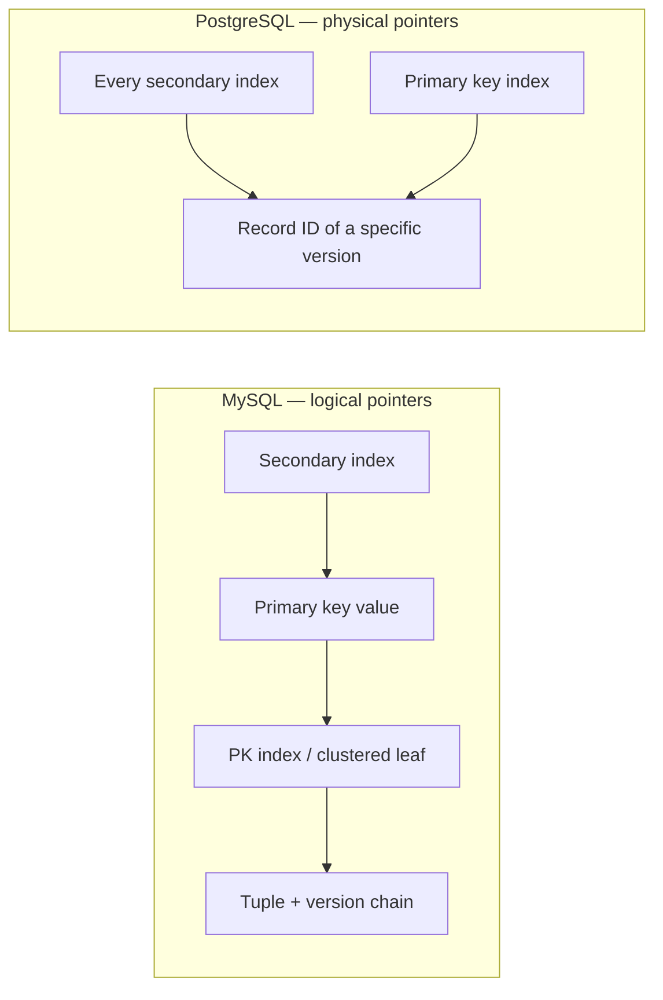

# 08 — Index management

## Primary keys are easy, secondary indexes are not

- **Primary key index always points at the head of the version chain**, regardless of storage scheme. Updating the primary key itself is handled as a delete + insert [`52:14`](https://www.youtube.com/watch?v=niLwbfE3V9Q&t=3134) [`52:32`](https://www.youtube.com/watch?v=niLwbfE3V9Q&t=3152).
- **Secondary indexes are the problem**: depending on what they point to and the chain ordering, creating a new version may force an update to *every* secondary index — even ones whose indexed attribute did not change [`52:46`](https://www.youtube.com/watch?v=niLwbfE3V9Q&t=3166) [`55:56`](https://www.youtube.com/watch?v=niLwbfE3V9Q&t=3356).

## The Uber case study

- Blog post: **"Why Uber Engineering Switched from Postgres to MySQL"** [`53:12`](https://www.youtube.com/watch?v=niLwbfE3V9Q&t=3192) [`53:27`](https://www.youtube.com/watch?v=niLwbfE3V9Q&t=3207).
- Andy's correction: the real title is "why Uber switched **from MySQL to Postgres back to MySQL**." They hit scaling problems on MySQL, hired a Postgres expert, migrated — and their workload turned out to be **the worst case for PostgreSQL's append-only MVCC**, forcing an expensive migration back [`53:27`](https://www.youtube.com/watch?v=niLwbfE3V9Q&t=3207).
- The lesson he draws: understand what the database is doing internally, because under heavy load these design decisions cause real, expensive problems [`54:10`](https://www.youtube.com/watch?v=niLwbfE3V9Q&t=3250).

## Two approaches for secondary index pointers

| Approach | Value stored in the index | Used by | Trade-off |
|---|---|---|---|
| **Logical pointer** | The **primary key** | MySQL | Secondary lookup returns a PK, then probe the PK index to reach the data. Updates only ever touch the PK index [`54:36`](https://www.youtube.com/watch?v=niLwbfE3V9Q&t=3276) [`57:09`](https://www.youtube.com/watch?v=niLwbfE3V9Q&t=3429) |
| **Logical pointer** | A synthetic **tuple ID** + mapping table | Essentially nobody | Requires maintaining yet another index; not worth it [`55:05`](https://www.youtube.com/watch?v=niLwbfE3V9Q&t=3305) |
| **Physical pointer** | Direct record ID (page + slot) of the version | PostgreSQL | Fast direct jump, but every new physical version invalidates every index entry [`55:05`](https://www.youtube.com/watch?v=niLwbfE3V9Q&t=3305) [`55:56`](https://www.youtube.com/watch?v=niLwbfE3V9Q&t=3356) |

- MySQL's InnoDB is index-organized storage: the B+Tree leaf nodes *are* the tuples, so a PK traversal yields the tuple directly rather than a record ID — but the concept is the same [`57:32`](https://www.youtube.com/watch?v=niLwbfE3V9Q&t=3452).

## PostgreSQL's mitigation: HOT (heap-only tuple) updates

- PostgreSQL normally adds an index entry for **every version** [`56:17`](https://www.youtube.com/watch?v=niLwbfE3V9Q&t=3377).
- **HOT optimization:** if the new version lands on the **same page** as the previous one, the index is not updated — the page itself redirects the reader down the chain [`56:17`](https://www.youtube.com/watch?v=niLwbfE3V9Q&t=3377).
- Measured hit rate in the group's experiments: **roughly 40% of the time** [`56:17`](https://www.youtube.com/watch?v=niLwbfE3V9Q&t=3377) [`57:09`](https://www.youtube.com/watch?v=niLwbfE3V9Q&t=3429).
- Andy's framing: it is "sort of a hack they have to do because they're dealing with their append-only storage" [`57:09`](https://www.youtube.com/watch?v=niLwbfE3V9Q&t=3429).

## Q&A: why not add a tuple-ID indirection layer?

A student proposes putting all secondary indexes behind a tuple-ID → physical-location hash map so only that map needs updating. Andy's answer: yes, it works, but it is **additional machinery, additional storage, and additional computational overhead** to maintain — and a primary key index lookup is already cheap enough. A B+Tree with large fan-out makes a single-key traversal inexpensive, so it is not worth it [`57:32`](https://www.youtube.com/watch?v=niLwbfE3V9Q&t=3452) [`58:28`](https://www.youtube.com/watch?v=niLwbfE3V9Q&t=3508) [`58:46`](https://www.youtube.com/watch?v=niLwbfE3V9Q&t=3526) [`59:07`](https://www.youtube.com/watch?v=niLwbfE3V9Q&t=3547).

## Version metadata in indexes

- Version timestamps normally live in the **tuple headers**, not in index keys [`59:28`](https://www.youtube.com/watch?v=niLwbfE3V9Q&t=3568) [`59:55`](https://www.youtube.com/watch?v=niLwbfE3V9Q&t=3595).
- **PostgreSQL is the exception:** it stores version information in the index so you can look up a (key, version) pair and jump straight to the exact tuple version without walking the chain [`59:55`](https://www.youtube.com/watch?v=niLwbfE3V9Q&t=3595).
- Why it matters: if a version chain is spread across multiple pages, what should be a single-page lookup becomes a large scan that "crushes performance" [`1:00:23`](https://www.youtube.com/watch?v=niLwbfE3V9Q&t=3623).
