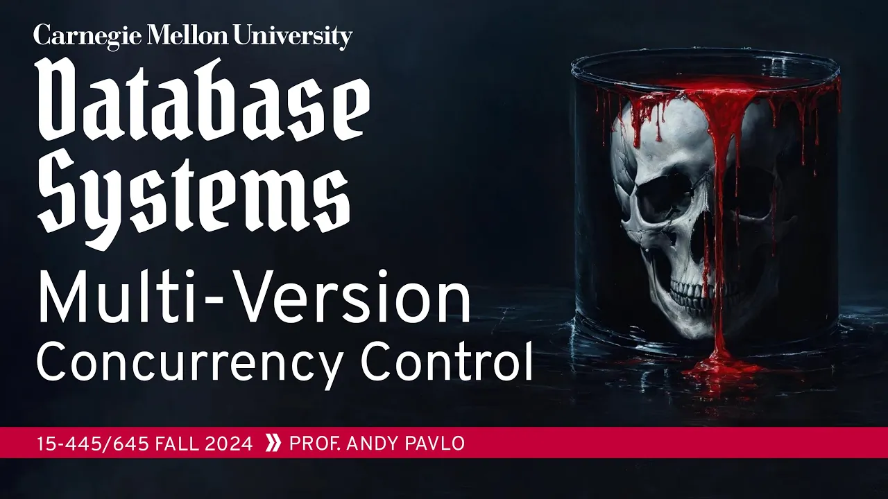
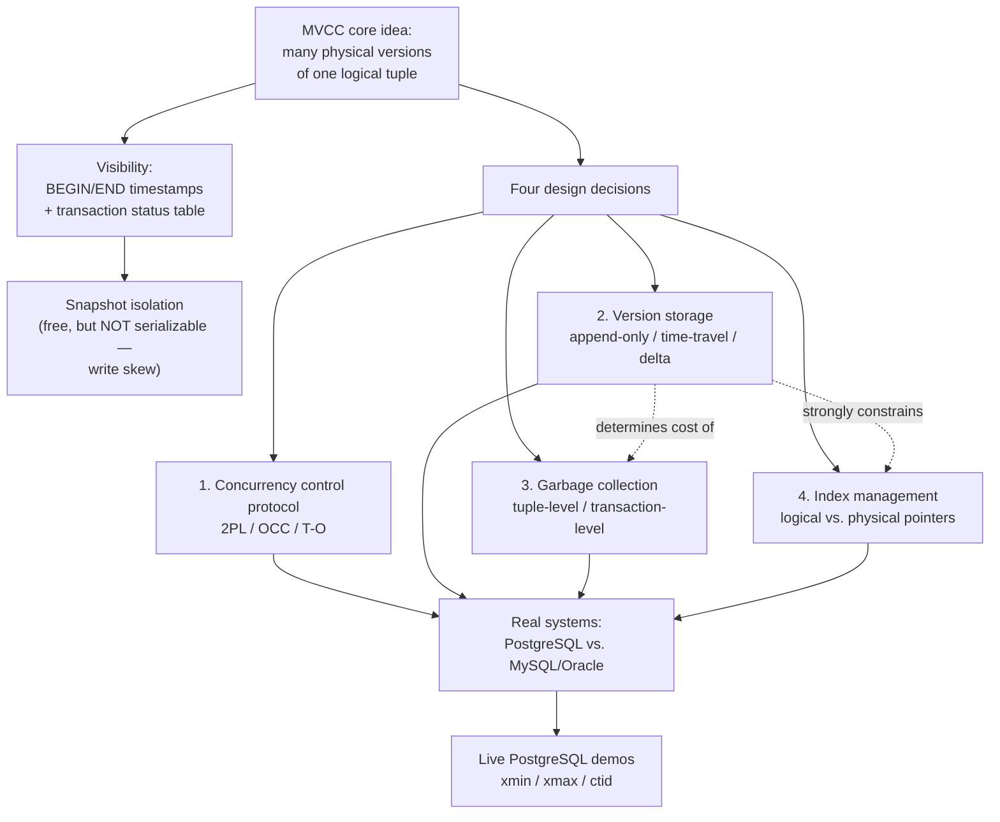

# #19 - Multi-Version Concurrency Control (CMU Intro to Database Systems)

*CMU Database Group · 1:27:07 · [Watch on YouTube](https://www.youtube.com/watch?v=niLwbfE3V9Q)*

## Summary

Andy Pavlo's lecture 19 of CMU 15-445/645 (Fall 2024) explains **Multi-Version Concurrency Control (MVCC)**: the technique of keeping multiple physical versions of a single logical tuple so that writers never block readers and readers never block writers. The lecture walks through the visibility mechanics (BEGIN/END timestamps plus a transaction status table), shows why the resulting **snapshot isolation is not serializable** via Jim Gray's marbles/write-skew example, and then covers the **four design decisions** any MVCC implementation must make: concurrency control protocol, version storage, garbage collection, and index management. It closes with live PostgreSQL demonstrations that expose `xmin`, `xmax`, and `ctid` to prove the theory matches the real engine — including a serializable abort and PostgreSQL's silent refusal to actually implement READ UNCOMMITTED.

The recurring thesis: **PostgreSQL has the worst MVCC implementation in wide use today**, because its append-only version storage forces whole-tuple copies, secondary index churn, and expensive vacuuming — while MySQL and Oracle's delta storage avoids all three.

## Topics

1. [Course admin and recap of timestamp ordering](./01-course-admin-and-recap.md)
2. [MVCC: core idea and history](./02-mvcc-core-idea-and-history.md)
3. [Version visibility: timestamps and the transaction status table](./03-version-visibility-walkthrough.md)
4. [Snapshot isolation and the write skew anomaly](./04-snapshot-isolation-and-write-skew.md)
5. [The four MVCC design decisions and the concurrency control protocol](./05-design-decisions-and-cc-protocol.md)
6. [Version storage](./06-version-storage.md)
7. [Garbage collection](./07-garbage-collection.md)
8. [Index management](./08-index-management.md)
9. [Deletes, tombstones, and index churn](./09-deletes-tombstones-and-index-churn.md)
10. [How real systems compare](./10-real-system-comparison.md)
11. [Live PostgreSQL demos](./11-postgresql-live-demos.md)
12. [Conclusion and what comes next](./12-conclusion-and-next-class.md)

## Key takeaways

- **MVCC is not a concurrency control protocol — it is an architecture.** It gives you "writers don't block readers, readers don't block writers" and snapshot isolation for free, but you still need 2PL, OCC, or timestamp ordering underneath to resolve write-write conflicts; a writer whose target version has END = ∞ and an uncommitted writer must stall [`6:21`](https://www.youtube.com/watch?v=niLwbfE3V9Q&t=381) [`9:19`](https://www.youtube.com/watch?v=niLwbfE3V9Q&t=559) [`20:51`](https://www.youtube.com/watch?v=niLwbfE3V9Q&t=1251).
- **Snapshot isolation is provably not serializable.** Jim Gray's marbles example: starting from 2 black + 2 white, "turn white→black" and "turn black→white" running concurrently under SI simply swap the colors, whereas *any* serial order yields all-black or all-white. This write skew anomaly was missed by the 1992 ANSI isolation-level spec, which is why **Oracle's "serializable" is really snapshot isolation** [`25:22`](https://www.youtube.com/watch?v=niLwbfE3V9Q&t=1522) [`26:09`](https://www.youtube.com/watch?v=niLwbfE3V9Q&t=1569) [`26:48`](https://www.youtube.com/watch?v=niLwbfE3V9Q&t=1608) [`27:08`](https://www.youtube.com/watch?v=niLwbfE3V9Q&t=1628).
- **Delta storage beats append-only and time-travel storage.** Delta copies only the modified columns (update 1 of 1,000 columns and copy 1, not 1,000), keeps the head address stable so secondary indexes never need repointing, and lets GC scan only the rollback segment instead of the whole table — MySQL can simply blow the segment away, while PostgreSQL leaves holes and won't return space to the OS without `VACUUM FULL` [`32:20`](https://www.youtube.com/watch?v=niLwbfE3V9Q&t=1940) [`35:32`](https://www.youtube.com/watch?v=niLwbfE3V9Q&t=2132) [`51:49`](https://www.youtube.com/watch?v=niLwbfE3V9Q&t=3109).
- **PostgreSQL is named the worst production MVCC implementation**, a legacy of a 1980s design that assumed no write-ahead log. Its append-only storage means every update writes a new physical tuple, invalidating every secondary index entry; the HOT-update mitigation (skip the index update when the new version lands on the same page) fires only **about 40% of the time** in the CMU group's experiments. Uber's blog post on migrating off Postgres is the canonical real-world cost of this [`28:59`](https://www.youtube.com/watch?v=niLwbfE3V9Q&t=1739) [`33:14`](https://www.youtube.com/watch?v=niLwbfE3V9Q&t=1994) [`56:17`](https://www.youtube.com/watch?v=niLwbfE3V9Q&t=3377) [`53:27`](https://www.youtube.com/watch?v=niLwbfE3V9Q&t=3207).
- **The live demo confirmed the theory end to end.** After an update, `ctid` moved from (0,1) to (0,3) — a genuinely new physical version; the concurrent session was denied even an explicit `ctid`-targeted read of it, hung 17 seconds on the logical-tuple write lock, and under SERIALIZABLE was **aborted** for updating based on a stale read of 100 while the committer had already written 101 [`1:12:50`](https://www.youtube.com/watch?v=niLwbfE3V9Q&t=4370) [`1:14:21`](https://www.youtube.com/watch?v=niLwbfE3V9Q&t=4461) [`1:15:22`](https://www.youtube.com/watch?v=niLwbfE3V9Q&t=4522) [`1:19:50`](https://www.youtube.com/watch?v=niLwbfE3V9Q&t=4790).
- **PostgreSQL cannot give you READ UNCOMMITTED at all** — asking for it silently yields READ COMMITTED, because implementing true dirty reads would take extra code the team judged not worth writing. The inverse of Oracle, which downgrades your request for serializable [`1:23:10`](https://www.youtube.com/watch?v=niLwbfE3V9Q&t=4990) [`1:23:43`](https://www.youtube.com/watch?v=niLwbfE3V9Q&t=5023).
- **Garbage collection is non-negotiable and shapes the design.** PostgreSQL's autovacuum triggers around 20–25% of a table's tuples being modified, guided by a dirty-page bitmap; cooperative cleaning alone is insufficient because versions never re-read become SQL Server's "dusty corners" and need a periodic background sweep [`49:00`](https://www.youtube.com/watch?v=niLwbfE3V9Q&t=2940) [`50:39`](https://www.youtube.com/watch?v=niLwbfE3V9Q&t=3039).
