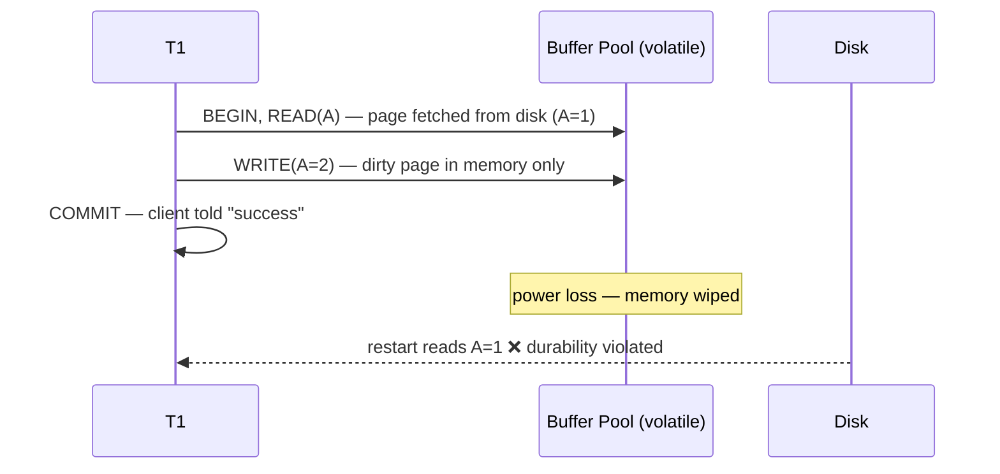

# 01 — Why Recovery Exists (and course admin)

## Warm-up: is it OK to tune a DBMS for the benchmark?

- Standard benchmarks (TPC-C, TPC-H, TPC-DS) have been public since 1992, so vendors know the exact schema and queries and take shortcuts ([`0:28`](https://www.youtube.com/watch?v=mbelzgz-97s&t=28)).
- Example: in TPC-C the `warehouse` table is fixed-size and never updated, so a vendor can make `CREATE INDEX` build a plain **array** instead of a B+Tree — O(1) offset jump, much faster than a tree ([`1:09`](https://www.youtube.com/watch?v=mbelzgz-97s&t=69), [`1:19`](https://www.youtube.com/watch?v=mbelzgz-97s&t=79)).
- Verdict: "in industry you're not supposed to do that, but people still do it" ([`1:19`](https://www.youtube.com/watch?v=mbelzgz-97s&t=79)).

## Course logistics

- Project 3 due that Sunday; Saturday office hours on the 16th, 3–5pm, Gates 5th floor ([`1:42`](https://www.youtube.com/watch?v=mbelzgz-97s&t=102)).
- Project 4 posted; due **December 8** ([`2:16`](https://www.youtube.com/watch?v=mbelzgz-97s&t=136)).
- Final exam **December 13, 8:30am** — no early sittings, don't travel before that date ([`2:16`](https://www.youtube.com/watch?v=mbelzgz-97s&t=136)).

## Where this lecture sits in ACID

- Concurrency control protocols (2PL, OCC, MVCC) deliver **atomicity, consistency, isolation** ([`2:39`](https://www.youtube.com/watch?v=mbelzgz-97s&t=159)).
- The missing piece is **durability** — plus recovery also backstops atomicity when half a transaction's writes reach disk and half do not ([`3:22`](https://www.youtube.com/watch?v=mbelzgz-97s&t=202)).
- MVCC is not just a CC protocol: keeping multiple versions leaks into indexes and the execution engine, i.e. the whole architecture ([`2:39`](https://www.youtube.com/watch?v=mbelzgz-97s&t=159)).

## The failure scenario that motivates everything

- Once the DBMS tells the outside world "committed", the change must survive anything short of the machine melting ([`4:26`](https://www.youtube.com/watch?v=mbelzgz-97s&t=266), [`5:01`](https://www.youtube.com/watch?v=mbelzgz-97s&t=301)).
- Edge case: if a transaction commits and the ack never reaches the client (power cut first), the transaction is **still considered committed** — what matters is what reached non-volatile storage ([`6:14`](https://www.youtube.com/watch?v=mbelzgz-97s&t=374)).

## A recovery algorithm has two halves

1. **During normal operation** — extra bookkeeping while transactions run so that recovery is possible later. *This is today's lecture* ([`6:39`](https://www.youtube.com/watch?v=mbelzgz-97s&t=399)).
2. **After a failure** — scan the disk, reconstruct the state at the moment of the crash, restore correctness. *Next lecture (ARIES)* ([`7:07`](https://www.youtube.com/watch?v=mbelzgz-97s&t=427), [`7:22`](https://www.youtube.com/watch?v=mbelzgz-97s&t=442)).

## Lecture outline announced

- Buffer pool policies → **shadow paging** → **write-ahead logging** (the spoiler: WAL wins) → what goes in the log → naive checkpoints ([`7:22`](https://www.youtube.com/watch?v=mbelzgz-97s&t=442), [`7:47`](https://www.youtube.com/watch?v=mbelzgz-97s&t=467)).
- Shadow paging was IBM's original System R design; some systems still use it, but WAL is always the superior choice ([`7:47`](https://www.youtube.com/watch?v=mbelzgz-97s&t=467)).
- Guest speaker from **Confluent** (the company behind Kafka) at the end ([`8:18`](https://www.youtube.com/watch?v=mbelzgz-97s&t=498)).

## Hardware assumptions and the two primitives

- Disk-oriented DBMS, von Neumann page-copy architecture, algorithms chosen to **maximize sequential I/O** over random I/O ([`8:18`](https://www.youtube.com/watch?v=mbelzgz-97s&t=498), [`8:40`](https://www.youtube.com/watch?v=mbelzgz-97s&t=520)).
- DRAM retains readable content for roughly **30 seconds** after power loss per research, but program counters and everything else are gone — so durability means disk ([`9:05`](https://www.youtube.com/watch?v=mbelzgz-97s&t=545)).
- **UNDO** — remove the effects of transactions that did not complete (aborted by the app, killed by 2PL/OCC, or lost to a crash) ([`10:02`](https://www.youtube.com/watch?v=mbelzgz-97s&t=602)).
- **REDO** — re-apply the changes of transactions the system claimed were committed ([`10:30`](https://www.youtube.com/watch?v=mbelzgz-97s&t=630)).
- How UNDO/REDO are implemented depends entirely on what the **buffer pool manager** is allowed to do ([`11:00`](https://www.youtube.com/watch?v=mbelzgz-97s&t=660)).
