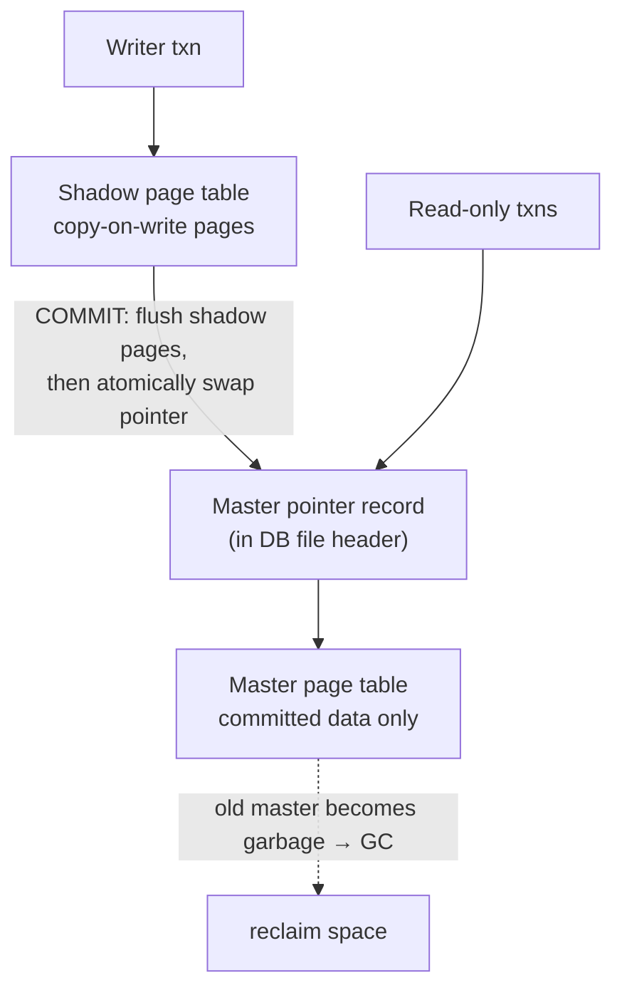

# 03 — Shadow Paging

## Definition

- A **NO-STEAL + FORCE** buffer pool policy that avoids copying the whole database by copying **pages**, while forbidding two transactions from updating the same page concurrently — so a flush never has to excise uncommitted changes ([`20:30`](https://www.youtube.com/watch?v=mbelzgz-97s&t=1230)).
- Invented by IBM for **System R**; the dominant approach in 1970s–80s databases until WAL arrived in the late '70s / early '80s and everyone switched ([`20:59`](https://www.youtube.com/watch?v=mbelzgz-97s&t=1259)).
- Simplifying assumption used in the lecture: **one writer transaction at a time, many readers**. SQL's `BEGIN ... READ ONLY` hint exists so the DBMS can exploit exactly this ([`21:24`](https://www.youtube.com/watch?v=mbelzgz-97s&t=1284)).

## Mechanism: two page tables + a master pointer

- **Master page table** maps page IDs to the latest committed pages; the **shadow page table** holds the uncommitted writer's copies ([`21:38`](https://www.youtube.com/watch?v=mbelzgz-97s&t=1298)).
- On BEGIN (read-write), the shadow table starts as an exact copy of the master's pointers ([`22:24`](https://www.youtube.com/watch?v=mbelzgz-97s&t=1344)).
- First write to a page → copy the page, redirect the shadow table's pointer at the copy. This is literally **copy-on-write**, the same idea Linux uses ([`22:24`](https://www.youtube.com/watch?v=mbelzgz-97s&t=1344), [`23:01`](https://www.youtube.com/watch?v=mbelzgz-97s&t=1381)).
- Concurrent read-only transactions follow the **master pointer record** and see the older, consistent version ([`23:29`](https://www.youtube.com/watch?v=mbelzgz-97s&t=1409)).
- COMMIT = flush the shadow's dirty pages, then update the master pointer record (kept in the DB file header or a special location). The shadow becomes the new master ([`23:56`](https://www.youtube.com/watch?v=mbelzgz-97s&t=1436), [`22:04`](https://www.youtube.com/watch?v=mbelzgz-97s&t=1324)).
- The old master must then be garbage-collected — effectively a **two-version system**, the degenerate case of MVCC's version chains ([`24:22`](https://www.youtube.com/watch?v=mbelzgz-97s&t=1462), [`24:43`](https://www.youtube.com/watch?v=mbelzgz-97s&t=1483)).

## Recovery: essentially free

- **Abort** — drop the shadow page table and let its pages be garbage-collected ([`26:00`](https://www.youtube.com/watch?v=mbelzgz-97s&t=1560), [`26:33`](https://www.youtube.com/watch?v=mbelzgz-97s&t=1593)).
- **Crash** — the master pointer either got updated (committed) or it didn't; ignore everything in the shadow table ([`26:00`](https://www.youtube.com/watch?v=mbelzgz-97s&t=1560)).
- **No UNDO, no REDO at all** ([`26:33`](https://www.youtube.com/watch?v=mbelzgz-97s&t=1593)).

## Why it sucks

- **Multiple writers don't fit**: you can still layer 2PL/OCC on top, but commits become batched — a 1 ms transaction waits for a 1 s transaction in the same batch ([`25:00`](https://www.youtube.com/watch?v=mbelzgz-97s&t=1500), [`25:43`](https://www.youtube.com/watch?v=mbelzgz-97s&t=1543)).
- **Copying the entire page table is expensive**, and commit overhead is high because everything must be flushed ([`28:00`](https://www.youtube.com/watch?v=mbelzgz-97s&t=1680)).
- **Fragmentation** — the killer IBM discovered. Data that was contiguous (great for sequential scans) becomes scattered with holes after copy-on-write plus cleanup, destroying sequential I/O. It needs the equivalent of an old `defrag` or a PostgreSQL `VACUUM FULL` ([`28:30`](https://www.youtube.com/watch?v=mbelzgz-97s&t=1710), [`28:45`](https://www.youtube.com/watch?v=mbelzgz-97s&t=1725)).
- **Random I/O everywhere** — the whole approach forces non-sequential writes to disk, contradicting the design principle of maximizing sequential access ([`31:33`](https://www.youtube.com/watch?v=mbelzgz-97s&t=1893), [`32:02`](https://www.youtube.com/watch?v=mbelzgz-97s&t=1922)).
- One-writer/many-readers is not outlandish though — **that is how SQLite works**, and it works well ([`25:43`](https://www.youtube.com/watch?v=mbelzgz-97s&t=1543)).

## Real-world cousin: SQLite's rollback journal

- SQLite originally shipped a **rollback mode** (not exactly shadow paging); the write-ahead log was added around **2010** for performance ([`29:19`](https://www.youtube.com/watch?v=mbelzgz-97s&t=1759)).
- Flow: fetch page → **copy the pristine page into a journal file *before* modifying it** → modify in memory ([`29:19`](https://www.youtube.com/watch?v=mbelzgz-97s&t=1759), [`30:04`](https://www.youtube.com/watch?v=mbelzgz-97s&t=1804)).
- On crash mid-transaction, recovery reads the journal back and blindly copies the original pages back to disk — safe because SQLite has a single writer, so it's all-or-nothing ([`30:28`](https://www.youtube.com/watch?v=mbelzgz-97s&t=1828), [`31:01`](https://www.youtube.com/watch?v=mbelzgz-97s&t=1861)).
- On commit, the journal file is simply deleted / marked unneeded ([`31:16`](https://www.youtube.com/watch?v=mbelzgz-97s&t=1876)).
- Reading the journal is sequential and fast, but **applying it back to the scattered database pages is random I/O** ([`32:02`](https://www.youtube.com/watch?v=mbelzgz-97s&t=1922)).

## Where shadow paging is still the right call

- The Puerto Rico power company built a 1970s database on the island where outages were frequent and non-deterministic. They chose shadow paging deliberately: **pay the runtime penalty to get instantaneous recovery**, because the system might lose power again during a long recovery ([`1:02:14`](https://www.youtube.com/watch?v=mbelzgz-97s&t=3734), [`1:02:34`](https://www.youtube.com/watch?v=mbelzgz-97s&t=3754)).
