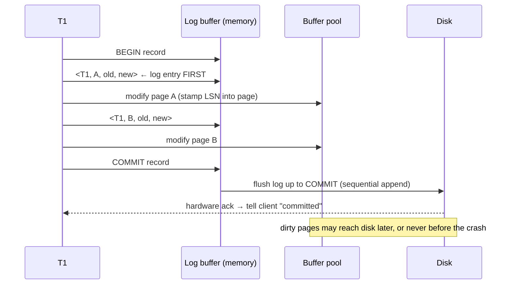

# 04 — Write-Ahead Logging (WAL)

## Core idea

- Goal: **convert random writes into sequential writes**, which is always much faster ([`32:20`](https://www.youtube.com/watch?v=mbelzgz-97s&t=1940)).
- Maintain a **log file separate from the heap files**, recording the minimum needed to describe each change: the transaction ID, the object modified, the **before value** (for UNDO), and the **after value** (for REDO). Checksums and timestamps are optional extras ([`32:47`](https://www.youtube.com/watch?v=mbelzgz-97s&t=1967), [`33:09`](https://www.youtube.com/watch?v=mbelzgz-97s&t=1989), [`39:11`](https://www.youtube.com/watch?v=mbelzgz-97s&t=2351)).
- Every DBMS in production today does something like this; only the details (what's stored, when it flushes, group commit) vary ([`32:20`](https://www.youtube.com/watch?v=mbelzgz-97s&t=1940)).

## The two invariants

1. Before telling the outside world a transaction **committed**, all of its log records must be flushed to disk ([`33:34`](https://www.youtube.com/watch?v=mbelzgz-97s&t=2014)).
2. Before writing a **dirty page** out of the buffer pool, the log records that dirtied it must already be on disk ([`33:34`](https://www.youtube.com/watch?v=mbelzgz-97s&t=2014)).

- Consequence: the buffer pool manager is no longer independent — its eviction policy must consult the log's durability watermark to decide whether a dirty page may be evicted ([`34:04`](https://www.youtube.com/watch?v=mbelzgz-97s&t=2044), [`34:32`](https://www.youtube.com/watch?v=mbelzgz-97s&t=2072), [`37:10`](https://www.youtube.com/watch?v=mbelzgz-97s&t=2230)).
- WAL = **STEAL + NO-FORCE**: evict uncommitted dirty pages as long as their log records are durable; on commit flush only the log ([`34:32`](https://www.youtube.com/watch?v=mbelzgz-97s&t=2072), [`34:49`](https://www.youtube.com/watch?v=mbelzgz-97s&t=2089)).

## The runtime protocol

- BEGIN record: shown for clarity, but many systems only write it on the transaction's first query, and some omit it entirely since the first query implies the start ([`38:34`](https://www.youtube.com/watch?v=mbelzgz-97s&t=2314), [`38:58`](https://www.youtube.com/watch?v=mbelzgz-97s&t=2338)).
- The page itself records the **log sequence number (LSN)** of the change that dirtied it ([`41:28`](https://www.youtube.com/watch?v=mbelzgz-97s&t=2488), [`36:44`](https://www.youtube.com/watch?v=mbelzgz-97s&t=2204)).
- Note: the log buffer is drawn small on the slide, but in reality it is **much larger than the buffer pool** ([`40:51`](https://www.youtube.com/watch?v=mbelzgz-97s&t=2451)).
- Historical aside: original PostgreSQL skipped real WAL because **append-only MVCC** always creates a new tuple — with copy-on-write you keep the original version, so you can skip the UNDO information. Most systems are not append-only MVCC ([`39:35`](https://www.youtube.com/watch?v=mbelzgz-97s&t=2375), [`40:01`](https://www.youtube.com/watch?v=mbelzgz-97s&t=2401)).

## Why it wins

- All log I/O is **sequential appends** ([`43:00`](https://www.youtube.com/watch?v=mbelzgz-97s&t=2580)).
- Volume: updating a billion tuples across a billion pages means flushing a billion 8 KB pages under FORCE, vs. a billion small contiguous log entries — far less data, written sequentially ([`43:22`](https://www.youtube.com/watch?v=mbelzgz-97s&t=2602), [`43:58`](https://www.youtube.com/watch?v=mbelzgz-97s&t=2638)).

## Synchronous commit and `fsync`

- `fsync` blocks until the OS confirms the data is safe on disk ([`37:35`](https://www.youtube.com/watch?v=mbelzgz-97s&t=2255)).
- **Most systems do not do this by default** — COMMIT returns and the flush happens eventually. Turning on synchronous commit costs performance; losing the last ~5 ms on a crash is acceptable for many applications ([`37:35`](https://www.youtube.com/watch?v=mbelzgz-97s&t=2255), [`38:13`](https://www.youtube.com/watch?v=mbelzgz-97s&t=2293)).

## Group commit + double buffering

- Flushing on every commit is a bottleneck: SSD write latency is **~1–5 ms**; S3 is **~100–300 ms** ([`43:58`](https://www.youtube.com/watch?v=mbelzgz-97s&t=2638), [`44:14`](https://www.youtube.com/watch?v=mbelzgz-97s&t=2654)).
- **Group commit**: batch committed transactions and flush on a tunable timeout (e.g. every 5 or 10 ms). The first transaction in a window waits up to that window — usually acceptable ([`44:14`](https://www.youtube.com/watch?v=mbelzgz-97s&t=2654), [`44:58`](https://www.youtube.com/watch?v=mbelzgz-97s&t=2698), [`45:09`](https://www.youtube.com/watch?v=mbelzgz-97s&t=2709)).
- Transactions may append to the log in any order — the concurrency control layer above already decides who may touch what ([`44:42`](https://www.youtube.com/watch?v=mbelzgz-97s&t=2682)).
- Implementation: **two log buffers**. When one fills, it is written out **asynchronously** (nobody asked to commit yet) while new entries fill the other — plain double buffering ([`45:20`](https://www.youtube.com/watch?v=mbelzgz-97s&t=2720), [`45:45`](https://www.youtube.com/watch?v=mbelzgz-97s&t=2745), [`46:54`](https://www.youtube.com/watch?v=mbelzgz-97s&t=2814)).
- A partially full buffer is flushed anyway once the timeout elapses — still correct ([`46:11`](https://www.youtube.com/watch?v=mbelzgz-97s&t=2771), [`46:38`](https://www.youtube.com/watch?v=mbelzgz-97s&t=2798)).

## Runtime vs. recovery trade-off

| | Runtime performance | Recovery time |
|---|---|---|
| **Shadow paging** (NO-STEAL + FORCE) | Slow — blind whole-page copies ([`47:31`](https://www.youtube.com/watch?v=mbelzgz-97s&t=2851)) | **Instantaneous** — nothing to replay ([`47:15`](https://www.youtube.com/watch?v=mbelzgz-97s&t=2835), [`47:57`](https://www.youtube.com/watch?v=mbelzgz-97s&t=2877)) |
| **WAL** (STEAL + NO-FORCE) | **Fastest** — sequential appends ([`47:31`](https://www.youtube.com/watch?v=mbelzgz-97s&t=2851)) | Slower — must replay the log, doing UNDO and REDO ([`48:11`](https://www.youtube.com/watch?v=mbelzgz-97s&t=2891)) |
