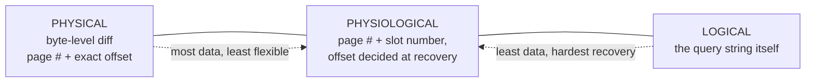

# 05 — What Goes in the Log: Physical, Logical, Physiological

## The three schemes

### Physical logging

- A **byte-level diff**: here is the page/record before, here it is after, at this exact physical location and offset within the file/page ([`48:28`](https://www.youtube.com/watch?v=mbelzgz-97s&t=2908), [`48:51`](https://www.youtube.com/watch?v=mbelzgz-97s&t=2931)).
- Must also log the changes made to **index pages** (e.g. the primary key index), otherwise a crash leaves the indexes gone and you need a full scan to rebuild them ([`49:44`](https://www.youtube.com/watch?v=mbelzgz-97s&t=2984), [`50:09`](https://www.youtube.com/watch?v=mbelzgz-97s&t=3009)).

### Logical logging

- Records **the query that was executed**; recovery re-executes it ([`48:51`](https://www.youtube.com/watch?v=mbelzgz-97s&t=2931), [`49:15`](https://www.youtube.com/watch?v=mbelzgz-97s&t=2955), [`50:29`](https://www.youtube.com/watch?v=mbelzgz-97s&t=3029)).
- Typically only seen in **in-memory systems** with no table heap — the DBMS reloads a snapshot and replays changes on top ([`50:44`](https://www.youtube.com/watch?v=mbelzgz-97s&t=3044), [`51:01`](https://www.youtube.com/watch?v=mbelzgz-97s&t=3061)).

### Physiological logging (the hybrid, and the winner)

- Records the change **within a specific page** but **not the exact offset** — just the page number and slot number; the system decides where to place it at recovery ([`49:15`](https://www.youtube.com/watch?v=mbelzgz-97s&t=2955), [`49:44`](https://www.youtube.com/watch?v=mbelzgz-97s&t=2984), [`51:30`](https://www.youtube.com/watch?v=mbelzgz-97s&t=3090)).
- **Most systems use this.** The slot-array indirection layer means a page's internal layout may legitimately differ from one recovery pass to the next, as long as changes stay scoped to the same page (page directory metadata must not be disturbed) ([`51:51`](https://www.youtube.com/watch?v=mbelzgz-97s&t=3111), [`52:14`](https://www.youtube.com/watch?v=mbelzgz-97s&t=3134)).

## Why logical logging loses, despite being tiny

- **Size**: one `UPDATE` touching a billion tuples needs a billion physical/physiological entries, but **one query string** logically ([`52:28`](https://www.youtube.com/watch?v=mbelzgz-97s&t=3148), [`52:51`](https://www.youtube.com/watch?v=mbelzgz-97s&t=3171)).
- **Recovery cost**: there is no magic speedup at recovery — a query that took an hour to run takes an hour to replay ([`52:51`](https://www.youtube.com/watch?v=mbelzgz-97s&t=3171)).
- **Non-determinism**: `WHERE val = RANDOM()` or a timestamp must reproduce the same seed/value on replay ([`51:01`](https://www.youtube.com/watch?v=mbelzgz-97s&t=3061), [`51:16`](https://www.youtube.com/watch?v=mbelzgz-97s&t=3076)).
- **Lower isolation levels**: interleaving transactions during replay may yield a different outcome than the original run — you can read another transaction's data that you didn't read the first time ([`53:19`](https://www.youtube.com/watch?v=mbelzgz-97s&t=3199)).
- For these reasons **most systems do not do logical logging** ([`53:19`](https://www.youtube.com/watch?v=mbelzgz-97s&t=3199)).
