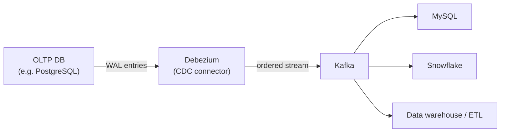

# 06 — Change Data Capture (bonus, not on the exam)

> Explicitly flagged as real-world context, **not exam material** ([`53:46`](https://www.youtube.com/watch?v=mbelzgz-97s&t=3226)).

## The insight

- Recovery = "take the WAL, look at the changes, apply them to a database." Nothing says it has to be **the same** database ([`54:13`](https://www.youtube.com/watch?v=mbelzgz-97s&t=3253), [`54:33`](https://www.youtube.com/watch?v=mbelzgz-97s&t=3273)).
- Ship the WAL to another system and apply it there → the second system is permanently in a kind of **virtual recovery mode**. This is also how distributed systems do replication ([`54:33`](https://www.youtube.com/watch?v=mbelzgz-97s&t=3273)).
- Called **change data capture (CDC)**, used to feed OLTP → data warehouse ETL pipelines (the topic of the earlier dbt guest talk) ([`53:46`](https://www.youtube.com/watch?v=mbelzgz-97s&t=3226), [`54:13`](https://www.youtube.com/watch?v=mbelzgz-97s&t=3253)).

## Why WAL-based CDC is the easy way

- The mechanism already exists for recovery — you just send the log elsewhere; the alternative is replicating queries ([`54:33`](https://www.youtube.com/watch?v=mbelzgz-97s&t=3273), [`55:15`](https://www.youtube.com/watch?v=mbelzgz-97s&t=3315)).
- Tools named: **Oracle GoldenGate** (the most famous) and **Debezium**, the open-source Red Hat tool ([`55:41`](https://www.youtube.com/watch?v=mbelzgz-97s&t=3341)).
- **Debezium moves the WAL between systems; Kafka guarantees the data arrives in order** ([`55:58`](https://www.youtube.com/watch?v=mbelzgz-97s&t=3358)).
- The target need not be the same DBMS — pull PostgreSQL WAL entries, ship over Kafka, replay into MySQL or Snowflake. A very common pattern ([`1:17:17`](https://www.youtube.com/watch?v=mbelzgz-97s&t=4637), [`1:17:53`](https://www.youtube.com/watch?v=mbelzgz-97s&t=4673)).
