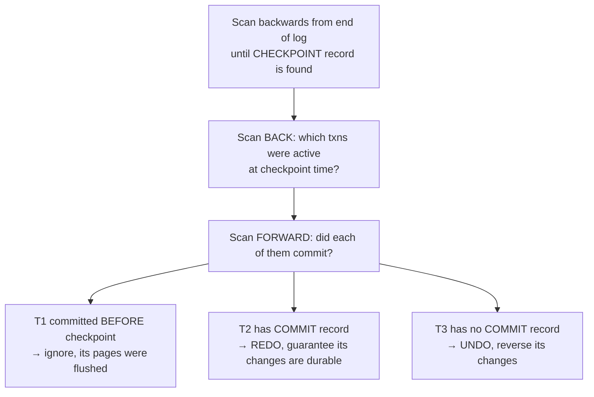

# 07 — Checkpoints (naive version) and Wrap-Up

## The problem WAL creates

- The log **grows forever**. If the system has been running for 10 years, recovery would replay 10 years of log ([`56:14`](https://www.youtube.com/watch?v=mbelzgz-97s&t=3374), [`56:34`](https://www.youtube.com/watch?v=mbelzgz-97s&t=3394)).
- **Checkpoint**: periodically flush all dirty pages and drop a marker into the log, so recovery need not go back to the beginning of time — and older log can be **truncated** ([`56:50`](https://www.youtube.com/watch?v=mbelzgz-97s&t=3410)).

## Naive scheme: blocking / consistent checkpoints

1. Pause all transactions and queries (let running queries finish) ([`57:44`](https://www.youtube.com/watch?v=mbelzgz-97s&t=3464)).
2. Flush the in-memory log records to disk ([`58:00`](https://www.youtube.com/watch?v=mbelzgz-97s&t=3480)).
3. Flush all dirty buffer pool pages to disk ([`58:00`](https://www.youtube.com/watch?v=mbelzgz-97s&t=3480)).
4. Write a `CHECKPOINT` entry into the WAL and flush it ([`58:00`](https://www.youtube.com/watch?v=mbelzgz-97s&t=3480)).
5. Unpause everything ([`58:16`](https://www.youtube.com/watch?v=mbelzgz-97s&t=3496)).

- Pages from **uncommitted** transactions are flushed too — allowed under STEAL, and their log records are on disk, so recovery still has enough information ([`58:16`](https://www.youtube.com/watch?v=mbelzgz-97s&t=3496)).
- Why the stall is necessary: without it you could flush one page of a two-page update and not the other, tearing the change ([`1:00:07`](https://www.youtube.com/watch?v=mbelzgz-97s&t=3607), [`1:00:24`](https://www.youtube.com/watch?v=mbelzgz-97s&t=3624)).

## How recovery uses the checkpoint

- Start at the end of the log, scan back to the checkpoint, then look **backwards and forwards** around it to classify every transaction ([`58:34`](https://www.youtube.com/watch?v=mbelzgz-97s&t=3514), [`58:57`](https://www.youtube.com/watch?v=mbelzgz-97s&t=3537)).
- Worked outcome from the slide: **T1 ignored** (committed before the checkpoint, pages flushed), **T2 redone** (commit record found), **T3 undone** (no commit record) ([`58:57`](https://www.youtube.com/watch?v=mbelzgz-97s&t=3537), [`59:36`](https://www.youtube.com/watch?v=mbelzgz-97s&t=3576), [`1:00:07`](https://www.youtube.com/watch?v=mbelzgz-97s&t=3607)).
- Next lecture fixes this with **fuzzy checkpoints**: let transactions keep running during the checkpoint, and track extra metadata about the buffer pool state and active transactions — including hints inside the checkpoint record itself, so recovery need not hunt for them ([`1:00:24`](https://www.youtube.com/watch?v=mbelzgz-97s&t=3624), [`1:00:58`](https://www.youtube.com/watch?v=mbelzgz-97s&t=3658)).

## Tuning checkpoint frequency

- Too often → the background task eats the time meant for queries, like GC or LSM compaction ([`1:01:26`](https://www.youtube.com/watch?v=mbelzgz-97s&t=3686)).
- Too rarely (say monthly) → recovery replays a month of log ([`1:01:45`](https://www.youtube.com/watch?v=mbelzgz-97s&t=3705)).
- **There is no magic number**, though **every 5 minutes is often the default**. It depends on the tolerable runtime penalty and the required recovery time for your application ([`1:01:45`](https://www.youtube.com/watch?v=mbelzgz-97s&t=3705), [`1:02:14`](https://www.youtube.com/watch?v=mbelzgz-97s&t=3734)).
- "Most people [are fine] with the default" ([`1:03:02`](https://www.youtube.com/watch?v=mbelzgz-97s&t=3782)).

## Wrap-up

- **WAL is almost always the best approach** for surviving crashes, via **STEAL + NO-FORCE** ([`1:03:02`](https://www.youtube.com/watch?v=mbelzgz-97s&t=3782)).
  - STEAL: evict uncommitted dirty pages **only if** their log records are already durable ([`1:03:33`](https://www.youtube.com/watch?v=mbelzgz-97s&t=3813)).
  - NO-FORCE: commit does not require flushing the transaction's dirty pages ([`1:03:33`](https://www.youtube.com/watch?v=mbelzgz-97s&t=3813)).
- At runtime: append log records to the buffer and take periodic checkpoints. At recovery: read the WAL "like the black box of an airplane" to reconstruct the crash-time state via REDO of committed and UNDO of uncommitted transactions ([`1:03:51`](https://www.youtube.com/watch?v=mbelzgz-97s&t=3831), [`1:04:12`](https://www.youtube.com/watch?v=mbelzgz-97s&t=3852)).
- Next class: better checkpoints and the **ARIES** recovery protocol — called **"probably the third hardest lecture of the semester"**. ARIES is deliberately over-cautious and will sometimes REDO changes that didn't need redoing, to guarantee correctness, "because people get mad when you lose data" ([`1:04:28`](https://www.youtube.com/watch?v=mbelzgz-97s&t=3868), [`1:05:07`](https://www.youtube.com/watch?v=mbelzgz-97s&t=3907)).
- Practical takeaway repeated throughout: this is why you should **use an existing DBMS instead of writing your own** ([`1:42`](https://www.youtube.com/watch?v=mbelzgz-97s&t=102)).
