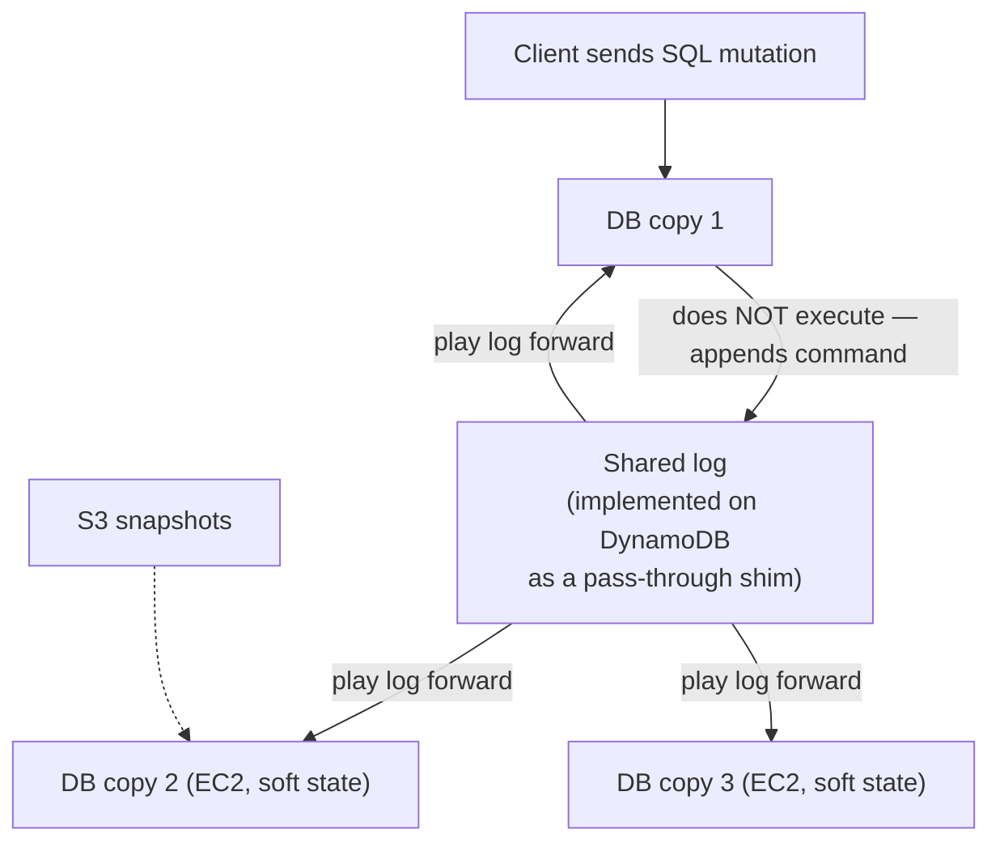

# 08 — Confluent Guest Talk: Cloud-First Kafka on a Shared Log

> Guest speaker from **Confluent** (the company behind Kafka); the transcript renders his name as "Mahesh". Background: PhD at Cornell, Microsoft Research, professor, then Facebook, now Confluent. A 10-minute talk starting at [`1:05:21`](https://www.youtube.com/watch?v=mbelzgz-97s&t=3921).

## What Kafka is, and its architectural problem

- **Publish/subscribe**: producers publish a totally ordered stream to a *topic*, consumers subscribe and pull. The idea came out of academic research in the **'80s and early '90s** ([`1:05:21`](https://www.youtube.com/watch?v=mbelzgz-97s&t=3921), [`1:05:51`](https://www.youtube.com/watch?v=mbelzgz-97s&t=3951)).
- Kafka started as a **LinkedIn project ~10–15 years ago**; founder Jay Kreps turned it into Confluent, now a **billion-dollar-revenue company** ([`1:05:51`](https://www.youtube.com/watch?v=mbelzgz-97s&t=3951), [`1:06:31`](https://www.youtube.com/watch?v=mbelzgz-97s&t=3991)).
- The catch: Kafka was **designed for on-premise**, a **hyperconverged** design where a single broker box does everything. Great to download and run yourself, **not great in the cloud** — where most of the business now is ([`1:06:31`](https://www.youtube.com/watch?v=mbelzgz-97s&t=3991), [`1:07:03`](https://www.youtube.com/watch?v=mbelzgz-97s&t=4023)).
- His mandate on joining Confluent 2–3 years ago: **what would a cloud-first Kafka look like?** ([`1:07:03`](https://www.youtube.com/watch?v=mbelzgz-97s&t=4023)).

## Reframing Kafka as a distributed file system

- A topic partition is basically an **append-only file**; producing appends, consuming reads ([`1:07:03`](https://www.youtube.com/watch?v=mbelzgz-97s&t=4023)).
- So a cloud-first Kafka looks like a distributed file system: compute layer + data layer + **metadata**, where metadata is a map from **topic name → list of data blobs** ([`1:07:03`](https://www.youtube.com/watch?v=mbelzgz-97s&t=4023), [`1:07:47`](https://www.youtube.com/watch?v=mbelzgz-97s&t=4067)).
- Producing = write the data to **S3**, then append a pointer to that S3 location in the metadata linked list; consuming = walk the list ([`1:07:47`](https://www.youtube.com/watch?v=mbelzgz-97s&t=4067), [`1:08:26`](https://www.youtube.com/watch?v=mbelzgz-97s&t=4106)).
- **Conclusion: building cloud-first Kafka is entirely a metadata-store problem** ([`1:08:26`](https://www.youtube.com/watch?v=mbelzgz-97s&t=4106)).

## The two obvious options, and why both fail

| Option | Pros | Cons |
|---|---|---|
| **Put metadata in DynamoDB** ([`1:09:09`](https://www.youtube.com/watch?v=mbelzgz-97s&t=4149)) | Trivial to operate; DynamoDB owns durability, so WAL complexity is someone else's problem ([`1:09:35`](https://www.youtube.com/watch?v=mbelzgz-97s&t=4175)) | **Extremely expensive** — read-heavy workload means a request per read; **chatty** linked-list traversal; **impedance gap** — AWS only offers ~5–10 usable database APIs ([`1:10:00`](https://www.youtube.com/watch?v=mbelzgz-97s&t=4200), [`1:10:16`](https://www.youtube.com/watch?v=mbelzgz-97s&t=4216)) |
| **Build your own DB on EC2** ([`1:10:36`](https://www.youtube.com/watch?v=mbelzgz-97s&t=4236)) | Any properties you want (e.g. a Spanner clone) | Operating a **durable** database in production is **10x–100x harder** than running soft-state servers — quorum loss, data loss as nodes fail ([`1:10:36`](https://www.youtube.com/watch?v=mbelzgz-97s&t=4236), [`1:11:10`](https://www.youtube.com/watch?v=mbelzgz-97s&t=4270)) |

- The real question: **can the cloud own durability** while you keep the cost, latency, and flexibility of your own database? ([`1:11:10`](https://www.youtube.com/watch?v=mbelzgz-97s&t=4270)).

## The answer: a replicated database over a shared log

- Idea originally from **Phil Bernstein** at Microsoft Research, turned into a real system by the speaker: run **multiple copies of any single-node database** (SQLite, MySQL, PostgreSQL, RocksDB, Berkeley DB) and keep them in sync through a **shared log** ([`1:11:34`](https://www.youtube.com/watch?v=mbelzgz-97s&t=4294)).
- A shared log is a fault-tolerant, replicated log sitting **across the network** from the database copies; its implementation can be an arbitrarily complex distributed protocol ([`1:12:21`](https://www.youtube.com/watch?v=mbelzgz-97s&t=4341)).

- Key move: **the database does not execute the command — it appends it to the log**, and every copy plays the log forward to materialize state. "The database is the log" ([`1:12:45`](https://www.youtube.com/watch?v=mbelzgz-97s&t=4365)).
- Benefits: complete separation of the database from the replication framework — any database, any API, unchanged replication logic; only one copy of the database needed; **no quorums at the database layer** ([`1:12:45`](https://www.youtube.com/watch?v=mbelzgz-97s&t=4365)).
- The property that mattered in hindsight: **any consensus protocol can sit under the log API**, so implementations can be virtualized and swapped ([`1:13:44`](https://www.youtube.com/watch?v=mbelzgz-97s&t=4424)).

## The 2013 "dumb idea" that became the design

- Around **2013–2014** he discussed using **S3 as the log** and dismissed it as "such a dumb idea" ([`1:14:00`](https://www.youtube.com/watch?v=mbelzgz-97s&t=4440)).
- In **2024** at Confluent it was the perfect fit: run **RocksDB (or anything) on EC2**, implement the log **directly on DynamoDB as a pass-through shim** ([`1:14:19`](https://www.youtube.com/watch?v=mbelzgz-97s&t=4459), [`1:14:47`](https://www.youtube.com/watch?v=mbelzgz-97s&t=4487)).
- Payoff: reads hit a **full coherent cache on the local EC2 machine** (cost + latency win), while durability lives in DynamoDB — **no EC2 machine holds any hard state**; snapshots go to S3 ([`1:14:47`](https://www.youtube.com/watch?v=mbelzgz-97s&t=4487), [`1:15:15`](https://www.youtube.com/watch?v=mbelzgz-97s&t=4515), [`1:15:32`](https://www.youtube.com/watch?v=mbelzgz-97s&t=4532)).

## Closing argument about research

- As a Cornell student he didn't believe professors that **state machine replication** was widely used in industry — it looked too simple and abstract. Spending time in industry showed him "**all the big ideas are actually coming from academic research**" ([`1:15:32`](https://www.youtube.com/watch?v=mbelzgz-97s&t=4532)).
- You usually **cannot tell at the time** why an idea will be practical, so there is value in "just doing random research" and doing it well; utility shows up later ([`1:16:16`](https://www.youtube.com/watch?v=mbelzgz-97s&t=4576)).
- His own case: the architecture mattered at **Facebook** because they needed simple databases that could evolve over time; at **Confluent** the same design turned out to matter for **saving cost** — something he did not anticipate 10–15 years earlier ([`1:16:42`](https://www.youtube.com/watch?v=mbelzgz-97s&t=4602), [`1:16:55`](https://www.youtube.com/watch?v=mbelzgz-97s&t=4615)).

## Andy's closing tie-back

- "The log he's talking about is basically what this whole class was about" — and with CDC you can replay a log on a **different** DBMS entirely: PostgreSQL WAL → Kafka → MySQL or Snowflake ([`1:17:17`](https://www.youtube.com/watch?v=mbelzgz-97s&t=4637), [`1:17:53`](https://www.youtube.com/watch?v=mbelzgz-97s&t=4673)).
- **Phil Bernstein** trivia: the Harvard professor denied tenure who was mentioned in the earlier OCC lecture (alongside H. T. Kung) — he laid down the core principles of transaction processing, is nearly 80, and is still at Microsoft ([`1:17:53`](https://www.youtube.com/watch?v=mbelzgz-97s&t=4673), [`1:18:16`](https://www.youtube.com/watch?v=mbelzgz-97s&t=4696)).
