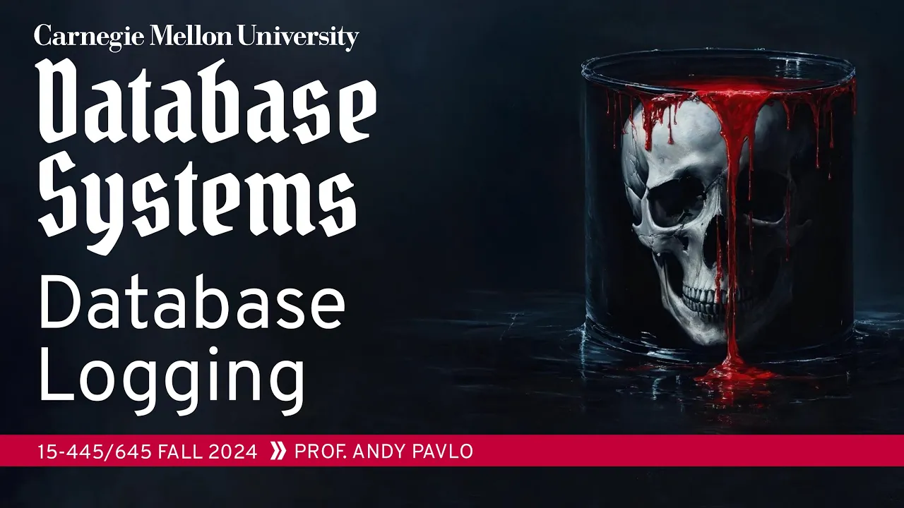
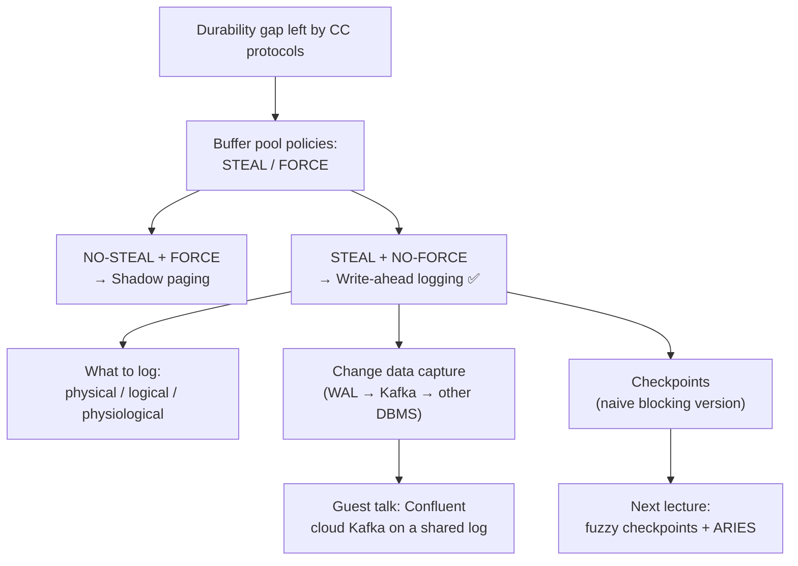

# #20 - Database Logging ✸ Confluent Database Talk (CMU Intro to Database Systems)

*CMU Database Group · 1:19:21 · [watch on YouTube](https://www.youtube.com/watch?v=mbelzgz-97s)*

## Summary

Lecture 20 of CMU 15-445/645 (Fall 2024) covers the **first half of database recovery**: everything a DBMS must do *while transactions are running* so that it can survive a crash later. Andy Pavlo starts from the durability gap left by concurrency control, derives the two buffer pool policies (**STEAL** and **FORCE**) that determine whether UNDO and REDO are needed, then compares the two classic protocols — **shadow paging** (System R, SQLite's rollback journal) and **write-ahead logging** — showing why WAL's STEAL + NO-FORCE quadrant wins by converting random writes into sequential appends. The lecture ends with what actually goes into log records (physical / logical / physiological), a bonus detour into change data capture, and a naive blocking checkpoint scheme, before a 10-minute guest talk from **Confluent** on rebuilding Kafka's cloud metadata store as a replicated database over a shared log.

## Topics

1. [Why Recovery Exists (and course admin)](./01-why-recovery-and-course-admin.md)
2. [Buffer Pool Policies: STEAL and FORCE](./02-buffer-pool-policies-steal-and-force.md)
3. [Shadow Paging](./03-shadow-paging.md)
4. [Write-Ahead Logging (WAL)](./04-write-ahead-logging.md)
5. [What Goes in the Log: Physical, Logical, Physiological](./05-logging-schemes.md)
6. [Change Data Capture (bonus)](./06-change-data-capture.md)
7. [Checkpoints (naive version) and Wrap-Up](./07-checkpoints-and-wrap-up.md)
8. [Confluent Guest Talk: Cloud-First Kafka on a Shared Log](./08-confluent-talk-cloud-kafka-on-a-shared-log.md)

## Key takeaways

- **Write-ahead logging with a STEAL + NO-FORCE buffer pool is the right answer, and effectively every production DBMS uses it.** STEAL lets dirty uncommitted pages be evicted (only once their log records are durable); NO-FORCE means COMMIT flushes only the log ([`1:03:02`](https://www.youtube.com/watch?v=mbelzgz-97s&t=3782), [`1:03:33`](https://www.youtube.com/watch?v=mbelzgz-97s&t=3813)).
- **The win is I/O shape, not just volume.** WAL turns scattered random page writes into sequential appends; updating a billion tuples costs a billion 8 KB page flushes under FORCE versus a much smaller contiguous run of log entries ([`43:00`](https://www.youtube.com/watch?v=mbelzgz-97s&t=2580), [`43:22`](https://www.youtube.com/watch?v=mbelzgz-97s&t=2602)).
- **Shadow paging buys instantaneous recovery and pays for it at runtime.** No UNDO, no REDO, but whole-page-table copies, high commit cost, and file fragmentation that kills sequential scans — which is why IBM's System R design lost to WAL. It is still the right trade in extreme environments, e.g. the 1970s Puerto Rico power company that needed instant recovery because outages were constant ([`26:33`](https://www.youtube.com/watch?v=mbelzgz-97s&t=1593), [`28:30`](https://www.youtube.com/watch?v=mbelzgz-97s&t=1710), [`1:02:34`](https://www.youtube.com/watch?v=mbelzgz-97s&t=3754)).
- **Physiological logging is the industry default.** Physical logging pins the exact byte offset (least flexible), logical logging stores only the query (one string can stand in for a billion tuple changes) but replays at full original cost and breaks under non-determinism or low isolation levels; the hybrid — page number plus slot, offset chosen at recovery — is what most systems store ([`51:51`](https://www.youtube.com/watch?v=mbelzgz-97s&t=3111), [`52:51`](https://www.youtube.com/watch?v=mbelzgz-97s&t=3171), [`53:19`](https://www.youtube.com/watch?v=mbelzgz-97s&t=3199)).
- **Commit durability is usually a lie by default, deliberately.** Most systems do not `fsync` on COMMIT, and group commit batches flushes on a ~5–10 ms timeout with double-buffered log buffers, because SSD writes cost ~1–5 ms and S3 ~100–300 ms ([`37:35`](https://www.youtube.com/watch?v=mbelzgz-97s&t=2255), [`44:14`](https://www.youtube.com/watch?v=mbelzgz-97s&t=2654), [`45:20`](https://www.youtube.com/watch?v=mbelzgz-97s&t=2720)).
- **Checkpoint frequency is a pure runtime-vs-recovery dial with no correct answer** — too frequent starves query execution, too rare means replaying months of log; ~5 minutes is the common default and most people should leave it alone ([`1:01:26`](https://www.youtube.com/watch?v=mbelzgz-97s&t=3686), [`1:01:45`](https://www.youtube.com/watch?v=mbelzgz-97s&t=3705), [`1:03:02`](https://www.youtube.com/watch?v=mbelzgz-97s&t=3782)).
- **The WAL doubles as a replication bus.** Change data capture (Oracle GoldenGate, Debezium) ships the same log to a *different* database — PostgreSQL WAL → Kafka (which guarantees ordering) → MySQL or Snowflake — for free, since the mechanism already exists for recovery ([`54:33`](https://www.youtube.com/watch?v=mbelzgz-97s&t=3273), [`55:41`](https://www.youtube.com/watch?v=mbelzgz-97s&t=3341), [`1:17:53`](https://www.youtube.com/watch?v=mbelzgz-97s&t=4673)).
- **Confluent's cloud-first Kafka reduces to a metadata problem, solved by "the log is the database".** Rather than paying DynamoDB per read or operating their own durable database (10x–100x harder than soft-state servers), they run RocksDB copies on stateless EC2 nodes synchronized through a shared log implemented as a DynamoDB pass-through shim, with snapshots in S3 — an idea from Phil Bernstein that the speaker had dismissed as "a dumb idea" in 2013 ([`1:08:26`](https://www.youtube.com/watch?v=mbelzgz-97s&t=4106), [`1:11:10`](https://www.youtube.com/watch?v=mbelzgz-97s&t=4270), [`1:14:00`](https://www.youtube.com/watch?v=mbelzgz-97s&t=4440), [`1:14:47`](https://www.youtube.com/watch?v=mbelzgz-97s&t=4487)).
