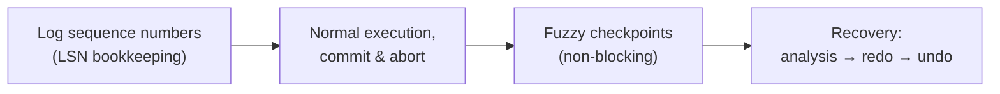

# 02 - The three core ideas of ARIES

ARIES rests on exactly three ideas ([`6:07`](https://www.youtube.com/watch?v=yVpzHdAP0TY&t=367)).

## 1. Write-ahead logging

- Every page modification produces a log entry describing the change ([`6:07`](https://www.youtube.com/watch?v=yVpzHdAP0TY&t=367)).
- A log record must reach disk **before** the corresponding dirty page may be stolen, and before commit is acknowledged. This is just STEAL + NO-FORCE restated ([`6:07`](https://www.youtube.com/watch?v=yVpzHdAP0TY&t=367)).

## 2. Repeat history during redo

- On restart, ARIES picks a point in the WAL and **replays every entry** forward to the end of the log ([`6:34`](https://www.youtube.com/watch?v=yVpzHdAP0TY&t=394)).
- It replays even changes that may already be on disk. Rationale: there is **no log record saying "this page was flushed"**, so guessing is impossible — reapplying is cheaper than being wrong ([`6:34`](https://www.youtube.com/watch?v=yVpzHdAP0TY&t=394)).
- This guarantees the database is put back into exactly the state it was in at the moment of the crash ([`7:22`](https://www.youtube.com/watch?v=yVpzHdAP0TY&t=442)).

## 3. Log changes during undo

- Rolling back an aborted transaction generates **new log records** for the reversals, exactly as if the transaction itself had issued the inverse updates ([`7:22`](https://www.youtube.com/watch?v=yVpzHdAP0TY&t=442), [`7:35`](https://www.youtube.com/watch?v=yVpzHdAP0TY&t=455)).
- These reversal records are marked as belonging to the undo process rather than normal execution ([`7:35`](https://www.youtube.com/watch?v=yVpzHdAP0TY&t=455)).
- Not logging undo would be faster, but ARIES chooses verbosity to guarantee correctness ([`7:49`](https://www.youtube.com/watch?v=yVpzHdAP0TY&t=469)).

## Lecture roadmap

Announced at [`8:05`](https://www.youtube.com/watch?v=yVpzHdAP0TY&t=485):

