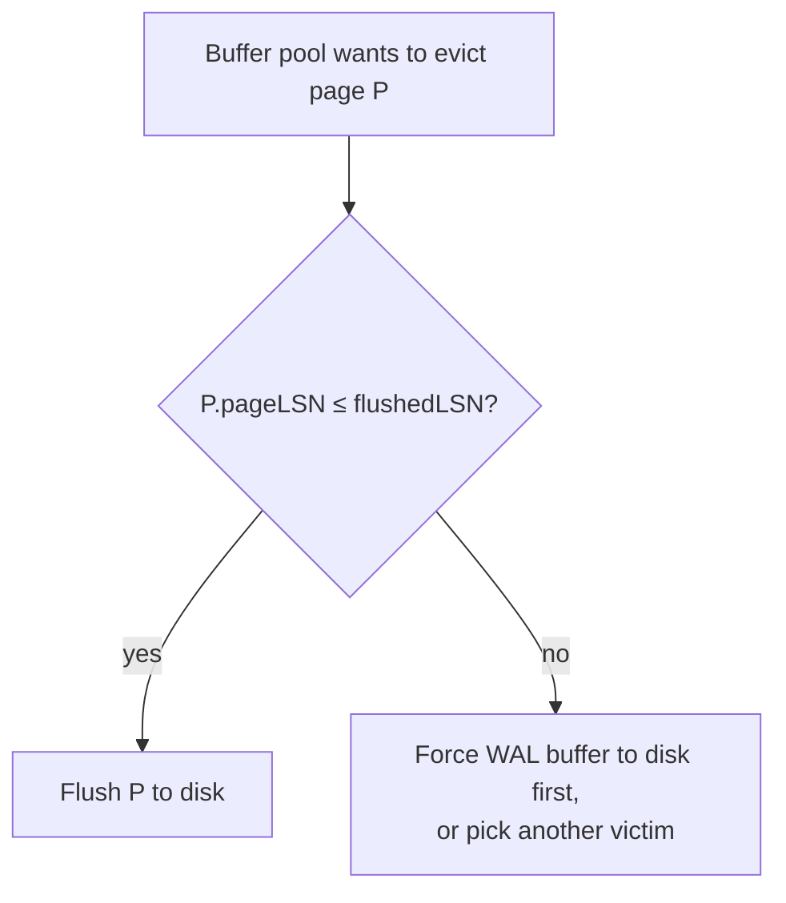

# 03 - Log sequence numbers (LSNs)

## Why they exist

- Delimiters alone are not enough: recovery logs can be gigabytes or terabytes, and the system needs to identify each record individually and know the *order* of records for a given transaction ([`8:52`](https://www.youtube.com/watch?v=yVpzHdAP0TY&t=532)).
- An LSN is a **monotonically increasing counter**, incremented by one per log record — synthetic like the timestamps used in concurrency control, but used for ordering log events ([`8:52`](https://www.youtube.com/watch?v=yVpzHdAP0TY&t=532)).

## The LSN family

| Name | Where it lives | What it records |
|---|---|---|
| `LSN` | every log record | global monotonic counter for that record ([`8:52`](https://www.youtube.com/watch?v=yVpzHdAP0TY&t=532)) |
| `pageLSN` | every page (memory and disk) | LSN of the **last** update applied to that page ([`9:54`](https://www.youtube.com/watch?v=yVpzHdAP0TY&t=594)) |
| `flushedLSN` | in-memory, global | largest LSN that has actually been flushed from the WAL buffer to disk ([`10:31`](https://www.youtube.com/watch?v=yVpzHdAP0TY&t=631)) |
| `recLSN` | dirty page table entry | LSN of the **oldest/first** update that dirtied the page since it was last flushed — tells redo how far back to jump ([`11:14`](https://www.youtube.com/watch?v=yVpzHdAP0TY&t=674), [`11:47`](https://www.youtube.com/watch?v=yVpzHdAP0TY&t=707)) |
| `lastLSN` | active transaction table entry | most recent log record created by that transaction ([`11:47`](https://www.youtube.com/watch?v=yVpzHdAP0TY&t=707)) |
| `MasterRecord` | global, on disk | LSN of the last successful checkpoint — the entry point into the log after a crash ([`11:47`](https://www.youtube.com/watch?v=yVpzHdAP0TY&t=707)) |

The MasterRecord exists precisely to avoid scanning the entire log, which could span terabytes depending on retention and throughput ([`12:25`](https://www.youtube.com/watch?v=yVpzHdAP0TY&t=745)).

## The flush rule

The buffer pool may write a page to disk **only if** `pageLSN ≤ flushedLSN` ([`10:31`](https://www.youtube.com/watch?v=yVpzHdAP0TY&t=631), [`13:18`](https://www.youtube.com/watch?v=yVpzHdAP0TY&t=798)).

- If `pageLSN` points into the on-disk portion of the log → safe to flush ([`13:18`](https://www.youtube.com/watch?v=yVpzHdAP0TY&t=798)).
- If `pageLSN > flushedLSN` (the record is still only in the in-memory log buffer) → the eviction policy must either force the log record out first, or pick a different victim page ([`13:52`](https://www.youtube.com/watch?v=yVpzHdAP0TY&t=832)).
- Project 1 did not require these checks because it had no notion of LSNs ([`14:13`](https://www.youtube.com/watch?v=yVpzHdAP0TY&t=853)).

## Maintenance rules

- Every log record gets an LSN ([`14:26`](https://www.youtube.com/watch?v=yVpzHdAP0TY&t=866)).
- `pageLSN` is updated on every page modification ([`14:26`](https://www.youtube.com/watch?v=yVpzHdAP0TY&t=866)).
- `flushedLSN` is updated every time the in-memory WAL buffer is written to disk ([`14:26`](https://www.youtube.com/watch?v=yVpzHdAP0TY&t=866)).
