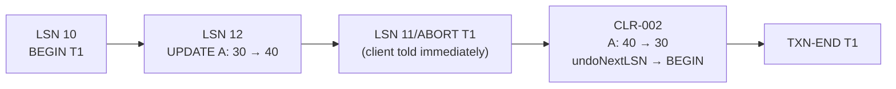

# 05 - Aborts and Compensation Log Records (CLRs)

## Aborting is a special kind of update

- In ARIES an abort is treated as the transaction issuing inverse updates; the reversals are logged like normal updates but flagged as part of the undo process ([`19:07`](https://www.youtube.com/watch?v=yVpzHdAP0TY&t=1147)).

## `prevLSN` — the per-transaction linked list

- Every log record carries a `prevLSN` pointing at the previous record of the **same** transaction; the first record has `prevLSN = nil` ([`19:40`](https://www.youtube.com/watch?v=yVpzHdAP0TY&t=1180), [`20:30`](https://www.youtube.com/watch?v=yVpzHdAP0TY&t=1230)).
- It forms a backwards linked list so undo can walk a transaction's records in reverse order without scanning the whole log — essential when many transactions interleave their records ([`20:03`](https://www.youtube.com/watch?v=yVpzHdAP0TY&t=1203), [`20:30`](https://www.youtube.com/watch?v=yVpzHdAP0TY&t=1230)).
- **Needed for efficiency, not for correctness** ([`20:03`](https://www.youtube.com/watch?v=yVpzHdAP0TY&t=1203)).

## The Compensation Log Record

- A **CLR** is the logged reversal of an update, restoring the previous version of the value ([`21:22`](https://www.youtube.com/watch?v=yVpzHdAP0TY&t=1282)).
- This is exactly why log records store **both** before and after values ([`21:22`](https://www.youtube.com/watch?v=yVpzHdAP0TY&t=1282)).
- It requires **physiological/physical logging** — absolute values, not logical operations. `value = value + 1` inverted by `value = value - 1` is not acceptable; the exact prior value must be reinstalled ([`21:50`](https://www.youtube.com/watch?v=yVpzHdAP0TY&t=1310), [`22:16`](https://www.youtube.com/watch?v=yVpzHdAP0TY&t=1336)).
- CLRs **do not need to be flushed immediately** — the client can be told "aborted" as soon as the abort is recorded, so the CLRs are written out lazily ([`22:16`](https://www.youtube.com/watch?v=yVpzHdAP0TY&t=1336), [`22:37`](https://www.youtube.com/watch?v=yVpzHdAP0TY&t=1357)).
- **CLRs are never undone.** If a crash interrupts a rollback halfway (e.g. 2 of 5 tuples compensated), recovery does not generate new CLRs for the already-compensated updates — it simply redoes the existing CLRs ([`29:04`](https://www.youtube.com/watch?v=yVpzHdAP0TY&t=1744)).

## `undoNextLSN` vs. `prevLSN`

- A CLR carries an extra `undoNextLSN` field: the next LSN that still needs undoing ([`22:53`](https://www.youtube.com/watch?v=yVpzHdAP0TY&t=1373), [`24:05`](https://www.youtube.com/watch?v=yVpzHdAP0TY&t=1445)).
- The two differ: in the lecture's example the CLR's `prevLSN` points at the ABORT record (LSN 11), while `undoNextLSN` skips the bookkeeping records and points at the real work still to reverse ([`24:05`](https://www.youtube.com/watch?v=yVpzHdAP0TY&t=1445), [`24:22`](https://www.youtube.com/watch?v=yVpzHdAP0TY&t=1462)).
- Summary: `prevLSN` = log-order chain of what the transaction did; `undoNextLSN` = chain of what still must be reversed, skipping aborts and other metadata ([`24:41`](https://www.youtube.com/watch?v=yVpzHdAP0TY&t=1481)).
- When following `undoNextLSN` reaches the BEGIN record, the rollback is complete and TXN-END is appended ([`24:59`](https://www.youtube.com/watch?v=yVpzHdAP0TY&t=1499)).

## The abort algorithm

1. Write the ABORT record ([`28:16`](https://www.youtube.com/watch?v=yVpzHdAP0TY&t=1696)).
2. Tell the client it aborted (no waiting required) ([`23:05`](https://www.youtube.com/watch?v=yVpzHdAP0TY&t=1385)).
3. Walk the transaction's write set in **reverse** order of application ([`28:16`](https://www.youtube.com/watch?v=yVpzHdAP0TY&t=1696)).
4. For each undone change: write a CLR, then restore the old value ([`28:49`](https://www.youtube.com/watch?v=yVpzHdAP0TY&t=1729)).
5. Write TXN-END ([`28:49`](https://www.youtube.com/watch?v=yVpzHdAP0TY&t=1729)).

## Q&A: granularity

- Two updates → two separate CLRs. Update A then B; on abort, reverse B first, then A ([`26:35`](https://www.youtube.com/watch?v=yVpzHdAP0TY&t=1595)).
- Even updating 3 fields of A and 7 fields of B produces individual WAL entries per update ([`27:00`](https://www.youtube.com/watch?v=yVpzHdAP0TY&t=1620)).
- Real-system exception: in PostgreSQL, the *first* update after a page is brought into memory logs the **entire page contents**; subsequent updates while the page stays resident are fine-grained. Original ARIES did not require this ([`27:52`](https://www.youtube.com/watch?v=yVpzHdAP0TY&t=1672), [`28:16`](https://www.youtube.com/watch?v=yVpzHdAP0TY&t=1696)).
