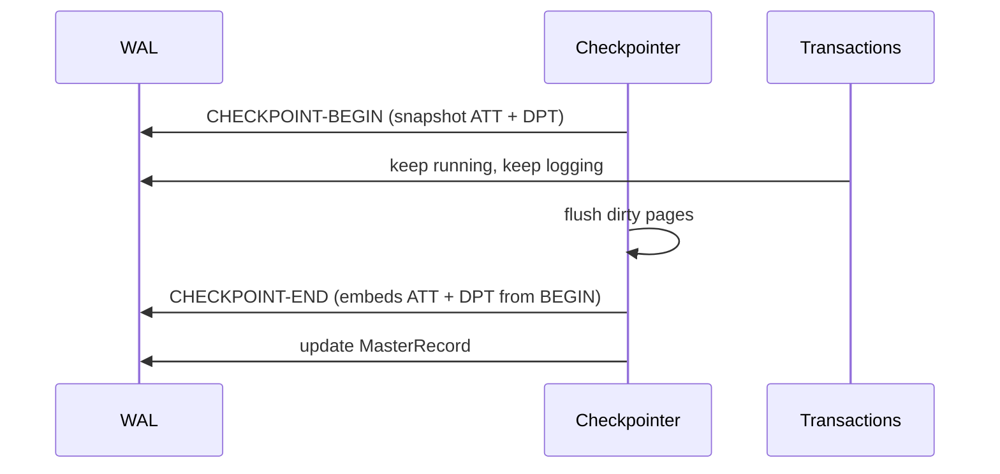

# 06 - Checkpoints: from stop-the-world to fuzzy

## Why checkpoints are needed

The WAL grows forever. Without checkpoints, recovery would replay everything — including CLRs from a transaction that aborted 30 days ago ([`29:33`](https://www.youtube.com/watch?v=yVpzHdAP0TY&t=1773)).

## Attempt 1 — blocking checkpoint (bad)

- Halt new transactions, let all active transactions **run to completion**, then take the checkpoint ([`30:08`](https://www.youtube.com/watch?v=yVpzHdAP0TY&t=1808)).
- Recovery becomes trivial: the checkpoint is a consistent snapshot with no partial updates, so only log entries *after* it need replaying ([`30:40`](https://www.youtube.com/watch?v=yVpzHdAP0TY&t=1840)).
- **Fatal flaw**: one long transaction blocks everything. If a second transaction runs for three days, the system stalls for three days ([`30:55`](https://www.youtube.com/watch?v=yVpzHdAP0TY&t=1855)).

## Attempt 2 — pause queries mid-flight (still bad)

- Pause running queries wherever they are, write out dirty pages, then resume ([`31:20`](https://www.youtube.com/watch?v=yVpzHdAP0TY&t=1880), [`31:36`](https://www.youtube.com/watch?v=yVpzHdAP0TY&t=1896)).
- **Fatal flaw: partial updates** ([`31:56`](https://www.youtube.com/watch?v=yVpzHdAP0TY&t=1916)). Concrete example with a 3-page buffer pool ([`32:14`](https://www.youtube.com/watch?v=yVpzHdAP0TY&t=1934)):
  - A checkpoint is a sequential scan of buffer-pool pages, writing them out top to bottom.
  - The transaction modified page 3, which the scan picks up and writes.
  - After resuming, the transaction modifies page 1 — already scanned past, so the change is missed.
  - On crash, only **half** of the transaction's changes are on disk ([`32:35`](https://www.youtube.com/watch?v=yVpzHdAP0TY&t=1955)).
- The fix is not to abandon the approach but to add metadata plus explicit begin/end markers in the log ([`33:03`](https://www.youtube.com/watch?v=yVpzHdAP0TY&t=1983)).

## The two metadata tables

### Active Transaction Table (ATT)

In-memory hash table, one entry per live transaction ([`33:30`](https://www.youtube.com/watch?v=yVpzHdAP0TY&t=2010)):

- `txnId`
- `status` — running / committing / candidate-for-undo. During normal execution everything is *running* unless a commit or abort is seen ([`33:30`](https://www.youtube.com/watch?v=yVpzHdAP0TY&t=2010)).
- `lastLSN` — most recent record from that transaction ([`34:05`](https://www.youtube.com/watch?v=yVpzHdAP0TY&t=2045)).
- **During recovery every transaction is initially assumed to be aborting**; the log then upgrades it to committed ([`34:05`](https://www.youtube.com/watch?v=yVpzHdAP0TY&t=2045)).
- An entry is removed only when TXN-END is seen — which is exactly why TXN-END exists, since an aborting transaction may still be emitting CLRs while the checkpoint runs ([`34:30`](https://www.youtube.com/watch?v=yVpzHdAP0TY&t=2070), [`34:47`](https://www.youtube.com/watch?v=yVpzHdAP0TY&t=2087)).

### Dirty Page Table (DPT)

- One entry per buffer-pool page that is dirty and not yet flushed ([`35:07`](https://www.youtube.com/watch?v=yVpzHdAP0TY&t=2107)).
- Each entry stores `recLSN`: the LSN of the log record that **first** dirtied the page. Reading a page in does not create an entry; the first modification does ([`35:07`](https://www.youtube.com/watch?v=yVpzHdAP0TY&t=2107), [`35:33`](https://www.youtube.com/watch?v=yVpzHdAP0TY&t=2133)).

## Fuzzy checkpoints — the ARIES answer

- Write a **CHECKPOINT-BEGIN** record when the checkpoint starts, then let transactions keep running while the checkpoint proceeds ([`37:19`](https://www.youtube.com/watch?v=yVpzHdAP0TY&t=2239)).
- Write a **CHECKPOINT-END** record when it completes, embedding the ATT and DPT **as observed at the begin point** ([`37:37`](https://www.youtube.com/watch?v=yVpzHdAP0TY&t=2257), [`37:51`](https://www.youtube.com/watch?v=yVpzHdAP0TY&t=2271)).
- Recovery reads CHECKPOINT-END, learns the state at CHECKPOINT-BEGIN, and then examines all log records **between** the two markers to see what may have changed in the gap ([`37:51`](https://www.youtube.com/watch?v=yVpzHdAP0TY&t=2271), [`38:17`](https://www.youtube.com/watch?v=yVpzHdAP0TY&t=2297)).
- No transactions are stalled ([`37:19`](https://www.youtube.com/watch?v=yVpzHdAP0TY&t=2239), [`1:09:20`](https://www.youtube.com/watch?v=yVpzHdAP0TY&t=4160)).

## Example walkthrough

- First checkpoint: page 11 already flushed (absent from DPT); ATT knows T2; DPT holds page 22 ([`36:21`](https://www.youtube.com/watch?v=yVpzHdAP0TY&t=2181) area, [`35:49`](https://www.youtube.com/watch?v=yVpzHdAP0TY&t=2149)).
- Second checkpoint: ATT holds T2 **and** T3 (T3 started after the first checkpoint); DPT holds pages 11 and 33 ([`36:21`](https://www.youtube.com/watch?v=yVpzHdAP0TY&t=2181)).
- With CHECKPOINT-BEGIN at LSN 7 and CHECKPOINT-END at LSN 10, the ATT entry for T2 is a **hint** to recovery: "T2 was doing something before the checkpoint — go find out what and either reapply or reverse it" ([`38:17`](https://www.youtube.com/watch?v=yVpzHdAP0TY&t=2297), [`38:38`](https://www.youtube.com/watch?v=yVpzHdAP0TY&t=2318)).

## Q&A: what the DPT does and does not tell you

- A DPT entry does **not** prove the page was never written out. The page may have been flushed during the checkpoint and then modified again by another transaction ([`39:41`](https://www.youtube.com/watch?v=yVpzHdAP0TY&t=2381), [`40:06`](https://www.youtube.com/watch?v=yVpzHdAP0TY&t=2406)).
- The root cause: **there is no log record saying "this page was flushed"**, so the system can only reason from LSNs ([`40:06`](https://www.youtube.com/watch?v=yVpzHdAP0TY&t=2406), [`40:32`](https://www.youtube.com/watch?v=yVpzHdAP0TY&t=2432)).

## MasterRecord update

Once CHECKPOINT-END is successfully flushed, the MasterRecord is updated to point at that checkpoint — the jump-in point for the next recovery ([`40:59`](https://www.youtube.com/watch?v=yVpzHdAP0TY&t=2459)).
