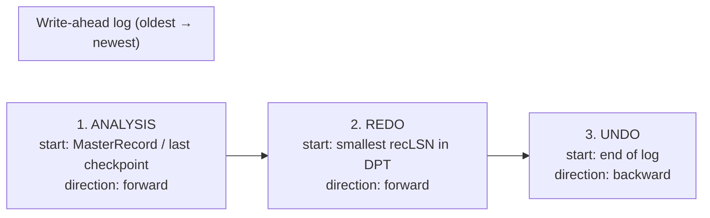

# 07 - The three phases of ARIES recovery

LSNs + CLRs + TXN-END + fuzzy checkpoints together are enough to recover the database. ARIES recovery is a three-phase protocol ([`41:22`](https://www.youtube.com/watch?v=yVpzHdAP0TY&t=2482)).

| Phase | Entry point | Direction | Output |
|---|---|---|---|
| Analysis | last checkpoint (via MasterRecord) | forward to end of log | rebuilt ATT + DPT ([`41:22`](https://www.youtube.com/watch?v=yVpzHdAP0TY&t=2482), [`41:58`](https://www.youtube.com/watch?v=yVpzHdAP0TY&t=2518)) |
| Redo | smallest `recLSN` in the DPT | forward to end of log | database in exactly its pre-crash state ([`46:09`](https://www.youtube.com/watch?v=yVpzHdAP0TY&t=2769), [`46:43`](https://www.youtube.com/watch?v=yVpzHdAP0TY&t=2803)) |
| Undo | oldest record of each loser transaction | backward | losers rolled back, CLRs appended ([`42:28`](https://www.youtube.com/watch?v=yVpzHdAP0TY&t=2548), [`47:42`](https://www.youtube.com/watch?v=yVpzHdAP0TY&t=2862)) |

---

## Phase 1 — Analysis

- Start at the last checkpoint, scan **forward** to the end of the log, reconstructing what was running and what was dirty ([`41:22`](https://www.youtube.com/watch?v=yVpzHdAP0TY&t=2482), [`42:47`](https://www.youtube.com/watch?v=yVpzHdAP0TY&t=2567)).
- Rules ([`48:25`](https://www.youtube.com/watch?v=yVpzHdAP0TY&t=2905), [`48:52`](https://www.youtube.com/watch?v=yVpzHdAP0TY&t=2932)):
  - On first seeing a transaction: add it to the ATT with status **candidate for undo**.
  - On COMMIT: change its status to committed.
  - On TXN-END: remove it from the ATT.
  - On an update record whose page is not in the DPT: add the page with this record's LSN as its `recLSN`.
- End state: the ATT lists every transaction active at the crash; the DPT lists every page that may not have reached disk ([`49:08`](https://www.youtube.com/watch?v=yVpzHdAP0TY&t=2948), [`49:32`](https://www.youtube.com/watch?v=yVpzHdAP0TY&t=2972)).

### Worked example ([`49:32`](https://www.youtube.com/watch?v=yVpzHdAP0TY&t=2972) onward)

1. See activity from **T96** with no BEGIN since the checkpoint → it must have started before CHECKPOINT-BEGIN. Add to ATT with status "undo" ([`49:53`](https://www.youtube.com/watch?v=yVpzHdAP0TY&t=2993), [`50:22`](https://www.youtube.com/watch?v=yVpzHdAP0TY&t=3022)).
2. T96 modified page 33 → add page 33 to DPT with its `recLSN` ([`50:22`](https://www.youtube.com/watch?v=yVpzHdAP0TY&t=3022)).
3. CHECKPOINT-END reveals a further transaction **T97** and dirty page 20 with `recLSN` 8, both from before the checkpoint began ([`50:42`](https://www.youtube.com/watch?v=yVpzHdAP0TY&t=3042)).
4. COMMIT for T96 → status flips to committed; T97 remains a candidate for undo ([`51:09`](https://www.youtube.com/watch?v=yVpzHdAP0TY&t=3069)).
5. TXN-END for T96 → removed from the ATT ([`51:26`](https://www.youtube.com/watch?v=yVpzHdAP0TY&t=3086)).

### Q&A: why not drop a transaction at COMMIT instead of TXN-END?

Because a committed transaction may still own an entry in the dirty page table. The DPT stores a `recLSN` but not the owning transaction — the mapping is only implicit. To know whether the change behind `recLSN` 20 committed, the transaction must still be in the ATT ([`51:42`](https://www.youtube.com/watch?v=yVpzHdAP0TY&t=3102), [`52:10`](https://www.youtube.com/watch?v=yVpzHdAP0TY&t=3130), [`52:41`](https://www.youtube.com/watch?v=yVpzHdAP0TY&t=3161)).

---

## Phase 2 — Redo (repeat history)

- Jump to the **smallest `recLSN`** found in the DPT and scan forward, replaying every update and every CLR ([`46:09`](https://www.youtube.com/watch?v=yVpzHdAP0TY&t=2769), [`54:04`](https://www.youtube.com/watch?v=yVpzHdAP0TY&t=3244)).
- **Everything is replayed**, including changes made by transactions already known to be losers — the goal is to restore the exact pre-crash state ([`42:12`](https://www.youtube.com/watch?v=yVpzHdAP0TY&t=2532), [`53:17`](https://www.youtube.com/watch?v=yVpzHdAP0TY&t=3197)).
- For an aborted transaction, redo applies its updates, sees the ABORT, then applies its CLRs, then its TXN-END ([`47:11`](https://www.youtube.com/watch?v=yVpzHdAP0TY&t=2831)).
- Collapsing several updates to the same page into one write is a *possible* optimization, explicitly rejected in favour of caution: "it's going to seem very wasteful, but if it's your data you don't want to lose it" ([`53:47`](https://www.youtube.com/watch?v=yVpzHdAP0TY&t=3227), [`54:04`](https://www.youtube.com/watch?v=yVpzHdAP0TY&t=3244)).

### Skip conditions ([`54:32`](https://www.youtube.com/watch?v=yVpzHdAP0TY&t=3272), [`54:54`](https://www.youtube.com/watch?v=yVpzHdAP0TY&t=3294), [`55:16`](https://www.youtube.com/watch?v=yVpzHdAP0TY&t=3316))

A record may be skipped when:
- the page is **not** in the DPT (it was never in memory dirty — nothing to do), or
- the page is in the DPT but the record's LSN < the page's `recLSN`, or
- the page's `pageLSN` on disk is **newer** than the record being replayed — proof the change already made it out.

Otherwise the change must be reapplied.

### Applying a redo ([`55:43`](https://www.youtube.com/watch?v=yVpzHdAP0TY&t=3343), [`55:56`](https://www.youtube.com/watch?v=yVpzHdAP0TY&t=3356))

- Replay the entry (updates and CLRs are handled identically) and set `pageLSN` to that record's LSN.
- **No additional logging** during redo — the WAL already says what to do; a redundant log would be pointless.
- **No flushing on COMMIT** during redo, because no new transactions are allowed to run yet.

### End of redo ([`56:23`](https://www.youtube.com/watch?v=yVpzHdAP0TY&t=3383))

For any committed transaction still in the ATT (no TXN-END seen), write TXN-END and remove it. After redo, **only non-committed transactions remain in the ATT**.

---

## Phase 3 — Undo

- Every transaction still in the ATT is a loser: no COMMIT, or an ABORT without a TXN-END ([`56:47`](https://www.youtube.com/watch?v=yVpzHdAP0TY&t=3407)).
- Process them in **reverse** order, following `undoNextLSN` to jump straight to the records that need reversing instead of scanning the whole log ([`56:47`](https://www.youtube.com/watch?v=yVpzHdAP0TY&t=3407), [`57:27`](https://www.youtube.com/watch?v=yVpzHdAP0TY&t=3447)).
- Committed transactions are skipped entirely ([`47:42`](https://www.youtube.com/watch?v=yVpzHdAP0TY&t=2862)).
- Each reversal appends a **new CLR**; CLRs themselves are never compensated, because a crash mid-undo is handled by redoing the already-written CLRs ([`57:27`](https://www.youtube.com/watch?v=yVpzHdAP0TY&t=3447), [`57:57`](https://www.youtube.com/watch?v=yVpzHdAP0TY&t=3477)).
- Undo does **not** actually need the DPT — it only needs the ATT plus the `undoNext` chain ([`1:03:46`](https://www.youtube.com/watch?v=yVpzHdAP0TY&t=3826)).
- When `undoNextLSN` leads back to the transaction's original (non-CLR) starting update and there is nothing further, the rollback is complete and TXN-END is written ([`1:04:12`](https://www.youtube.com/watch?v=yVpzHdAP0TY&t=3852), [`1:04:44`](https://www.youtube.com/watch?v=yVpzHdAP0TY&t=3884)).

## Note on concurrency control

- ARIES sits *below* concurrency control: a lock manager and strong strict 2PL already decided who may modify what, so the LSN order in the log is the order in which transactions applied changes ([`45:11`](https://www.youtube.com/watch?v=yVpzHdAP0TY&t=2711), [`46:09`](https://www.youtube.com/watch?v=yVpzHdAP0TY&t=2769)).
- Replaying the log therefore cannot reorder transactions under serializable ordering. **Multi-versioning or lower isolation levels complicate this substantially** and are out of scope ([`45:39`](https://www.youtube.com/watch?v=yVpzHdAP0TY&t=2739)).
