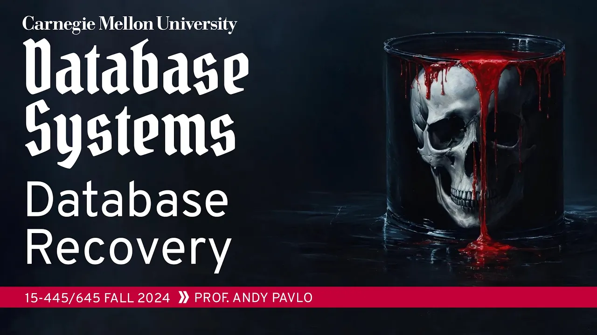
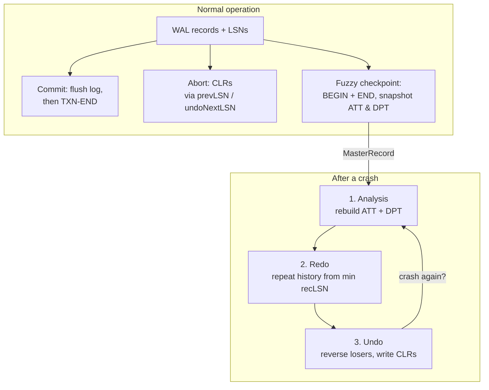

# #21 - Database Recovery with ARIES (CMU Intro to Database Systems)

*CMU Database Group · 1:12:55 · [Watch on YouTube](https://www.youtube.com/watch?v=yVpzHdAP0TY)*

## Summary

University lecture (CMU 15-445/645, Fall 2024) on **ARIES**, the canonical crash-recovery protocol for disk-oriented database systems. Building on the previous lecture's write-ahead log, it explains how a DBMS running under a STEAL + NO-FORCE buffer pool policy restarts after an unclean shutdown and restores atomicity, consistency and durability: log sequence numbers and the page/flush/rec/last LSN bookkeeping, transaction commit and abort with compensation log records, non-blocking fuzzy checkpoints backed by the Active Transaction Table and Dirty Page Table, and finally the three-phase recovery algorithm — analysis, redo, undo. The lecture closes with the property that distinguished ARIES from earlier protocols: it recovers correctly even when the system crashes *during* recovery.

## Topics

1. [Introduction and recovery goals](./01-introduction-and-recovery-goals.md) — why recovery is hard, STEAL/NO-FORCE, the T1/T2/T3 target scenario, and the lecture's assumptions ([`0:27`](https://www.youtube.com/watch?v=yVpzHdAP0TY&t=27))
2. [The three core ideas of ARIES](./02-the-three-core-ideas-of-aries.md) — WAL, repeat history during redo, log changes during undo ([`6:07`](https://www.youtube.com/watch?v=yVpzHdAP0TY&t=367))
3. [Log sequence numbers](./03-log-sequence-numbers.md) — LSN, pageLSN, flushedLSN, recLSN, lastLSN, MasterRecord and the flush rule ([`8:39`](https://www.youtube.com/watch?v=yVpzHdAP0TY&t=519))
4. [Normal execution and the commit protocol](./04-normal-execution-and-commit.md) — what gets logged, commit steps, COMMIT vs. TXN-END ([`14:44`](https://www.youtube.com/watch?v=yVpzHdAP0TY&t=884))
5. [Aborts and Compensation Log Records](./05-aborts-and-compensation-log-records.md) — prevLSN, CLRs, undoNextLSN, physical logging ([`19:07`](https://www.youtube.com/watch?v=yVpzHdAP0TY&t=1147))
6. [Checkpoints: from stop-the-world to fuzzy](./06-checkpoints-from-stop-the-world-to-fuzzy.md) — two bad designs, the ATT and DPT, fuzzy checkpoints ([`29:33`](https://www.youtube.com/watch?v=yVpzHdAP0TY&t=1773))
7. [The three phases of ARIES recovery](./07-the-three-phases-of-aries-recovery.md) — analysis, redo, undo in detail ([`41:22`](https://www.youtube.com/watch?v=yVpzHdAP0TY&t=2482))
8. [Full example, and crashing during recovery](./08-full-example-and-crashing-during-recovery.md) — end-to-end walkthrough plus a second crash mid-recovery ([`57:57`](https://www.youtube.com/watch?v=yVpzHdAP0TY&t=3477))
9. [Optimizations and wrap-up](./09-optimizations-and-wrap-up.md) — faster redo/undo, protocol recap, distributed databases preview ([`1:06:58`](https://www.youtube.com/watch?v=yVpzHdAP0TY&t=4018))

## Structure at a glance

## Key takeaways

- ARIES (paper ~1992, ~70 pages) is the canonical recovery protocol; earlier protocols optimized for particular cases and missed corner cases, and its distinguishing correctness property is surviving a crash **during** recovery ([`5:08`](https://www.youtube.com/watch?v=yVpzHdAP0TY&t=308), [`5:38`](https://www.youtube.com/watch?v=yVpzHdAP0TY&t=338), [`1:01:18`](https://www.youtube.com/watch?v=yVpzHdAP0TY&t=3678)).
- Redo deliberately **repeats all history**, replaying even changes that may already be on disk, because no log record records that a page was flushed — LSN comparison (`pageLSN` vs. the record's LSN) is the only available evidence ([`6:34`](https://www.youtube.com/watch?v=yVpzHdAP0TY&t=394), [`1:09:29`](https://www.youtube.com/watch?v=yVpzHdAP0TY&t=4169)).
- The flush rule that makes STEAL safe is a single comparison: a page may be written to disk only if `pageLSN ≤ flushedLSN`; otherwise force the log first or evict a different page ([`10:31`](https://www.youtube.com/watch?v=yVpzHdAP0TY&t=631), [`13:52`](https://www.youtube.com/watch?v=yVpzHdAP0TY&t=832)).
- Undo work must itself be logged as CLRs storing **absolute before/after values** (physical/physiological logging, not `value = value - 1`), and CLRs are never undone — a crash mid-rollback simply redoes the CLRs already written, so each recovery attempt has strictly less undo work and the process converges ([`21:50`](https://www.youtube.com/watch?v=yVpzHdAP0TY&t=1310), [`29:04`](https://www.youtube.com/watch?v=yVpzHdAP0TY&t=1744), [`1:06:28`](https://www.youtube.com/watch?v=yVpzHdAP0TY&t=3988)).
- Blocking checkpoints are unusable (one three-day transaction stalls the system) and naive pause-and-scan checkpoints produce partial updates; fuzzy checkpoints solve both by bracketing the checkpoint with BEGIN/END records that carry the ATT and DPT snapshot, stalling nothing ([`30:55`](https://www.youtube.com/watch?v=yVpzHdAP0TY&t=1855), [`32:14`](https://www.youtube.com/watch?v=yVpzHdAP0TY&t=1934), [`37:19`](https://www.youtube.com/watch?v=yVpzHdAP0TY&t=2239)).
- A transaction cannot be dropped from the ATT at COMMIT — only at TXN-END — because the DPT records a `recLSN` without its owning transaction, so recovery would lose the ability to tell whether the change behind that page committed ([`52:10`](https://www.youtube.com/watch?v=yVpzHdAP0TY&t=3130), [`52:41`](https://www.youtube.com/watch?v=yVpzHdAP0TY&t=3161)).
- Real systems diverge from the paper where it is safe to: original ARIES flushes the log and all dirty pages at TXN-END during undo, but most systems skip it since no real queries are running; PostgreSQL logs a page's full contents on its first in-memory update; and lazy per-page incremental undo exists only as a paper, implemented by no system ([`1:00:36`](https://www.youtube.com/watch?v=yVpzHdAP0TY&t=3636), [`27:52`](https://www.youtube.com/watch?v=yVpzHdAP0TY&t=1672), [`1:07:30`](https://www.youtube.com/watch?v=yVpzHdAP0TY&t=4050)).
- The lecture marks a course milestone: at this point a student can build a complete single-node DBMS, and the recommendation is to exhaust a single box before going distributed, since ~99% of workloads never need a distributed database ([`1:10:17`](https://www.youtube.com/watch?v=yVpzHdAP0TY&t=4217), [`1:11:45`](https://www.youtube.com/watch?v=yVpzHdAP0TY&t=4305)).

---

The full [transcript](./transcript.md) is included in this folder.
