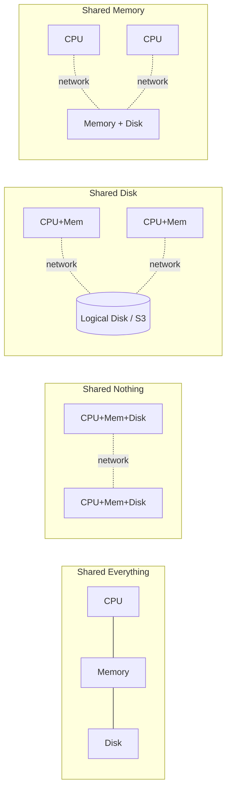

# 02 — System Architectures: The Four-Way Classification

## The defining question

- A system architecture specifies **which shared resources are directly accessible by a CPU**. It boils down to two questions: *where is the memory?* and *where is the disk?* [`8:23`](https://www.youtube.com/watch?v=o7bjRUcDMx0&t=503)
- The answer dictates what messages must be sent, who sends them, and how CPUs coordinate [`8:23`](https://www.youtube.com/watch?v=o7bjRUcDMx0&t=503).

## Shared everything

- Everything done in the course so far: one node with its own CPU, memory and disk. BusTub and Postgres, if you ignore replication [`8:56`](https://www.youtube.com/watch?v=o7bjRUcDMx0&t=536) [`9:16`](https://www.youtube.com/watch?v=o7bjRUcDMx0&t=556).

## Shared nothing

- Term coined in the **1980s by Mike Stonebraker** (Turing Award winner). Each node has its own CPU, memory and disk and may **only** communicate over the network [`9:16`](https://www.youtube.com/watch?v=o7bjRUcDMx0&t=556).
- Example: CS majors stored on the left node, ECE majors on the right — a query spanning both must cross the network [`9:16`](https://www.youtube.com/watch?v=o7bjRUcDMx0&t=556).
- This is what most people picture when they hear "distributed database" [`9:16`](https://www.youtube.com/watch?v=o7bjRUcDMx0&t=556).

## Shared disk

- Nodes keep their own CPU and memory but share **one big logical disk** — think Amazon S3. Local disks may still exist as a faster cache [`10:26`](https://www.youtube.com/watch?v=o7bjRUcDMx0&t=626).
- Became popular with the **rise of the public cloud around 2010**; most new database startups of the last five years are shared-disk, making it arguably dominant today [`10:09`](https://www.youtube.com/watch?v=o7bjRUcDMx0&t=609).
- The lecturer's explicit "if you remember one thing from this lecture" item: know what shared-disk architecture is [`24:17`](https://www.youtube.com/watch?v=o7bjRUcDMx0&t=1457).

## Shared memory

- Every node has only a CPU; **both** disk and memory are shared, so reading an in-memory data structure means a network round trip to fetch "the value at memory address X" [`10:57`](https://www.youtube.com/watch?v=o7bjRUcDMx0&t=657) [`11:26`](https://www.youtube.com/watch?v=o7bjRUcDMx0&t=686).
- Real use case is HPC / scientific simulation over RDMA or InfiniBand (e.g. CMU's Bridges supercomputer, seen in 15-418/618) [`11:26`](https://www.youtube.com/watch?v=o7bjRUcDMx0&t=686) [`28:37`](https://www.youtube.com/watch?v=o7bjRUcDMx0&t=1717).
- **No known real distributed DBMS uses it** — it is treated as an academic classification artifact from the 1980s and skipped [`11:26`](https://www.youtube.com/watch?v=o7bjRUcDMx0&t=686) [`28:13`](https://www.youtube.com/watch?v=o7bjRUcDMx0&t=1693).

## Q&A clarification: what is the "disk" machine?

- Asked whether the shared disk is a physical machine with no CPU or memory: conceptually yes — it has no CPU/memory *relevant to query processing*, though it needs enough compute to ship bytes back. Mental model: an API call to S3 that downloads a file [`12:23`](https://www.youtube.com/watch?v=o7bjRUcDMx0&t=743) [`12:56`](https://www.youtube.com/watch?v=o7bjRUcDMx0&t=776).
