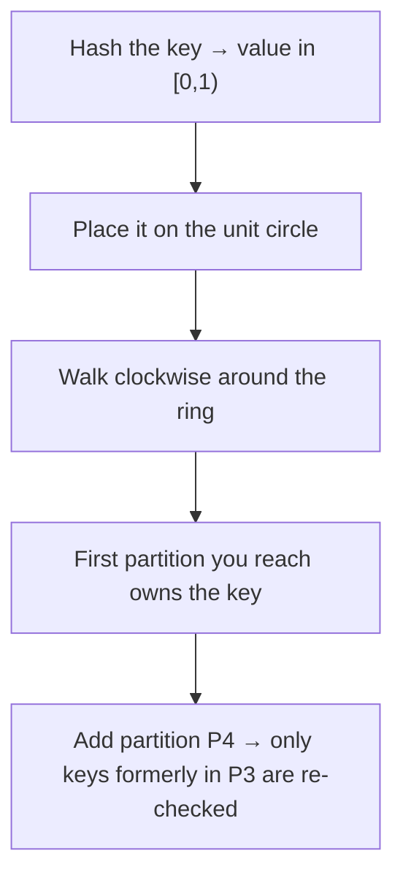

# 07 — Consistent Hashing

## The problem it solves

- Plain hash partitioning with `mod 4` breaks when you add a node: it becomes `mod 5` and **essentially all the data has to move** — "hilariously expensive" [`45:48`](https://www.youtube.com/watch?v=o7bjRUcDMx0&t=2748) [`46:01`](https://www.youtube.com/watch?v=o7bjRUcDMx0&t=2761).
- Motivating symptom raised by a student: one hot node saturates while other nodes idle, so you want to scale out or re-hash [`44:59`](https://www.youtube.com/watch?v=o7bjRUcDMx0&t=2699) [`45:27`](https://www.youtube.com/watch?v=o7bjRUcDMx0&t=2727).

## The idea

- **Incrementally add and remove nodes without rebalancing everything** [`46:01`](https://www.youtube.com/watch?v=o7bjRUcDMx0&t=2761).
- Introduced in **1997 by David Karger** (MIT) — the same name students will meet again in the algorithms class. It is also the product idea behind **Akamai's CDN**, now a billion-dollar company [`46:01`](https://www.youtube.com/watch?v=o7bjRUcDMx0&t=2761) [`46:40`](https://www.youtube.com/watch?v=o7bjRUcDMx0&t=2800).
- Informal poll of the room: roughly **1/3 of students had heard of it** [`46:01`](https://www.youtube.com/watch?v=o7bjRUcDMx0&t=2761).

## Mechanism

- A good hash function distributes values **uniformly around a unit circle** (values 0 to 1); partitions are placed roughly evenly on that circle [`46:40`](https://www.youtube.com/watch?v=o7bjRUcDMx0&t=2800).
- A key is assigned to the partition reached by **following the ring clockwise** — hash(key1) → P1, hash(key2) → P3 [`47:20`](https://www.youtube.com/watch?v=o7bjRUcDMx0&t=2840).
- **Adding a partition moves almost nothing**: inserting P4 only requires re-checking the keys previously owned by P3 and moving those that now hash to P4. Same for P5 (from P1) and P6 [`47:48`](https://www.youtube.com/watch?v=o7bjRUcDMx0&t=2868) [`48:10`](https://www.youtube.com/watch?v=o7bjRUcDMx0&t=2890).

## Replication on the ring

- The same ring supports replication: with **replication factor 3**, a key is stored on the next three partitions encountered walking clockwise, so losing one partition does not lose the data permanently [`48:29`](https://www.youtube.com/watch?v=o7bjRUcDMx0&t=2909) [`48:57`](https://www.youtube.com/watch?v=o7bjRUcDMx0&t=2937).

## Adoption

- Famously used in **Amazon's Dynamo (2007 research system)**. But in a **2022 paper Amazon disclosed that DynamoDB dropped consistent hashing** in favor of hierarchical replication [`48:57`](https://www.youtube.com/watch?v=o7bjRUcDMx0&t=2937).
- Still powerful and practical: **Snowflake** reportedly still uses it in its caching subsystem; **Riak**'s logo is the consistent-hashing ring (the company was later acquired) [`48:57`](https://www.youtube.com/watch?v=o7bjRUcDMx0&t=2937) [`49:41`](https://www.youtube.com/watch?v=o7bjRUcDMx0&t=2981).
- **Apache Cassandra** uses it heavily [`50:34`](https://www.youtube.com/watch?v=o7bjRUcDMx0&t=3034).

## Q&A: known weaknesses

- **Where do you place a new partition?** Not necessarily halfway — ideally wherever it balances load, which depends on how many keys map to that arc [`50:13`](https://www.youtube.com/watch?v=o7bjRUcDMx0&t=3013).
- **A single partition outgrowing its storage?** No magic in the algorithm — add a new partition just before it, or increase partition size limits [`51:07`](https://www.youtube.com/watch?v=o7bjRUcDMx0&t=3067) [`51:39`](https://www.youtube.com/watch?v=o7bjRUcDMx0&t=3099).
- **Unlucky hashes clustering together?** The answer is handwaved to good hash-function design; and you generally **cannot change the hash function on the fly** — "sometimes if you're unlucky you're just unlucky" [`51:58`](https://www.youtube.com/watch?v=o7bjRUcDMx0&t=3118) [`52:35`](https://www.youtube.com/watch?v=o7bjRUcDMx0&t=3155).

## Why it matters at scale — Cassandra deployments

- **DataStax** offers a cloud database-as-a-service based on Cassandra; guest speaker **Jonathan Ellis** is its co-founder and was Apache Cassandra project chair for six years [`52:53`](https://www.youtube.com/watch?v=o7bjRUcDMx0&t=3173).
- **Largest known Cassandra deployment: Apple** — over **100 PB** of data, over **160,000 instances**, thousands of clusters [`53:19`](https://www.youtube.com/watch?v=o7bjRUcDMx0&t=3199).
- **Netflix**: around **6 PB**, over **10,000 instances** [`53:19`](https://www.youtube.com/watch?v=o7bjRUcDMx0&t=3199).
- The point of the numbers: with consistent hashing you never move petabytes — only what sat on the neighboring partition [`53:19`](https://www.youtube.com/watch?v=o7bjRUcDMx0&t=3199).
