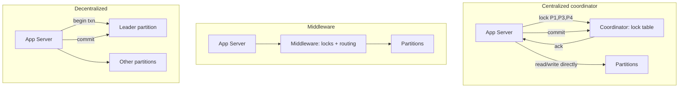

# 08 — Coordinating Distributed Transactions

## The starting question

- When a transaction arrives, the catalog metadata service determines whether it is a **single-node** or a **distributed** transaction [`53:51`](https://www.youtube.com/watch?v=o7bjRUcDMx0&t=3231).
- Single-node → no coordination problem. Distributed (touching one or more other partitions) → **expensive coordination** [`54:11`](https://www.youtube.com/watch?v=o7bjRUcDMx0&t=3251).
- Historically the earliest distributed transactions were **bank ATMs and flight reservations**; some of that code and those protocols (TP monitors) are still in production today [`55:26`](https://www.youtube.com/watch?v=o7bjRUcDMx0&t=3326) [`31:02`](https://www.youtube.com/watch?v=o7bjRUcDMx0&t=1862).

## Two broad approaches — and the hybrid that actually wins

- **Centralized**: a **global traffic cop** with a global view of the system decides whether a transaction may proceed [`54:27`](https://www.youtube.com/watch?v=o7bjRUcDMx0&t=3267).
- **Decentralized**: nodes self-organize and figure it out among themselves [`54:27`](https://www.youtube.com/watch?v=o7bjRUcDMx0&t=3267).
- **In practice most systems use a hybrid**: they periodically **elect a leader node**, and if the leader dies or its term expires they elect a new one. Done for performance reasons [`54:27`](https://www.youtube.com/watch?v=o7bjRUcDMx0&t=3267) [`55:11`](https://www.youtube.com/watch?v=o7bjRUcDMx0&t=3311).

## 1. Centralized transaction coordinator

- The catalog metadata service still tells the app server **which partitions** to touch [`55:43`](https://www.youtube.com/watch?v=o7bjRUcDMx0&t=3343).
- Flow: app server asks the coordinator to **lock P1, P3, P4**; the coordinator (holding the global view of what is locked) acknowledges; the app server does its reads/writes directly against the partitions; then sends a **commit request**, and the coordinator double-checks with the partitions that committing is safe before acknowledging [`56:04`](https://www.youtube.com/watch?v=o7bjRUcDMx0&t=3364) [`56:32`](https://www.youtube.com/watch?v=o7bjRUcDMx0&t=3392).
- The coordinator's **only job here is the lock table** [`57:42`](https://www.youtube.com/watch?v=o7bjRUcDMx0&t=3462).
- Older systems used this model; **Transarc** came out of CMU (founded by CMU professor Jeff Eppinger, now in the software engineering department / S3D) [`56:54`](https://www.youtube.com/watch?v=o7bjRUcDMx0&t=3414).

## 2. Middleware (more common today)

- Difference from the above: the **middleware talks to the partitions on the application server's behalf** — it does the locking, sends the requests, and returns the response. It manages **both** the lock table and the partition communication [`57:18`](https://www.youtube.com/watch?v=o7bjRUcDMx0&t=3438) [`57:42`](https://www.youtube.com/watch?v=o7bjRUcDMx0&t=3462).
- **More widely adopted commercially** [`58:20`](https://www.youtube.com/watch?v=o7bjRUcDMx0&t=3500).
- Real deployments: **Facebook** used this to scale out MySQL (MySQL had no native distributed-transaction support); **YouTube** and **Google's ads system** had similar layers [`58:20`](https://www.youtube.com/watch?v=o7bjRUcDMx0&t=3500).

## 3. Decentralized

- No middleware, no global coordinator. A transaction arrives at some partition, which declares itself the **leader node** and coordinates with the other partitions involved [`58:47`](https://www.youtube.com/watch?v=o7bjRUcDMx0&t=3527).
- The app server then talks directly to all the partitions, but must send its **commit request back to the original leader partition**, which verifies it is safe to commit [`58:47`](https://www.youtube.com/watch?v=o7bjRUcDMx0&t=3527) [`59:31`](https://www.youtube.com/watch?v=o7bjRUcDMx0&t=3571).
