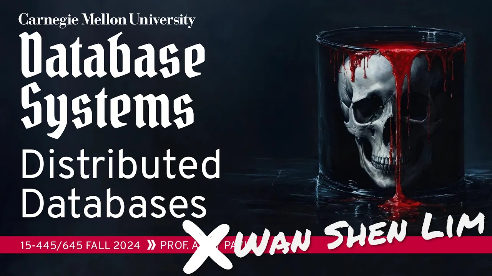
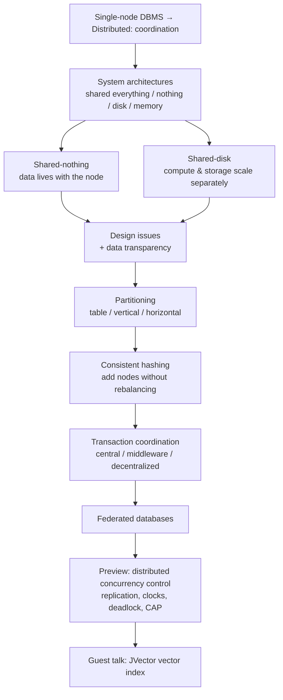

# #22 - Distributed Database Architectures ✸ DataStax Database Talk (CMU Intro to Database Systems)

*CMU Database Group · 1:23:02 · [Watch on YouTube](https://www.youtube.com/watch?v=o7bjRUcDMx0)*

## Summary

A guest lecture in CMU 15-445/645 (Fall 2024) that makes the jump from the single-node DBMS students have been building all semester to distributed database systems, framing every new difficulty as a **coordination** problem. It walks the classic four-way architecture classification (shared everything / nothing / disk / memory), explains why shared-nothing dominated from the 1980s to the 2000s and why shared-disk took over with the public cloud, then covers partitioning schemes (table, vertical, horizontal: hash / range / predicate), consistent hashing, and the three ways to coordinate distributed transactions (centralized coordinator, middleware, decentralized leader). It closes with a preview of distributed concurrency control — replication, clock skew, distributed deadlock, CAP — and a flash talk from DataStax co-founder Jonathan Ellis on how the JVector index that powers vector search in Cassandra and Astra reduced its memory overhead to under 2 MB.

## Topics

1. [From Single-Node to Distributed: Why Coordination Changes Everything](./01-single-node-to-distributed.md)
2. [System Architectures: The Four-Way Classification](./02-system-architectures-overview.md)
3. [Shared-Nothing Architecture in Depth](./03-shared-nothing.md)
4. [Shared-Disk Architecture in Depth](./04-shared-disk.md)
5. [Core Design Issues and Data Transparency](./05-design-issues.md)
6. [Database Partitioning](./06-database-partitioning.md)
7. [Consistent Hashing](./07-consistent-hashing.md)
8. [Coordinating Distributed Transactions](./08-transaction-coordination.md)
9. [Federated Databases](./09-federated-databases.md)
10. [Preview: Distributed Concurrency Control (and When Not to Go Distributed)](./10-distributed-concurrency-control-preview.md)
11. [DataStax Flash Talk: Building the JVector Index](./11-datastax-jvector-talk.md)

Also in this folder: [`transcript.md`](./transcript.md) — the full timestamped transcript.

## Key takeaways

- **Shared-disk, not shared-nothing, is the modern default.** Shared-nothing was the recommended architecture from the 1980s to the early 2000s, but the public cloud (~2010, S3-style storage) flipped it: most database startups of the last 5–10 years are shared-disk, and the lecturer names it the one thing to remember from the lecture [`10:09`](https://www.youtube.com/watch?v=o7bjRUcDMx0&t=609) [`17:31`](https://www.youtube.com/watch?v=o7bjRUcDMx0&t=1051) [`24:17`](https://www.youtube.com/watch?v=o7bjRUcDMx0&t=1457).
- **The concrete win of shared-disk is decoupled scaling.** Compute and storage scale independently, and a hot tuple needs no data copying — the new node just translates the tuple ID and reads it from the shared layer, versus copying (e.g.) 2 TB onto a new shared-nothing node [`22:20`](https://www.youtube.com/watch?v=o7bjRUcDMx0&t=1340) [`26:59`](https://www.youtube.com/watch?v=o7bjRUcDMx0&t=1619) [`16:25`](https://www.youtube.com/watch?v=o7bjRUcDMx0&t=985). The cost is moving the problem to cache invalidation on update [`27:31`](https://www.youtube.com/watch?v=o7bjRUcDMx0&t=1651).
- **Consistent hashing (Karger, 1997) removes the rehash catastrophe.** Plain `hash mod N` forces moving essentially all data when N changes; on the hash ring, adding a partition only touches keys owned by its clockwise neighbor — which is why Apple's ~100 PB / 160,000-instance Cassandra deployment can grow at all [`46:01`](https://www.youtube.com/watch?v=o7bjRUcDMx0&t=2761) [`47:48`](https://www.youtube.com/watch?v=o7bjRUcDMx0&t=2868) [`53:19`](https://www.youtube.com/watch?v=o7bjRUcDMx0&t=3199). It is not universal, though: **DynamoDB dropped it in favor of hierarchical replication**, per Amazon's 2022 paper [`48:57`](https://www.youtube.com/watch?v=o7bjRUcDMx0&t=2937).
- **Middleware coordination beat pure centralized coordinators in practice, and hybrids beat both.** Facebook (scaling MySQL, which lacked distributed transactions), YouTube and Google Ads all used middleware; most real systems periodically elect a leader rather than committing to fully centralized or fully decentralized designs [`58:20`](https://www.youtube.com/watch?v=o7bjRUcDMx0&t=3500) [`54:27`](https://www.youtube.com/watch?v=o7bjRUcDMx0&t=3267) [`55:11`](https://www.youtube.com/watch?v=o7bjRUcDMx0&t=3311).
- **Most workloads should not be distributed at all.** Ignoring replication, most deployments are tens to hundreds of gigabytes, not petabytes; if you genuinely need scale, buying Snowflake beats building it, because real distributed DBMSs need whole teams per subsystem [`1:06:17`](https://www.youtube.com/watch?v=o7bjRUcDMx0&t=3977) [`1:06:34`](https://www.youtube.com/watch?v=o7bjRUcDMx0&t=3994) [`1:05:47`](https://www.youtube.com/watch?v=o7bjRUcDMx0&t=3947).
- **JVector cut vector-index memory overhead to under 2 MB per index with no slowdown**, by combining DiskANN's coarse-pass-plus-rerank design, product quantization (32× compression, ~64× on modern embeddings), and Quicker ADC with precomputed distances held in AVX-512 registers [`1:18:23`](https://www.youtube.com/watch?v=o7bjRUcDMx0&t=4703) [`1:13:42`](https://www.youtube.com/watch?v=o7bjRUcDMx0&t=4422) [`1:12:09`](https://www.youtube.com/watch?v=o7bjRUcDMx0&t=4329).
- **Two negative results from the vector-search talk**: graph-quality improvements are a dead end (1–3% situational gains; edges stop mattering past a minimum quality), and the remaining bottleneck — disk reads for full-resolution reranking — has no known solution [`1:20:10`](https://www.youtube.com/watch?v=o7bjRUcDMx0&t=4810) [`1:20:44`](https://www.youtube.com/watch?v=o7bjRUcDMx0&t=4844).
