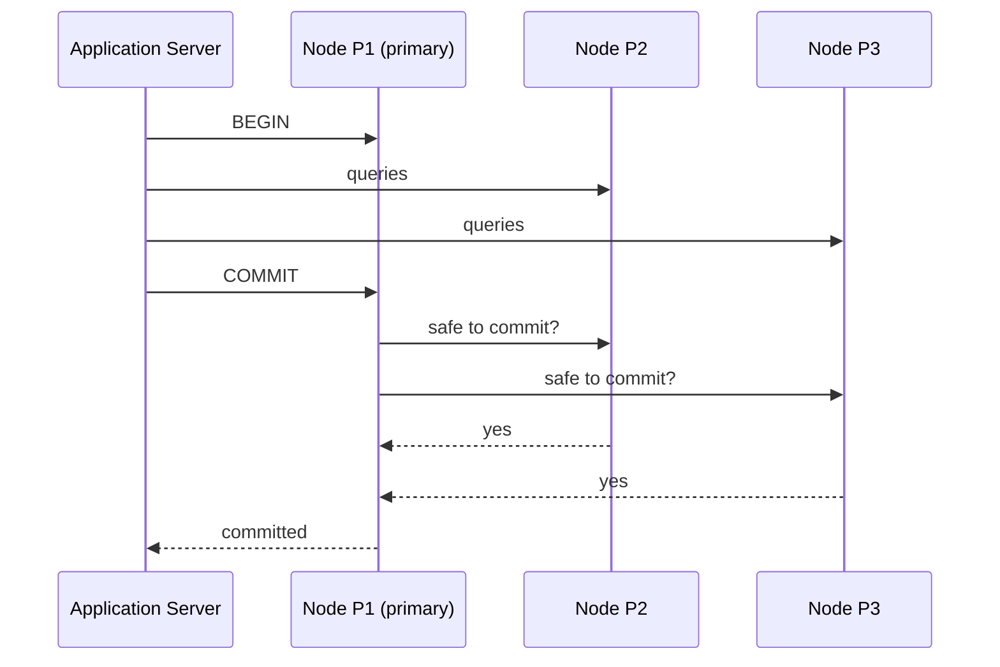

# 02 — The Distributed Transaction Problem

## The centralized-coordinator picture

- A transaction begins, lands on the node holding its first partition (say P1), and that node is designated the **primary node** for that transaction ([`8:23`](https://www.youtube.com/watch?v=3wNmpE6DsSs&t=503)).
- The application server may then send query requests to any other node, all in the transaction's context ([`8:49`](https://www.youtube.com/watch?v=3wNmpE6DsSs&t=529)).
- On commit, the primary asks every involved node "is it safe to commit?", and only after unanimous agreement does the client get an acknowledgement ([`8:49`](https://www.youtube.com/watch?v=3wNmpE6DsSs&t=529), [`9:20`](https://www.youtube.com/watch?v=3wNmpE6DsSs&t=560)).

## The core goal

- Split the database across many compute nodes/disks, but make it **appear to the application as a single logical database** — the same SQL must work whether the data lives on 1 machine or 1,000 ([`9:53`](https://www.youtube.com/watch?v=3wNmpE6DsSs&t=593)).
- Same ACID guarantees as a single-node system: survive crashes, and once a commit is announced, a read on any other node must see those changes ([`9:20`](https://www.youtube.com/watch?v=3wNmpE6DsSs&t=560)).

## What makes it hard

The easy case is when nothing fails; the difficulty is entirely in the failure modes ([`10:44`](https://www.youtube.com/watch?v=3wNmpE6DsSs&t=644)):

- A node **crashes mid-transaction** ([`10:44`](https://www.youtube.com/watch?v=3wNmpE6DsSs&t=644)).
- A **message is delayed** — TCP/IP orders a stream, but a network hiccup can delay one stream by a second ([`11:18`](https://www.youtube.com/watch?v=3wNmpE6DsSs&t=678)).
- A node is **alive but unresponsive** — e.g. a Java DBMS whose garbage collector pauses for 5 seconds: pings still answer, the database process does not ([`11:38`](https://www.youtube.com/watch?v=3wNmpE6DsSs&t=698)).
- The system **acknowledges early** without waiting for full agreement, and then a node crashes and comes back ([`12:02`](https://www.youtube.com/watch?v=3wNmpE6DsSs&t=722)).

> Emphasis of the lecture: this is hard enough that you want the DBMS to do it — not application code ([`12:16`](https://www.youtube.com/watch?v=3wNmpE6DsSs&t=736)).

## The friendly-nodes assumption

- The whole lecture assumes all nodes are **friendly**: same administrative domain, software we wrote and control, well behaved ([`12:32`](https://www.youtube.com/watch?v=3wNmpE6DsSs&t=752), [`12:47`](https://www.youtube.com/watch?v=3wNmpE6DsSs&t=767)).
- Consequence: a node that says "yes, commit" will **not deliberately reverse that decision** later. Failures are still permitted and handled ([`12:47`](https://www.youtube.com/watch?v=3wNmpE6DsSs&t=767)).
- If you cannot trust the other nodes you need a **Byzantine Fault Tolerant (BFT)** protocol — which is how blockchains work, tolerating nodes that lie ([`13:16`](https://www.youtube.com/watch?v=3wNmpE6DsSs&t=796)).
- **Cost of BFT: roughly 5–10x slower** than the protocols in this lecture. Verdict: do not put it anywhere near an OLTP DBMS unless you are doing Bitcoin ([`13:50`](https://www.youtube.com/watch?v=3wNmpE6DsSs&t=830)). Blockchain is a *degenerate, slower* case of what is covered here ([`14:23`](https://www.youtube.com/watch?v=3wNmpE6DsSs&t=863)).

## Lecture roadmap

1. **Replication** — how to copy the database across nodes ([`14:37`](https://www.youtube.com/watch?v=3wNmpE6DsSs&t=877)).
2. **Atomic commit / consensus protocols** — how everyone agrees on changes and their order ([`15:01`](https://www.youtube.com/watch?v=3wNmpE6DsSs&t=901)).
3. **Consistency issues** — CAP theorem and the PACELC extension ([`15:01`](https://www.youtube.com/watch?v=3wNmpE6DsSs&t=901)).
