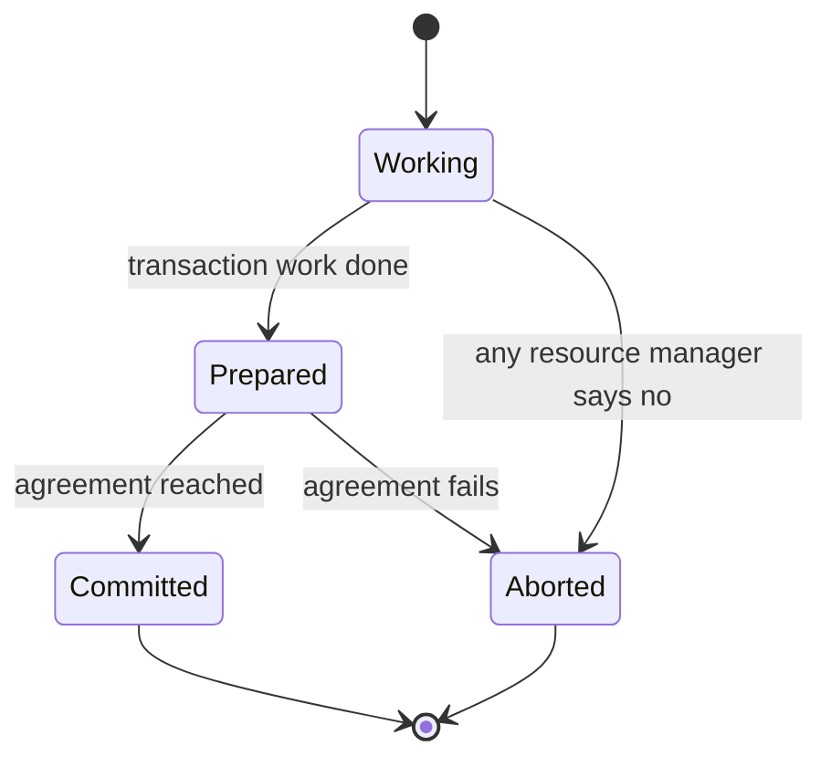

# 05 — Atomic Commit / Consensus Protocols

## Why a protocol is needed

- On a single node, committing is already hard (concurrency control), but at least the node can reason about everything in its own purview ([`41:53`](https://www.youtube.com/watch?v=3wNmpE6DsSs&t=2513), [`42:21`](https://www.youtube.com/watch?v=3wNmpE6DsSs&t=2541)).
- With multiple nodes: how does everyone agree, get notified of the agreement, and survive the coordinator dying mid-flight ([`42:21`](https://www.youtube.com/watch?v=3wNmpE6DsSs&t=2541))?
- **Key insight**: deciding *whether a transaction may commit* and deciding *who is allowed to be the primary* are the **same decision** — leader election is just another transaction with slightly different semantics ([`42:41`](https://www.youtube.com/watch?v=3wNmpE6DsSs&t=2561)).

## Terminology

- Databases call it an **atomic commit protocol**; distributed systems call it a **consensus protocol** (or atomic consensus). At a high level they do the same thing: decide the **order in which transactions commit** across nodes ([`43:02`](https://www.youtube.com/watch?v=3wNmpE6DsSs&t=2582)).
- This maps directly to distributed-systems **state machine replication**: the state of the database *is* the commit order of its transactions, including the ones not allowed to commit ([`43:30`](https://www.youtube.com/watch?v=3wNmpE6DsSs&t=2610), [`43:47`](https://www.youtube.com/watch?v=3wNmpE6DsSs&t=2627)).
- Required regardless of partitioning or replication ([`44:06`](https://www.youtube.com/watch?v=3wNmpE6DsSs&t=2646)).

## Protocol history

| Protocol | Origin | Status |
|---|---|---|
| **Two-phase commit** | Attributed to **Jim Gray** (1970s paper), who himself credits an Italian designer of a 1970s retirement/social-security system — who said it came from **contract law** ([`44:58`](https://www.youtube.com/watch?v=3wNmpE6DsSs&t=2698)) | Most common in distributed DBs ([`44:18`](https://www.youtube.com/watch?v=3wNmpE6DsSs&t=2658)) |
| **Three-phase commit** | Stonebraker, to avoid pausing the system when a node dies ([`45:28`](https://www.youtube.com/watch?v=3wNmpE6DsSs&t=2728)) | Nobody uses it — complicated, mishandles corner cases ([`45:28`](https://www.youtube.com/watch?v=3wNmpE6DsSs&t=2728)) |
| **Four-phase commit** | Microsoft, for RDMA/InfiniBand hardware accelerators ([`45:28`](https://www.youtube.com/watch?v=3wNmpE6DsSs&t=2728)) | Ignorable ([`45:50`](https://www.youtube.com/watch?v=3wNmpE6DsSs&t=2750)) |
| **Viewstamped Replication** | **1988, Barbara Liskov** (later a Turing Award winner) ([`45:50`](https://www.youtube.com/watch?v=3wNmpE6DsSs&t=2750)) | First proved correct under all possible failures; the only known user is **TigerBeetle** ([`46:17`](https://www.youtube.com/watch?v=3wNmpE6DsSs&t=2777)) |
| **Paxos** | **Leslie Lamport**, apparently unaware of Viewstamped Replication, so he does not cite Liskov ([`45:50`](https://www.youtube.com/watch?v=3wNmpE6DsSs&t=2750)) | The one everyone knows ([`45:50`](https://www.youtube.com/watch?v=3wNmpE6DsSs&t=2750)) |
| **ZAB** | ZooKeeper Atomic Broadcast ([`46:17`](https://www.youtube.com/watch?v=3wNmpE6DsSs&t=2777)) | Only ZooKeeper uses it ([`46:17`](https://www.youtube.com/watch?v=3wNmpE6DsSs&t=2777)) |
| **Raft** | Stanford, a simplified Paxos ([`46:17`](https://www.youtube.com/watch?v=3wNmpE6DsSs&t=2777)) | Probably more common than Paxos today ([`44:18`](https://www.youtube.com/watch?v=3wNmpE6DsSs&t=2658)) |

## The common state machine

Gray and Lamport's joint paper distills what all these protocols share ([`46:52`](https://www.youtube.com/watch?v=3wNmpE6DsSs&t=2812)):

- **Resource managers** (the generic term for "node") each control the fate of some data ([`46:52`](https://www.youtube.com/watch?v=3wNmpE6DsSs&t=2812), [`47:27`](https://www.youtube.com/watch?v=3wNmpE6DsSs&t=2847)).
- In the **working phase** changes are applied; a single resource manager voting to abort is **game over** for the transaction ([`47:27`](https://www.youtube.com/watch?v=3wNmpE6DsSs&t=2847)).
- In the **prepared phase** the system seeks agreement; yes → committed, no → aborted ([`47:27`](https://www.youtube.com/watch?v=3wNmpE6DsSs&t=2847)).

## Required properties

- **Stable**: once the decision to commit is made, it **cannot be reversed** — 2PC requires unanimity, Paxos requires a majority. This is exactly the problem blockchains struggle with ([`48:16`](https://www.youtube.com/watch?v=3wNmpE6DsSs&t=2896), [`48:43`](https://www.youtube.com/watch?v=3wNmpE6DsSs&t=2923)).
- **Consistent**: at some undetermined point everyone agrees on the correct state — i.e. the commit order ([`48:43`](https://www.youtube.com/watch?v=3wNmpE6DsSs&t=2923)).
- **Liveness**: the state machine can always make forward progress — not necessarily efficiently, but never permanently stuck. Requires nodes to be alive and communicating ([`49:11`](https://www.youtube.com/watch?v=3wNmpE6DsSs&t=2951), [`49:28`](https://www.youtube.com/watch?v=3wNmpE6DsSs&t=2968), [`49:47`](https://www.youtube.com/watch?v=3wNmpE6DsSs&t=2987)).

## The headline relationship

**Two-phase commit is a degenerate case (a subset) of Paxos** — 2PC came first, Paxos later, and the Lamport–Gray paper proves they are essentially the same thing, differing in the requirement for deciding when a transaction may commit (unanimity vs majority) ([`49:47`](https://www.youtube.com/watch?v=3wNmpE6DsSs&t=2987), [`50:16`](https://www.youtube.com/watch?v=3wNmpE6DsSs&t=3016)).
