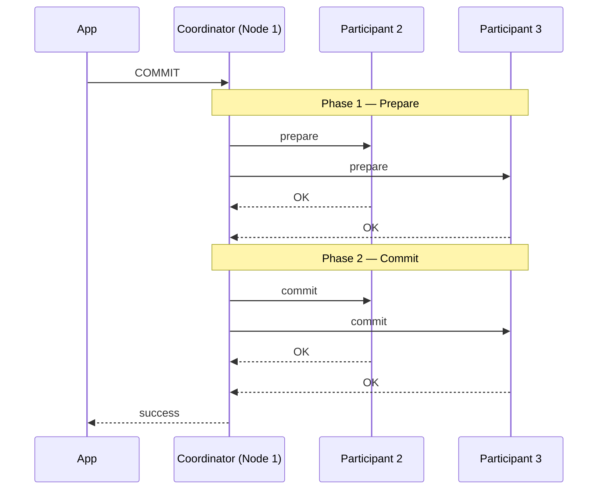

# 06 — Two-Phase Commit (2PC)

## Roles

- **Coordinator**: the node in charge of deciding whether the transaction may commit ([`50:16`](https://www.youtube.com/watch?v=3wNmpE6DsSs&t=3016), [`50:41`](https://www.youtube.com/watch?v=3wNmpE6DsSs&t=3041)).
- **Participants**: the other nodes involved in *this* transaction — not necessarily every node in the cluster ([`50:41`](https://www.youtube.com/watch?v=3wNmpE6DsSs&t=3041), [`51:57`](https://www.youtube.com/watch?v=3wNmpE6DsSs&t=3117)).

## The commit path

1. **Prepare phase**: the coordinator asks every participant whether the transaction may commit. Each participant decides using only its **own local context** ([`50:57`](https://www.youtube.com/watch?v=3wNmpE6DsSs&t=3057), [`51:13`](https://www.youtube.com/watch?v=3wNmpE6DsSs&t=3073), [`53:57`](https://www.youtube.com/watch?v=3wNmpE6DsSs&t=3237)).
2. **Commit phase**: once *all* participants say OK, the coordinator tells everyone to commit; each applies changes and (under synchronous commit) flushes before acknowledging ([`51:57`](https://www.youtube.com/watch?v=3wNmpE6DsSs&t=3117), [`52:35`](https://www.youtube.com/watch?v=3wNmpE6DsSs&t=3155)).
3. Only then does the client get "committed" ([`52:35`](https://www.youtube.com/watch?v=3wNmpE6DsSs&t=3155), [`52:52`](https://www.youtube.com/watch?v=3wNmpE6DsSs&t=3172)).

**All inbound and outbound protocol messages are themselves written to the WAL and flushed**, so a crashed node can recover its position in the protocol. They can go in the same WAL as ordinary queries ([`51:35`](https://www.youtube.com/watch?v=3wNmpE6DsSs&t=3095), [`51:57`](https://www.youtube.com/watch?v=3wNmpE6DsSs&t=3117), [`54:59`](https://www.youtube.com/watch?v=3wNmpE6DsSs&t=3299)).

### How a participant decides (student question)

It is the same single-node machinery already covered ([`53:11`](https://www.youtube.com/watch?v=3wNmpE6DsSs&t=3191)):

- **OCC**: the validation phase may find the write set intersects a running transaction → cannot commit.
- **2PL**: if locks are held and updates are complete, it is fine.
- **Integrity constraints**: e.g. deferred index checks that only detect a duplicate key at commit time ([`53:43`](https://www.youtube.com/watch?v=3wNmpE6DsSs&t=3223)).

## The abort path

- The moment **one** participant votes abort, the transaction is dead regardless of what the others think ([`54:12`](https://www.youtube.com/watch?v=3wNmpE6DsSs&t=3252)).
- **Asymmetry**: on abort the coordinator does **not** wait for phase-2 acknowledgements before telling the client — the outcome is already certain ([`54:39`](https://www.youtube.com/watch?v=3wNmpE6DsSs&t=3279)).

## Recovery

| Situation | Behavior |
|---|---|
| Participant crashed *after* voting OK on prepare | On restart, reads its log, contacts the coordinator to learn the transaction's real fate, then either rolls back (changes are in its WAL) or applies ([`54:59`](https://www.youtube.com/watch?v=3wNmpE6DsSs&t=3299)) |
| Participant crashed *before* the prepared phase | Just aborts — a crash mid-updates is equivalent to aborting ([`56:02`](https://www.youtube.com/watch?v=3wNmpE6DsSs&t=3362)) |
| Coordinator crashed after everyone agreed | On restart it tells all nodes to commit, even if the client was never told ([`56:02`](https://www.youtube.com/watch?v=3wNmpE6DsSs&t=3362), [`56:26`](https://www.youtube.com/watch?v=3wNmpE6DsSs&t=3386)) |
| Participant fails to answer prepare | The coordinator assumes an abort and aborts the transaction everywhere ([`58:09`](https://www.youtube.com/watch?v=3wNmpE6DsSs&t=3489)) |

- **Durability rule**: if the changes reached disk but the acknowledgement never reached the client before the crash, the transaction still counts as **committed** — it is up to the application server to go back and check ([`56:26`](https://www.youtube.com/watch?v=3wNmpE6DsSs&t=3386), [`56:57`](https://www.youtube.com/watch?v=3wNmpE6DsSs&t=3417)).
- **Coordinator failure is the blocking problem**: participants detect it via **heartbeat timeouts**, then negotiate among themselves. While they do, **the system is unavailable** — no other transaction may commit, because a second transaction that read from the undecided first one could commit and violate ACID if the first aborts ([`56:57`](https://www.youtube.com/watch?v=3wNmpE6DsSs&t=3417), [`57:35`](https://www.youtube.com/watch?v=3wNmpE6DsSs&t=3455), [`57:47`](https://www.youtube.com/watch?v=3wNmpE6DsSs&t=3467), [`58:09`](https://www.youtube.com/watch?v=3wNmpE6DsSs&t=3489)).

## Two optimizations

### 1. Early prepare voting (rare)

- If you know a given query is the **last** one this transaction will send to that node, piggyback the prepare vote on the query response: you get back the result *and* an OK/abort vote, eliminating a later round trip ([`58:31`](https://www.youtube.com/watch?v=3wNmpE6DsSs&t=3511), [`59:12`](https://www.youtube.com/watch?v=3wNmpE6DsSs&t=3552)).
- **Rarely implemented**: SQL gives you no way to know where a query will run or that it is the last one. JDBC may expose such a flag, and VoltDB supports it, but most systems cannot ([`59:21`](https://www.youtube.com/watch?v=3wNmpE6DsSs&t=3561), [`59:46`](https://www.youtube.com/watch?v=3wNmpE6DsSs&t=3586)).

### 2. Early acknowledgement after prepare (very common)

- Once the prepare phase gets all OKs, **the transaction is committing no matter what**, so the coordinator can return success to the client immediately and run phase 2 afterwards ([`59:46`](https://www.youtube.com/watch?v=3wNmpE6DsSs&t=3586), [`1:00:01`](https://www.youtube.com/watch?v=3wNmpE6DsSs&t=3601)).
- Saves exactly **one round trip** of *waiting* — the commit phase still runs, you just do not block on it. Safe because the recovery protocol already handles crashes during commit ([`1:00:23`](https://www.youtube.com/watch?v=3wNmpE6DsSs&t=3623), [`1:01:04`](https://www.youtube.com/watch?v=3wNmpE6DsSs&t=3664)).

## Why phase 2 acknowledgements are still required (student question)

- The coordinator must know **everyone applied the change** before it commits the *next* transaction, so that the next transaction reading data written by the first sees the correct version ([`1:03:03`](https://www.youtube.com/watch?v=3wNmpE6DsSs&t=3783), [`1:04:56`](https://www.youtube.com/watch?v=3wNmpE6DsSs&t=3896)).
- A second commit request can **start** but cannot **commit** until the first finishes phase 2 ([`1:03:27`](https://www.youtube.com/watch?v=3wNmpE6DsSs&t=3807)).
- Subtlety: after receiving the commit message the participants *can* begin committing another transaction, but the **coordinator cannot**, because it does not yet know its message arrived ([`1:04:06`](https://www.youtube.com/watch?v=3wNmpE6DsSs&t=3846), [`1:04:36`](https://www.youtube.com/watch?v=3wNmpE6DsSs&t=3876)).

> Repeated warning throughout: "this is hard, there are a lot of corner cases you have to deal with" ([`1:02:40`](https://www.youtube.com/watch?v=3wNmpE6DsSs&t=3760)).
