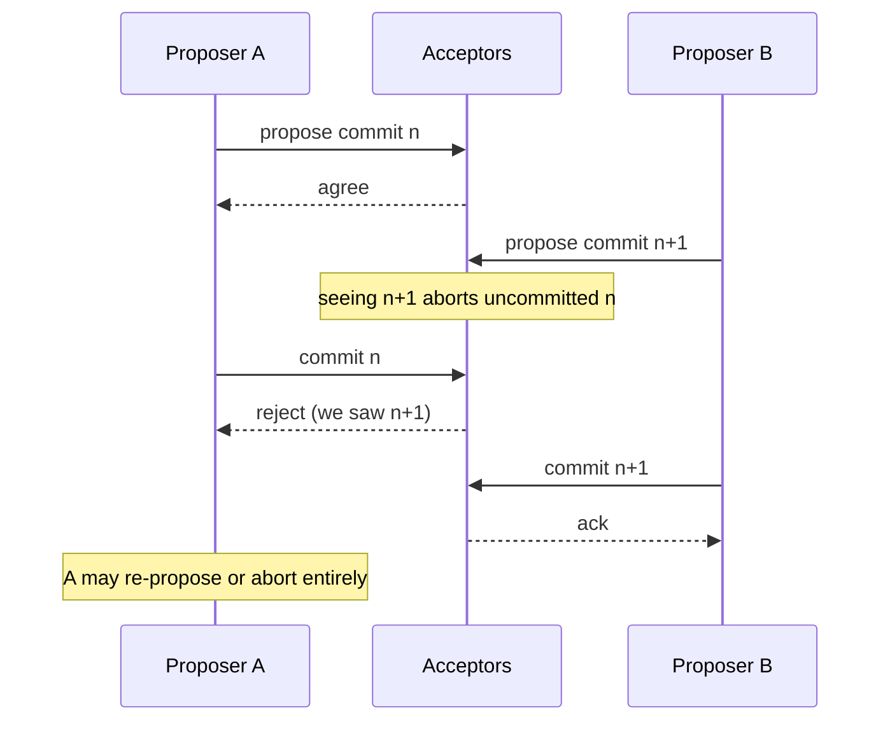

# 07 — Paxos, Multi-Paxos, and Raft

## The core difference from 2PC

- Paxos is the **provably resilient** atomic protocol in the face of asynchronous networks ([`1:05:39`](https://www.youtube.com/watch?v=3wNmpE6DsSs&t=3939)).
- Structurally identical to 2PC, except: **2PC needs unanimity, Paxos needs only a majority** to commit ([`1:05:39`](https://www.youtube.com/watch?v=3wNmpE6DsSs&t=3939), [`1:06:07`](https://www.youtube.com/watch?v=3wNmpE6DsSs&t=3967)) — which is exactly why 2PC is a degenerate case of Paxos ([`1:06:07`](https://www.youtube.com/watch?v=3wNmpE6DsSs&t=3967)).

## Roles

| Paxos | 2PC equivalent |
|---|---|
| **Proposer** | Coordinator ([`1:10:00`](https://www.youtube.com/watch?v=3wNmpE6DsSs&t=4200)) |
| **Acceptor** | Participant ([`1:10:00`](https://www.youtube.com/watch?v=3wNmpE6DsSs&t=4200)) |
| **Learner** | Non-voting replica that observes changes; ignorable for this lecture. Raft calls them followers ([`1:10:00`](https://www.youtube.com/watch?v=3wNmpE6DsSs&t=4200), [`1:10:53`](https://www.youtube.com/watch?v=3wNmpE6DsSs&t=4253)) |

- If an acceptor dies mid-protocol, a **majority response is still enough** to consider the transaction committed; the dead node catches up from the others when it wakes ([`1:10:26`](https://www.youtube.com/watch?v=3wNmpE6DsSs&t=4226), [`1:10:53`](https://www.youtube.com/watch?v=3wNmpE6DsSs&t=4253)).

## Liveness: the real advantage

- Under **2PC**, a node crashing mid-commit makes the system **unavailable** while the survivors figure out the transaction's state ([`1:11:24`](https://www.youtube.com/watch?v=3wNmpE6DsSs&t=4284), [`1:11:36`](https://www.youtube.com/watch?v=3wNmpE6DsSs&t=4296)).
- Under **Paxos**, proposers keep proposing, so the system keeps moving forward ([`1:11:36`](https://www.youtube.com/watch?v=3wNmpE6DsSs&t=4296)).

## Competing proposers

- The rule: **as soon as an acceptor sees a newer proposal, any previous uncommitted transaction must abort** — the system always accepts new proposals and marches forward in time ([`1:12:05`](https://www.youtube.com/watch?v=3wNmpE6DsSs&t=4325), [`1:12:33`](https://www.youtube.com/watch?v=3wNmpE6DsSs&t=4353)).
- Contrast with 2PC, where you must **wait** for the first transaction to commit before proposing another ([`1:12:33`](https://www.youtube.com/watch?v=3wNmpE6DsSs&t=4353)).
- **Failure mode**: many proposers clashing means the system stays *live* but never actually commits anything, because transactions keep aborting each other ([`1:13:20`](https://www.youtube.com/watch?v=3wNmpE6DsSs&t=4400)).

## Multi-Paxos (Google, "Paxos Made Live")

- Anoint **one leader** per Paxos group; only it may commit transactions, which lets you **skip the propose phase** entirely since no one else will propose ([`1:13:46`](https://www.youtube.com/watch?v=3wNmpE6DsSs&t=4426)).
- If a node goes down, fall back to regular Paxos ([`1:14:09`](https://www.youtube.com/watch?v=3wNmpE6DsSs&t=4449)).
- The leader holds a **lease/timeout**; on expiry a **leader election** runs — which is just another round of Paxos ([`1:14:09`](https://www.youtube.com/watch?v=3wNmpE6DsSs&t=4449)).
- Losers use **randomized incremental backoff** before retrying; since nodes are not malicious, failing to become leader is fine ([`1:14:39`](https://www.youtube.com/watch?v=3wNmpE6DsSs&t=4479)).
- Lease-length tradeoff: longer leases mean fewer elections but longer waits to detect a failed leader (heartbeats can shorten detection) ([`1:15:01`](https://www.youtube.com/watch?v=3wNmpE6DsSs&t=4501)).

### Real lease durations cited

| System | Leader lease |
|---|---|
| **Google Spanner** | 10 seconds ([`1:15:01`](https://www.youtube.com/watch?v=3wNmpE6DsSs&t=4501)) |
| **YugabyteDB** | 2 seconds ([`1:15:01`](https://www.youtube.com/watch?v=3wNmpE6DsSs&t=4501)) |
| **CockroachDB** (transcript garbled as "GB") | 5 minutes (default) ([`1:15:31`](https://www.youtube.com/watch?v=3wNmpE6DsSs&t=4531)) |
| **TiDB** | 10 seconds — "because they just follow Google" ([`1:15:31`](https://www.youtube.com/watch?v=3wNmpE6DsSs&t=4531)) |

## Comparison

| | 2PC | Paxos | Raft |
|---|---|---|---|
| Agreement needed | Unanimous | Majority | Majority |
| Behavior on coordinator/leader failure | **Blocking** — all transactions stall until the coordinator returns or the nodes resolve it themselves | **Non-blocking** as long as a majority is alive and failures do not continue | Same as Paxos |
| Node types | Coordinator, participant | Proposer, acceptor, learner | Fewer types (leader/follower) |
| Leader eligibility | — | Any node | **Only a node with the most up-to-date log** |

([`1:15:31`](https://www.youtube.com/watch?v=3wNmpE6DsSs&t=4531), [`1:16:05`](https://www.youtube.com/watch?v=3wNmpE6DsSs&t=4565), [`1:16:40`](https://www.youtube.com/watch?v=3wNmpE6DsSs&t=4600))

Raft's freshest-log rule exists so a lagging node — obviously slow — does not become leader and make things worse ([`1:16:05`](https://www.youtube.com/watch?v=3wNmpE6DsSs&t=4565)).

## Reading recommendations and lore

- The original Paxos paper is written as if by an **archaeologist** describing an ancient Greek voting system on the island of Paxos, where tablets were thrown into a hole — brilliant prose, but unimplementable as a spec ([`1:06:31`](https://www.youtube.com/watch?v=3wNmpE6DsSs&t=3991), [`1:06:44`](https://www.youtube.com/watch?v=3wNmpE6DsSs&t=4004), [`1:06:58`](https://www.youtube.com/watch?v=3wNmpE6DsSs&t=4018)).
- Written in **1989** and **rejected**; reviewers (one of whom was Maurice Herlihy, then at CMU, now at Brown) asked only for a proof in the appendix, and Lamport refused on the grounds that it was a work of art. He filed it away, saw 1990s papers circling the same problem, dusted it off, and it was published with a tongue-in-cheek prologue about a manuscript found behind a filing cabinet ([`1:06:58`](https://www.youtube.com/watch?v=3wNmpE6DsSs&t=4018), [`1:07:26`](https://www.youtube.com/watch?v=3wNmpE6DsSs&t=4046), [`1:07:51`](https://www.youtube.com/watch?v=3wNmpE6DsSs&t=4071)).
- **"Paxos Made Simple" does not help either.** The recommended modern description is Google's **"Paxos Made Live" (2003–2004)** ([`1:08:45`](https://www.youtube.com/watch?v=3wNmpE6DsSs&t=4125)).
- The Gray–Lamport unification paper dates to **2006**, shortly before Jim Gray disappeared while sailing alone in San Francisco Bay to scatter his mother's ashes. Satellites were retasked over the bay and an early crowdsourcing effort searched the images; the boat was never found and he was declared dead years later — an indication of how much he meant to the field ([`1:09:13`](https://www.youtube.com/watch?v=3wNmpE6DsSs&t=4153), [`1:09:37`](https://www.youtube.com/watch?v=3wNmpE6DsSs&t=4177)).
