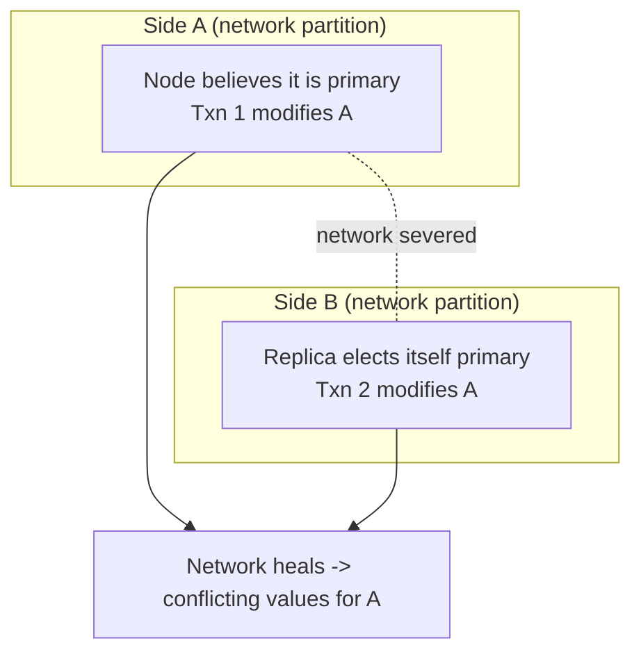

# 08 — CAP Theorem, Split Brain, PACELC, and Conclusion

## CAP theorem

- Proposed in the **late 1990s by Eric Brewer**: a distributed system cannot simultaneously guarantee **Consistency**, **Availability**, and **Partition tolerance** ([`1:17:00`](https://www.youtube.com/watch?v=3wNmpE6DsSs&t=4620)).
- **The practical reading**: the question is only *what do you do when the network fails* — be a **consistent** system or an **available** system. Being both consistent and available under a partition does not make sense ([`1:17:25`](https://www.youtube.com/watch?v=3wNmpE6DsSs&t=4645)).

| Property | Meaning here |
|---|---|
| **Consistency** | Apply a change, propagate it to the replica, *then* announce the commit; any later read on any node sees the correct version ([`1:17:25`](https://www.youtube.com/watch?v=3wNmpE6DsSs&t=4645), [`1:17:58`](https://www.youtube.com/watch?v=3wNmpE6DsSs&t=4678)) |
| **Availability** | A node going down still leaves the surviving nodes serving reads and writes ([`1:18:13`](https://www.youtube.com/watch?v=3wNmpE6DsSs&t=4693)) |
| **Partition tolerance** | Surviving a severed network between nodes — the hard case ([`1:18:36`](https://www.youtube.com/watch?v=3wNmpE6DsSs&t=4716)) |

## Split brain

- With the network severed, the primary keeps believing it is primary and the replica elects **itself** primary; neither knows the other is alive ([`1:18:36`](https://www.youtube.com/watch?v=3wNmpE6DsSs&t=4716)).
- Both sides accept writes to the same object and both acknowledge commits; when the network heals, the values conflict. This is **split brain** ([`1:19:11`](https://www.youtube.com/watch?v=3wNmpE6DsSs&t=4751), [`1:19:29`](https://www.youtube.com/watch?v=3wNmpE6DsSs&t=4769)).

### Response 1 — choose consistency (halt)

- Halt the side that **lacks the majority** of nodes. On healing, the majority side simply propagates its updates; **conflicting values never arise** ([`1:19:53`](https://www.youtube.com/watch?v=3wNmpE6DsSs&t=4793)).
- **Most distributed relational systems choose this** ([`1:20:22`](https://www.youtube.com/watch?v=3wNmpE6DsSs&t=4822)).

### Response 2 — choose availability (reconcile later)

Allow writes on both sides, then reconcile ([`1:20:22`](https://www.youtube.com/watch?v=3wNmpE6DsSs&t=4822)):

- **Server-side: last write wins** — the newest timestamp is declared correct. This is what **Cassandra** and most NoSQL systems do ([`1:20:42`](https://www.youtube.com/watch?v=3wNmpE6DsSs&t=4842)).
- **Client-side: vector clocks** — invented by Leslie Lamport; essentially MVCC exposed to the application. A read returns a **list of values with timestamps** and the application must choose ([`1:20:42`](https://www.youtube.com/watch?v=3wNmpE6DsSs&t=4842)).
- **Verdict on vector clocks**: the only system the lecturer knows that did it is **Riak**, and it was "a nightmare" — you are effectively reimplementing MVCC conflict resolution in application code. Explicit advice: **don't do this** ([`1:21:25`](https://www.youtube.com/watch?v=3wNmpE6DsSs&t=4885), [`1:21:51`](https://www.youtube.com/watch?v=3wNmpE6DsSs&t=4911)).

## PACELC (2010)

- Extension to CAP: **if there is a Partition, choose Availability or Consistency; Else, choose Latency or Consistency** ([`1:21:51`](https://www.youtube.com/watch?v=3wNmpE6DsSs&t=4911)).
- The "else" case is the everyday one: with a primary in one data center propagating to another, waiting indefinitely guarantees consistency but destroys availability/latency; waiting for one acknowledgement responds faster with weaker guarantees ([`1:21:51`](https://www.youtube.com/watch?v=3wNmpE6DsSs&t=4911), [`1:22:32`](https://www.youtube.com/watch?v=3wNmpE6DsSs&t=4952)).

## Conclusion: Google, BigTable, and Spanner

- Google originally dropped transactions in **BigTable** to "be web scale", and many open-source systems copied that choice — kicking off the NoSQL wave ([`1:22:32`](https://www.youtube.com/watch?v=3wNmpE6DsSs&t=4952)).
- Meanwhile Google had concluded transactions *were* a good idea and had been quietly building **Spanner** (SQL support came later) ([`1:23:09`](https://www.youtube.com/watch?v=3wNmpE6DsSs&t=4989)).
- The closing quote from the Spanner paper, paraphrased: it is **better for application programmers to deal with performance problems from overusing transactions than to always code around their absence** — i.e. than to hand them vector clocks and inconsistent data ([`1:23:32`](https://www.youtube.com/watch?v=3wNmpE6DsSs&t=5012)).
- The takeaway: let a small number of skilled people make distributed transactions fast, so everyone else can just use them ([`1:23:32`](https://www.youtube.com/watch?v=3wNmpE6DsSs&t=5012)).
- Next lecture: **distributed OLAP systems** ([`1:23:57`](https://www.youtube.com/watch?v=3wNmpE6DsSs&t=5037)).
