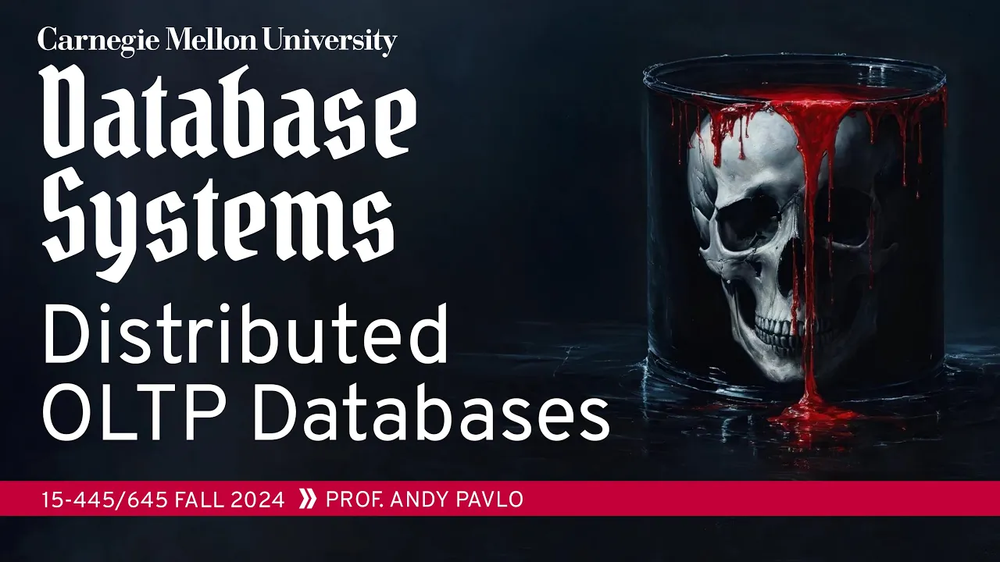
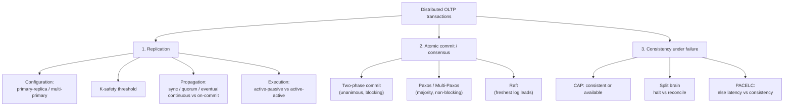

# #23 - Distributed Transactional Databases (CMU Intro to Database Systems)

*CMU Database Group · 1:24:53 · [Watch on YouTube](https://www.youtube.com/watch?v=3wNmpE6DsSs)*

## Summary

Lecture 23 of CMU 15-445/645 (Fall 2024) covers how an OLTP database keeps ACID guarantees when its data is spread across multiple nodes. It walks the full design space of **replication** — primary-replica vs multi-primary, K-safety, synchronous/quorum/eventual propagation, continuous vs on-commit timing, and active-passive vs active-active execution — then the **atomic commit protocols** that make nodes agree: two-phase commit with its recovery paths and optimizations, followed by Paxos, Multi-Paxos, and Raft. It closes with the **CAP theorem**, split brain and its two remedies, the PACELC extension, and Google's reversal from transaction-free BigTable to transactional Spanner.

The whole lecture assumes **friendly, non-malicious nodes**; distrust would require a Byzantine fault tolerant protocol, which costs 5–10x more.

## Topics

1. [Course Logistics and Recap of Distributed Architectures](./01-course-logistics-and-recap.md) — [`0:27`](https://www.youtube.com/watch?v=3wNmpE6DsSs&t=27)
2. [The Distributed Transaction Problem](./02-the-distributed-transaction-problem.md) — [`8:23`](https://www.youtube.com/watch?v=3wNmpE6DsSs&t=503)
3. [Replication Configurations and K-Safety](./03-replication-configurations.md) — [`15:22`](https://www.youtube.com/watch?v=3wNmpE6DsSs&t=922)
4. [Propagation Schemes, Timing, and Execution Models](./04-propagation-schemes-and-execution-models.md) — [`25:11`](https://www.youtube.com/watch?v=3wNmpE6DsSs&t=1511)
5. [Atomic Commit / Consensus Protocols](./05-atomic-commit-protocols.md) — [`41:53`](https://www.youtube.com/watch?v=3wNmpE6DsSs&t=2513)
6. [Two-Phase Commit (2PC)](./06-two-phase-commit.md) — [`50:16`](https://www.youtube.com/watch?v=3wNmpE6DsSs&t=3016)
7. [Paxos, Multi-Paxos, and Raft](./07-paxos-multi-paxos-and-raft.md) — [`1:04:56`](https://www.youtube.com/watch?v=3wNmpE6DsSs&t=3896)
8. [CAP Theorem, PACELC, and Conclusion](./08-cap-theorem-pacelc-and-conclusion.md) — [`1:16:40`](https://www.youtube.com/watch?v=3wNmpE6DsSs&t=4600)

Full source: [transcript.md](./transcript.md)

## Key takeaways

- **Two-phase commit is a degenerate case of Paxos.** The Lamport–Gray paper shows they are essentially the same protocol; the only real difference is that 2PC requires *unanimous* agreement while Paxos requires only a *majority* ([`49:47`](https://www.youtube.com/watch?v=3wNmpE6DsSs&t=2987), [`50:16`](https://www.youtube.com/watch?v=3wNmpE6DsSs&t=3016), [`1:06:07`](https://www.youtube.com/watch?v=3wNmpE6DsSs&t=3967)).
- **2PC blocks on coordinator failure; Paxos does not.** Under 2PC no other transaction can commit while the survivors resolve the undecided one — otherwise a transaction that read the pending data could commit and violate ACID. Paxos keeps making progress as long as a majority is alive ([`57:35`](https://www.youtube.com/watch?v=3wNmpE6DsSs&t=3455), [`57:47`](https://www.youtube.com/watch?v=3wNmpE6DsSs&t=3467), [`1:16:05`](https://www.youtube.com/watch?v=3wNmpE6DsSs&t=4565)).
- **The commit decision and the leader-election decision are the same decision** — electing a primary is just another transaction with slightly different semantics, which is why one protocol handles both ([`42:41`](https://www.youtube.com/watch?v=3wNmpE6DsSs&t=2561)).
- **Practical defaults settled by the lecture**: use primary-replica (≈99% of deployments), active-passive execution (reuses existing WAL infrastructure; almost every system does it), and continuous propagation (aborts are rare, so streaming log records early wins) ([`15:47`](https://www.youtube.com/watch?v=3wNmpE6DsSs&t=947), [`31:29`](https://www.youtube.com/watch?v=3wNmpE6DsSs&t=1889), [`41:34`](https://www.youtube.com/watch?v=3wNmpE6DsSs&t=2494)).
- **Active-active only saves intermediate network traffic, and demands full determinism from the DBMS** — a billion-record update ships a billion WAL records under active-passive and none under active-active, but it requires seeded randomness, shared timestamps, serializable ordering, and stored procedures. VoltDB is essentially the only system that pulls it off, and lower isolation levels break it outright ([`34:35`](https://www.youtube.com/watch?v=3wNmpE6DsSs&t=2075), [`36:18`](https://www.youtube.com/watch?v=3wNmpE6DsSs&t=2178), [`41:17`](https://www.youtube.com/watch?v=3wNmpE6DsSs&t=2477)).
- **Early acknowledgement after prepare is the optimization worth having**: once every participant votes OK the transaction is committing regardless, so the client can be answered one round trip early. Early *prepare voting*, by contrast, is rarely implementable because SQL cannot tell you which query is the last one for a node ([`59:21`](https://www.youtube.com/watch?v=3wNmpE6DsSs&t=3561), [`59:46`](https://www.youtube.com/watch?v=3wNmpE6DsSs&t=3586), [`1:01:04`](https://www.youtube.com/watch?v=3wNmpE6DsSs&t=3664)).
- **Real Multi-Paxos leader leases vary by two orders of magnitude**: Spanner 10s, YugabyteDB 2s, CockroachDB 5 min default, TiDB 10s — the tradeoff being election frequency against failure-detection delay ([`1:15:01`](https://www.youtube.com/watch?v=3wNmpE6DsSs&t=4501), [`1:15:31`](https://www.youtube.com/watch?v=3wNmpE6DsSs&t=4531)).
- **CAP reduces in practice to one question: on a network partition, halt or reconcile?** Distributed relational systems halt the minority side and never face conflicting values; NoSQL systems reconcile afterwards, usually via last-write-wins (Cassandra). Vector clocks push MVCC conflict resolution into application code — Riak tried it and it was a nightmare ([`1:17:25`](https://www.youtube.com/watch?v=3wNmpE6DsSs&t=4645), [`1:19:53`](https://www.youtube.com/watch?v=3wNmpE6DsSs&t=4793), [`1:20:42`](https://www.youtube.com/watch?v=3wNmpE6DsSs&t=4842), [`1:21:25`](https://www.youtube.com/watch?v=3wNmpE6DsSs&t=4885)).
- **BFT protocols run 5–10x slower** than the protocols covered here, so blockchain-style trustlessness has no place in an OLTP DBMS unless you genuinely cannot trust your own nodes ([`13:50`](https://www.youtube.com/watch?v=3wNmpE6DsSs&t=830), [`14:23`](https://www.youtube.com/watch?v=3wNmpE6DsSs&t=863)).
- **Google reversed the NoSQL wave it started**: after dropping transactions in BigTable, it built Spanner on the argument that programmers should deal with the performance cost of overusing transactions rather than perpetually coding around their absence ([`1:22:32`](https://www.youtube.com/watch?v=3wNmpE6DsSs&t=4952), [`1:23:09`](https://www.youtube.com/watch?v=3wNmpE6DsSs&t=4989), [`1:23:32`](https://www.youtube.com/watch?v=3wNmpE6DsSs&t=5012)).
