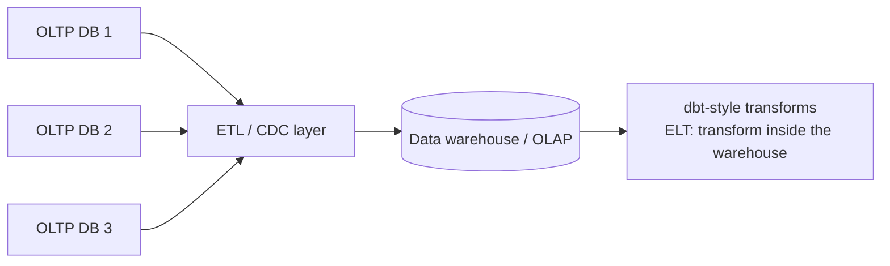

# 02 — Analytical Data Environments: ETL, ELT, and Decision Support

## The canonical data pipeline

- Front-end **OLTP databases** serve the outside world (phone apps hitting a web server) and each becomes a **data silo** [`3:57`](https://www.youtube.com/watch?v=L6E75IyBgpk&t=237).
- The goal is to consolidate all silos into a single **data warehouse / OLAP system**, so analytics run across *all* data rather than a subset [`3:57`](https://www.youtube.com/watch?v=L6E75IyBgpk&t=237).
- Two ways to move the data across [`3:57`](https://www.youtube.com/watch?v=L6E75IyBgpk&t=237):
  - **ETL** middleware that pulls from source systems and pushes into the warehouse.
  - **Change Data Capture (CDC)**: read the source's write-ahead log entries and convert them into records inserted into the warehouse.

## ETL vs ELT

- Classic **ETL** tools in the space: **Informatica**, **Fivetran**, **Amazon Glue** [`4:46`](https://www.youtube.com/watch?v=L6E75IyBgpk&t=286).
- **ELT** (extract, load, transform) flips the order: dump everything raw into the warehouse first (e.g. Parquet files in S3), then transform it into curated datasets **inside** the warehouse — **dbt** is the most famous tool here [`4:46`](https://www.youtube.com/watch?v=L6E75IyBgpk&t=286) [`5:12`](https://www.youtube.com/watch?v=L6E75IyBgpk&t=312).
- Economic wrinkle: dbt doesn't pay for bad queries — the transform runs on *your* Snowflake/warehouse bill, and those systems are scalable enough to absorb it [`5:35`](https://www.youtube.com/watch?v=L6E75IyBgpk&t=335).

## Decision support systems

- The purpose of centralizing data is to **extrapolate new knowledge and make business decisions** — these are called **decision support systems** [`6:25`](https://www.youtube.com/watch?v=L6E75IyBgpk&t=385) [`7:15`](https://www.youtube.com/watch?v=L6E75IyBgpk&t=435).
- Worked example — **Walmart and hurricanes** [`6:25`](https://www.youtube.com/watch?v=L6E75IyBgpk&t=385) [`6:51`](https://www.youtube.com/watch?v=L6E75IyBgpk&t=411):
  - Every store has its own database; sales records flow to a central warehouse.
  - Query what customers buy **before** a hurricane (stock up in advance) and **after** (blankets, recovery goods).
  - Operational payoff: stage trucks just outside the danger zone so stores can be flooded with the right goods immediately after landfall.
- History: the idea dates to the **late 1990s / early 2000s**, when only Walmart-scale companies and big banks had datasets that large [`7:40`](https://www.youtube.com/watch?v=L6E75IyBgpk&t=460).
- Today any web app can accumulate large data quickly, which is why large-scale analytical tooling has proliferated [`7:40`](https://www.youtube.com/watch?v=L6E75IyBgpk&t=460) [`8:06`](https://www.youtube.com/watch?v=L6E75IyBgpk&t=486).
