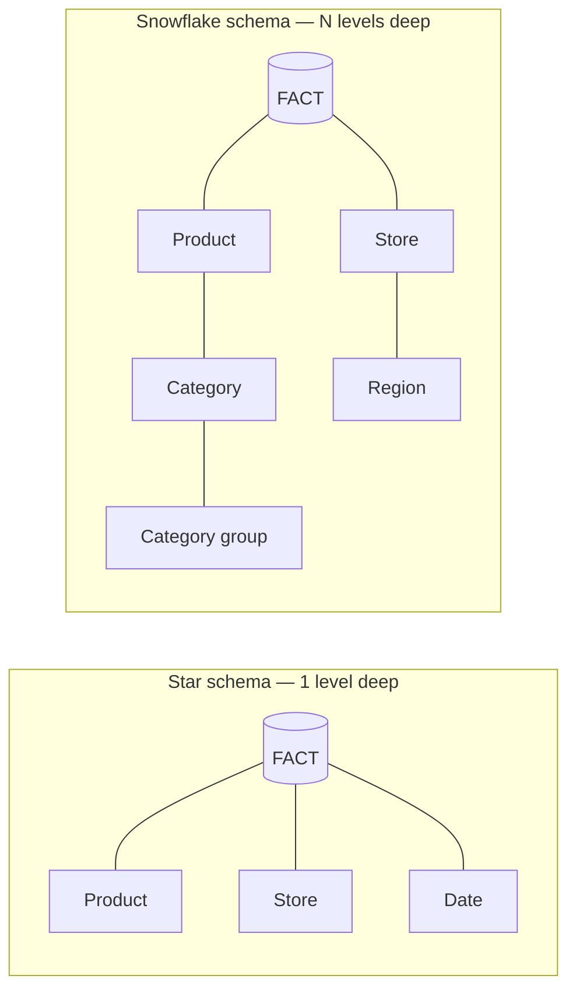

# 03 — Star Schemas, Snowflake Schemas, and Normalization

## Why OLAP schemas differ from OLTP schemas

- OLTP schemas are **tree hierarchies** (customer → orders → order items) [`8:06`](https://www.youtube.com/watch?v=L6E75IyBgpk&t=486).
- That shape is bad for analytics: historical trend queries require **many joins across the tree**, which is expensive and slow [`8:06`](https://www.youtube.com/watch?v=L6E75IyBgpk&t=486).
- So warehouses deliberately organize data differently from the transactional source; the two dominant layouts are **star** and **snowflake** schemas [`8:41`](https://www.youtube.com/watch?v=L6E75IyBgpk&t=521).

## Star schema

- One central **fact table** recording a repeated event — for Walmart, every item anyone ever bought becomes a row; **billions to trillions** of rows [`9:02`](https://www.youtube.com/watch?v=L6E75IyBgpk&t=542) [`9:23`](https://www.youtube.com/watch?v=L6E75IyBgpk&t=563).
- Surrounding **dimension tables** hold enriching metadata reached by foreign key (product name, color, size, source, year) [`9:23`](https://www.youtube.com/watch?v=L6E75IyBgpk&t=563) [`9:56`](https://www.youtube.com/watch?v=L6E75IyBgpk&t=596).
- Key constraint: dimensions are **exactly one level deep**, so any analytics query is a single-hop join off the fact table [`9:56`](https://www.youtube.com/watch?v=L6E75IyBgpk&t=596) [`10:12`](https://www.youtube.com/watch?v=L6E75IyBgpk&t=612).
- Historical motivation: before **column stores and vectorized execution**, analytics on a row store was extremely slow, so cutting join count was the main lever [`10:12`](https://www.youtube.com/watch?v=L6E75IyBgpk&t=612).
- Cost: **duplicated data** — e.g. the category name "diapers" repeated across every diaper product row [`10:41`](https://www.youtube.com/watch?v=L6E75IyBgpk&t=641).

## Snowflake schema

- Same central fact table, but **dimension tables can chain multiple levels deep** (product → category → …) [`11:06`](https://www.youtube.com/watch?v=L6E75IyBgpk&t=666) [`11:31`](https://www.youtube.com/watch?v=L6E75IyBgpk&t=691).
- A star schema is just a **restricted form** of a snowflake schema [`11:06`](https://www.youtube.com/watch?v=L6E75IyBgpk&t=666).

## Trade-offs

| Dimension | Star | Snowflake |
|---|---|---|
| Storage | More (duplicated attributes) [`10:41`](https://www.youtube.com/watch?v=L6E75IyBgpk&t=641) | Less, no duplicate attributes [`11:49`](https://www.youtube.com/watch?v=L6E75IyBgpk&t=709) |
| Update cost | Must find and change every duplicate copy, in **application code** — the DBMS won't do it for you [`11:49`](https://www.youtube.com/watch?v=L6E75IyBgpk&t=709) [`12:14`](https://www.youtube.com/watch?v=L6E75IyBgpk&t=734) | Change in one place |
| Query complexity | Simple **left-deep join** the engine rips through efficiently [`14:03`](https://www.youtube.com/watch?v=L6E75IyBgpk&t=843) | Three or four levels of joins [`13:40`](https://www.youtube.com/watch?v=L6E75IyBgpk&t=820) |

- Join-order note: you still optimize the order among dimension tables, but the **fact table is always the one you ride through the pipeline last**, because it holds the trillions of records [`14:13`](https://www.youtube.com/watch?v=L6E75IyBgpk&t=853).

## Normalization, in one slide

- The instructor deliberately **does not teach normal forms** — functional dependencies and Armstrong's axioms were dropped because nobody applies them in practice [`12:14`](https://www.youtube.com/watch?v=L6E75IyBgpk&t=734) [`12:50`](https://www.youtube.com/watch?v=L6E75IyBgpk&t=770).
- All you need: **normalization = splitting tables apart; denormalization = embedding them together** [`12:36`](https://www.youtube.com/watch?v=L6E75IyBgpk&t=756).
- Using an ORM (Active Record, Hibernate) with foreign-key-linked objects lands you in **third normal form automatically** [`12:50`](https://www.youtube.com/watch?v=L6E75IyBgpk&t=770).
- Theory goes to fifth and sixth normal form; in practice **BCNF is good enough** and 99% of engineers never need this [`12:50`](https://www.youtube.com/watch?v=L6E75IyBgpk&t=770) [`13:18`](https://www.youtube.com/watch?v=L6E75IyBgpk&t=798).

## Practical status today

- Every widely used analytical system **supports both** — you don't declare which one you are, you just model the data [`14:29`](https://www.youtube.com/watch?v=L6E75IyBgpk&t=869).
- Trivia: **Snowflake the company is named after the snowflake schema**; early systems could only do star schemas [`14:53`](https://www.youtube.com/watch?v=L6E75IyBgpk&t=893).
