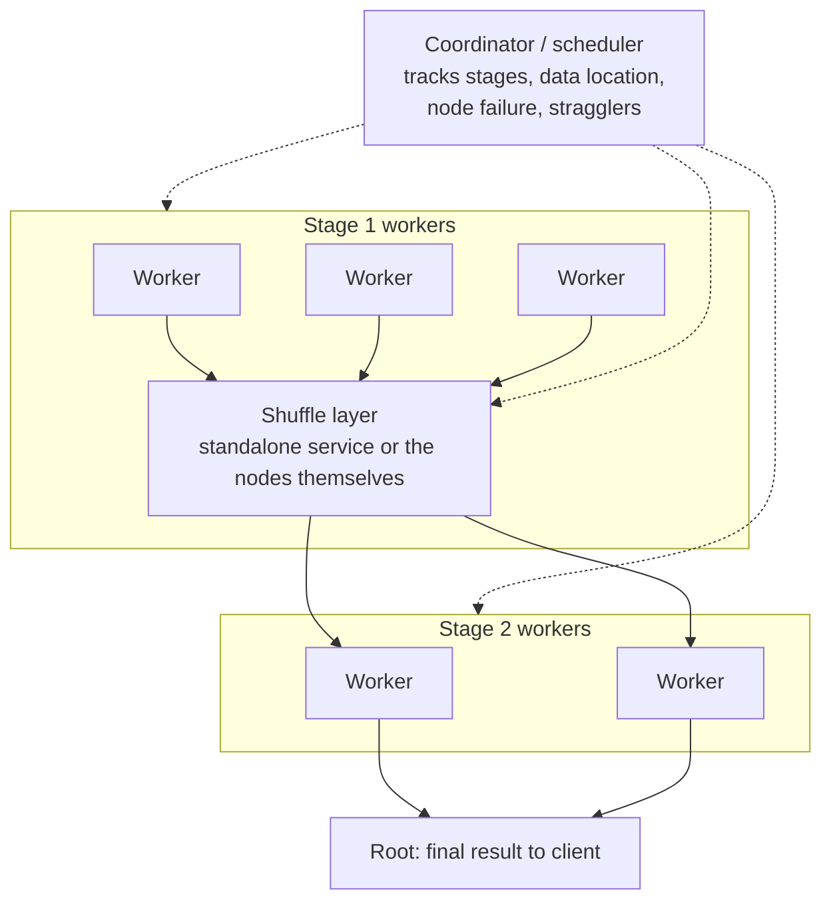

# 04 — The Distributed OLAP Execution Model

## The problem statement

- The same SQL query that runs on one node must run across many nodes and produce the **same correct answer** — the application should see a single logical database [`15:15`](https://www.youtube.com/watch?v=L6E75IyBgpk&t=915) [`17:23`](https://www.youtube.com/watch?v=L6E75IyBgpk&t=1043).
- The **naive approach** — copy all data to one node, join there, return — is correct but defeats the purpose: a single node holding a few TB of RAM/disk cannot absorb a petabyte dataset [`15:43`](https://www.youtube.com/watch?v=L6E75IyBgpk&t=943).
- Because OLAP workloads are **mostly read-only**, the dominant concern shifts from update synchronization (last lecture's topic) to **minimizing data movement** [`16:17`](https://www.youtube.com/watch?v=L6E75IyBgpk&t=977) [`16:40`](https://www.youtube.com/watch?v=L6E75IyBgpk&t=1000).
- Whether the cluster is **shared-disk or shared-nothing does not change the algorithms** [`15:15`](https://www.youtube.com/watch?v=L6E75IyBgpk&t=915) [`18:56`](https://www.youtube.com/watch?v=L6E75IyBgpk&t=1136).

## What changes vs. single-node execution

- Execution is essentially identical **except at pipeline breakers**, where a node may have to ship data out and wait for data to arrive [`17:52`](https://www.youtube.com/watch?v=L6E75IyBgpk&t=1072).
- The hazard: joining against an **incomplete hash table** because the data you need hasn't arrived yet, producing **incorrect results / false negatives** [`17:52`](https://www.youtube.com/watch?v=L6E75IyBgpk&t=1072) [`18:20`](https://www.youtube.com/watch?v=L6E75IyBgpk&t=1100).
- Scans, joins, aggregations, and sorting are all "way more complicated", but the **core divide-and-conquer algorithms are unchanged** [`18:36`](https://www.youtube.com/watch?v=L6E75IyBgpk&t=1116).

## Persistent vs. intermediate data

| | Persistent data | Intermediate data |
|---|---|---|
| What it is | The primary copy — leaf-node scans over base tables [`18:56`](https://www.youtube.com/watch?v=L6E75IyBgpk&t=1136) [`24:10`](https://www.youtube.com/watch?v=L6E75IyBgpk&t=1450) | Results derived from joins/aggregations, passed operator to operator [`19:23`](https://www.youtube.com/watch?v=L6E75IyBgpk&t=1163) [`24:51`](https://www.youtube.com/watch?v=L6E75IyBgpk&t=1491) |
| Where it lives | Local disk (shared-nothing) or S3 object store (shared-disk) [`18:56`](https://www.youtube.com/watch?v=L6E75IyBgpk&t=1136) | In memory / spilled, then routed to whichever node needs it [`19:23`](https://www.youtube.com/watch?v=L6E75IyBgpk&t=1163) |
| Mutability | On S3, **immutable** — Parquet files admit no fine-grained updates [`24:10`](https://www.youtube.com/watch?v=L6E75IyBgpk&t=1450) | Transient |

## The shuffle layer and the coordinator

- Workers push intermediate results into a **shuffle layer**; the next stage's workers pull from it, repeating until the query plan's root is reached [`19:49`](https://www.youtube.com/watch?v=L6E75IyBgpk&t=1189).
- A **coordinator / scheduler** sits above everything: it knows which queries are running, at what stage, where data comes from and goes, replaces dead nodes, and spins up capacity for **stragglers** [`20:39`](https://www.youtube.com/watch?v=L6E75IyBgpk&t=1239).

## The MapReduce digression

- Asked whether this is MapReduce, the answer is blunt: **"MapReduce is garbage, but yes"** — MapReduce **copied** parallel-database ideas from the 1990s without knowing it [`21:08`](https://www.youtube.com/watch?v=L6E75IyBgpk&t=1268) [`23:33`](https://www.youtube.com/watch?v=L6E75IyBgpk&t=1413).
- **Shuffle is just the exchange operator** from the parallel-execution lecture under a different name [`21:24`](https://www.youtube.com/watch?v=L6E75IyBgpk&t=1284) [`1:01:47`](https://www.youtube.com/watch?v=L6E75IyBgpk&t=3707).
- Timeline [`21:24`](https://www.youtube.com/watch?v=L6E75IyBgpk&t=1284) [`22:12`](https://www.youtube.com/watch?v=L6E75IyBgpk&t=1332) [`22:37`](https://www.youtube.com/watch?v=L6E75IyBgpk&t=1357):
  - **2004–2005**: Google's MapReduce paper; clones follow (Hadoop, MapR, Hortonworks).
  - Database researchers (Stonebraker, DeWitt) object that it reinvents 1990s parallel databases, badly.
  - **2009**: a paper the instructor co-authored showed MapReduce was **much slower and inferior to a distributed OLAP system like Vertica**; MapReduce subsequently died.
  - People then re-added SQL on top (**Hive** compiled SQL into MapReduce jobs) — still inferior to a real parallel database.
- **Snowflake's insight**: skip the MapReduce hype, keep SQL and the relational model, build a scalable **shared-disk cloud** system — right place, right time, and worth billions [`23:09`](https://www.youtube.com/watch?v=L6E75IyBgpk&t=1389).
- Notably, **Snowflake does not shuffle; BigQuery and Spark do** — and a Snowflake co-founder told the instructor over dinner in Amsterdam that **if he did it again, he would add a shuffle** [`23:33`](https://www.youtube.com/watch?v=L6E75IyBgpk&t=1413) [`23:51`](https://www.youtube.com/watch?v=L6E75IyBgpk&t=1431).
