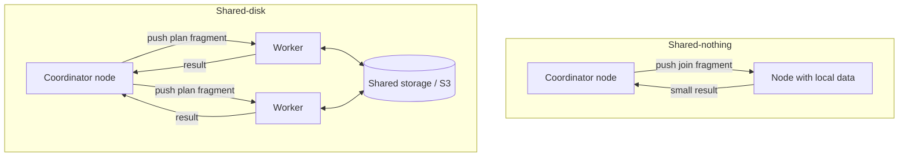

# 05 — Push the Query to the Data vs. Pull the Data to the Query

There are only **two** high-level strategies for moving work and data around a cluster [`25:05`](https://www.youtube.com/watch?v=L6E75IyBgpk&t=1505).

## Push the query to the data

- Send the query (or plan fragment) to wherever the data lives, process locally, return only results [`25:27`](https://www.youtube.com/watch?v=L6E75IyBgpk&t=1527).
- Why it wins: a SQL string is **tens of kilobytes**, the data can be **petabytes** [`26:48`](https://www.youtube.com/watch?v=L6E75IyBgpk&t=1608).
- Concrete case: a highly selective filter throws away **99%** of a petabyte — shipping that petabyte over the network first is pure waste [`25:55`](https://www.youtube.com/watch?v=L6E75IyBgpk&t=1555).
- This is what **shared-nothing** systems are good at; their downside is that adding nodes forces expensive data reshuffling [`25:55`](https://www.youtube.com/watch?v=L6E75IyBgpk&t=1555).

## Pull the data to the query

- Typical of **shared-disk** systems in the initial persistent-data phase: read from S3 into your node, then compute [`26:19`](https://www.youtube.com/watch?v=L6E75IyBgpk&t=1579).
- Once you're past the scan and working on intermediate data, you can switch back to push-the-query-to-the-data [`26:19`](https://www.youtube.com/watch?v=L6E75IyBgpk&t=1579) [`30:03`](https://www.youtube.com/watch?v=L6E75IyBgpk&t=1803).

## The blurred line: S3 Select

- **Amazon S3 Select** lets you send SQL-like requests to S3 over Parquet/CSV files and get **predicate push-down and projection push-down** executed by S3 itself [`27:08`](https://www.youtube.com/watch?v=L6E75IyBgpk&t=1628).
- **Azure has an equivalent**; the instructor believes **Google does not** [`27:32`](https://www.youtube.com/watch?v=L6E75IyBgpk&t=1652).
- **Amazon announced (a week or two before the lecture) that S3 Select is closed to new customers** — existing customers keep it. Reason: Amazon is doing serious compute (likely Redshift-like machinery) without charging extra for it, which is unsustainable [`27:32`](https://www.youtube.com/watch?v=L6E75IyBgpk&t=1652) [`27:54`](https://www.youtube.com/watch?v=L6E75IyBgpk&t=1674) [`28:11`](https://www.youtube.com/watch?v=L6E75IyBgpk&t=1691).

## How each architecture executes a join

- **Shared-nothing**: the node holding the data receives the join request, processes locally, sends the result up [`28:24`](https://www.youtube.com/watch?v=L6E75IyBgpk&t=1704) [`28:47`](https://www.youtube.com/watch?v=L6E75IyBgpk&t=1727).
- **Shared-disk**: each worker fetches the pages/files it needs from shared storage, joins locally, then results flow up [`29:22`](https://www.youtube.com/watch?v=L6E75IyBgpk&t=1762).
- Either way, dumping everything onto one node **destroys the parallelism** you paid for [`29:05`](https://www.youtube.com/watch?v=L6E75IyBgpk&t=1745).
