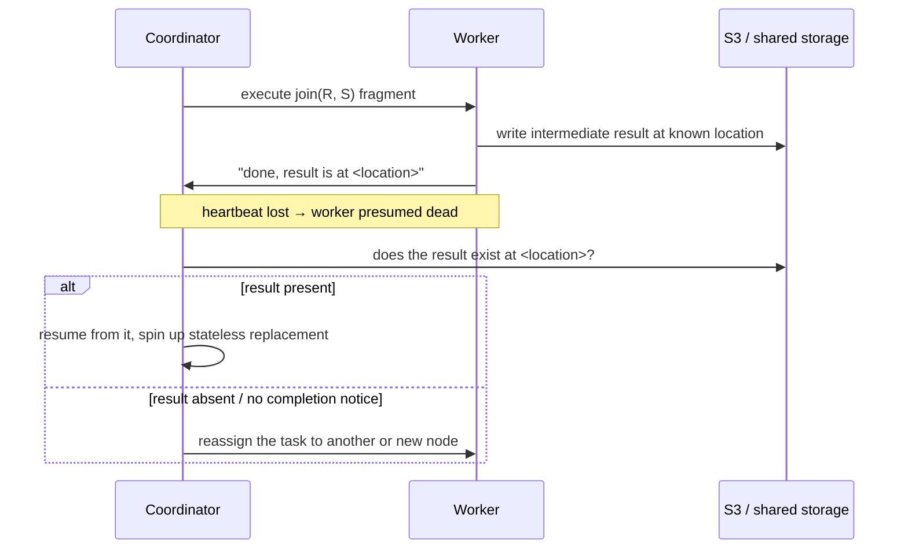

# 06 — Buffer Management and Fault Tolerance of Intermediate Results

## Buffer pools still exist

- Every node keeps its own **buffer pool**: incoming data is stored in pages and **spilled to disk** when space runs out — identical in principle to the single-node case [`30:03`](https://www.youtube.com/watch?v=L6E75IyBgpk&t=1803) [`30:32`](https://www.youtube.com/watch?v=L6E75IyBgpk&t=1832).
- Distributed scheduling adds cleverness: **pin** pages you're about to process immediately, and let later-arriving batches spill instead [`30:32`](https://www.youtube.com/watch?v=L6E75IyBgpk&t=1832) [`30:53`](https://www.youtube.com/watch?v=L6E75IyBgpk&t=1853).

## The failure problem

- If a node crashes after producing intermediate results but before shipping them, **that slice of the answer is simply missing** from the final result set [`30:53`](https://www.youtube.com/watch?v=L6E75IyBgpk&t=1853) [`31:22`](https://www.youtube.com/watch?v=L6E75IyBgpk&t=1882).
- **Traditional pre-MapReduce answer**: node failure during a query is rare, so **kill the query and restart it** [`31:22`](https://www.youtube.com/watch?v=L6E75IyBgpk&t=1882).
- Why that stopped being acceptable: MapReduce ran on **thousands** of machines (most databases run on tens), and a query running for **days** shouldn't lose all its work to one crash [`31:46`](https://www.youtube.com/watch?v=L6E75IyBgpk&t=1906).
- Extra motivation: running on **AWS spot instances** — cheaper, non-reserved capacity that can be reclaimed at any moment. With fault tolerance, losing an instance means picking up another, not restarting the query [`32:18`](https://www.youtube.com/watch?v=L6E75IyBgpk&t=1938).

## The solution: write intermediate results to storage decoupled from compute

- Local disk is useless here — it dies with the node. You need disks **not attached to any compute node**, i.e. **S3** / shared-disk storage [`33:10`](https://www.youtube.com/watch?v=L6E75IyBgpk&t=1990) [`33:28`](https://www.youtube.com/watch?v=L6E75IyBgpk&t=2008).
- Workers write join results **out to S3 or a distributed caching layer** instead of sending them directly upstream [`33:28`](https://www.youtube.com/watch?v=L6E75IyBgpk&t=2008).

- Recovery flow: the coordinator loses the heartbeat, checks whether the promised output actually landed in shared storage, and **resumes rather than restarting the whole plan**; the replacement node is stateless [`33:52`](https://www.youtube.com/watch?v=L6E75IyBgpk&t=2032) [`34:17`](https://www.youtube.com/watch?v=L6E75IyBgpk&t=2057).
- If the node died **before** writing, there is no completion notification, so the coordinator simply **reassigns the task** [`36:10`](https://www.youtube.com/watch?v=L6E75IyBgpk&t=2170) [`36:27`](https://www.youtube.com/watch?v=L6E75IyBgpk&t=2187).
- Attribution: **this is what the MapReduce/Hadoop crowd genuinely contributed** — earlier distributed database systems did not do it, and it is now standard in distributed relational systems [`34:30`](https://www.youtube.com/watch?v=L6E75IyBgpk&t=2070).

## Stragglers and noisy neighbors

- A node need not crash to be a problem — a **noisy neighbor** on the same EC2 host (overprovisioned hardware, someone mining crypto) makes it slow enough to look dead [`36:48`](https://www.youtube.com/watch?v=L6E75IyBgpk&t=2208).
- Mitigation: once everyone else has finished, **reassign the straggler's work** [`37:10`](https://www.youtube.com/watch?v=L6E75IyBgpk&t=2230).
- Anecdote: an unnamed web company running MySQL on EC2 would **spin up three instances, micro-benchmark all three, keep the fastest and kill the other two** — done constantly to dodge noisy neighbors [`37:10`](https://www.youtube.com/watch?v=L6E75IyBgpk&t=2230) [`37:36`](https://www.youtube.com/watch?v=L6E75IyBgpk&t=2256).
